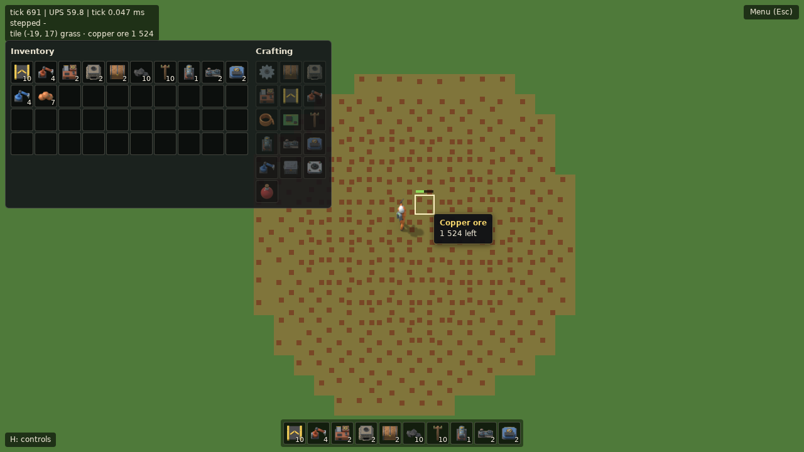
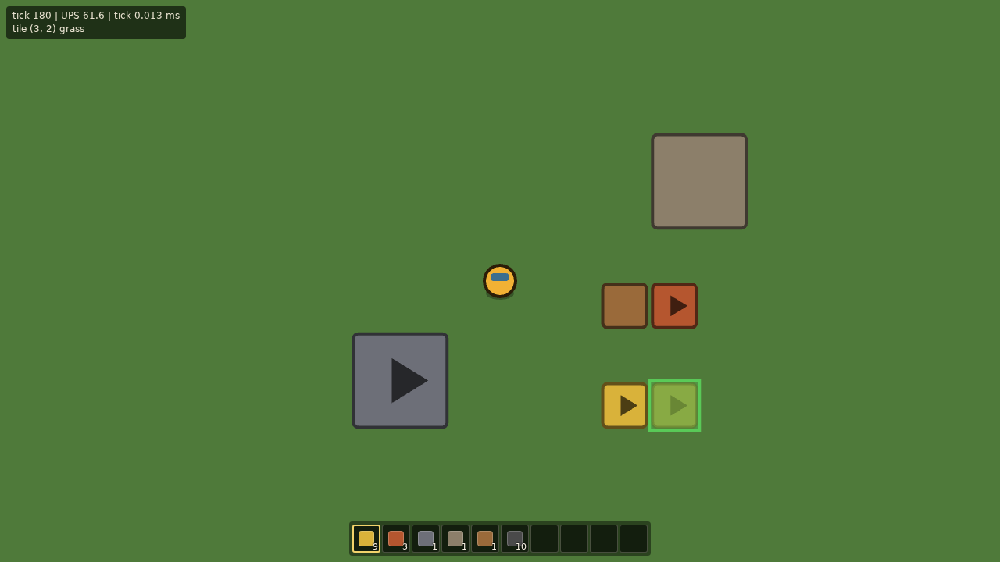
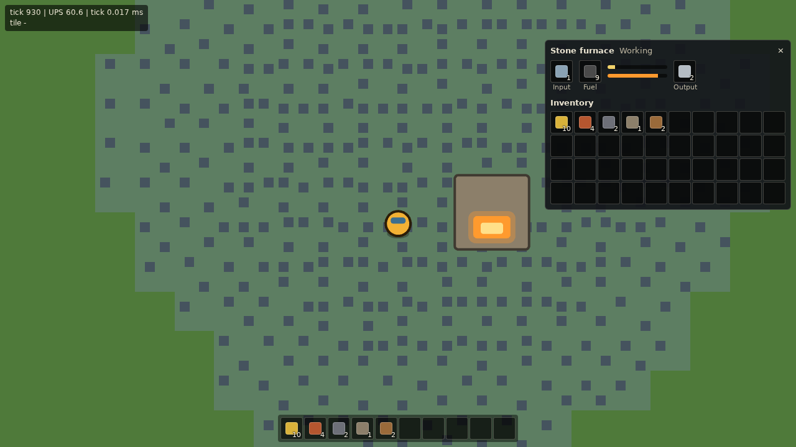
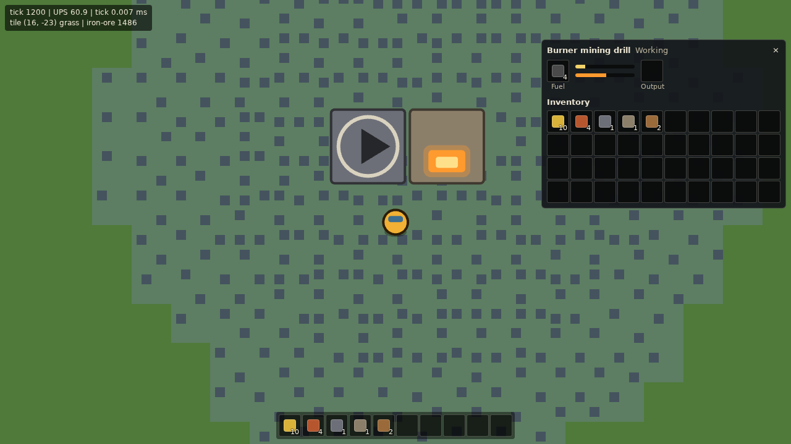
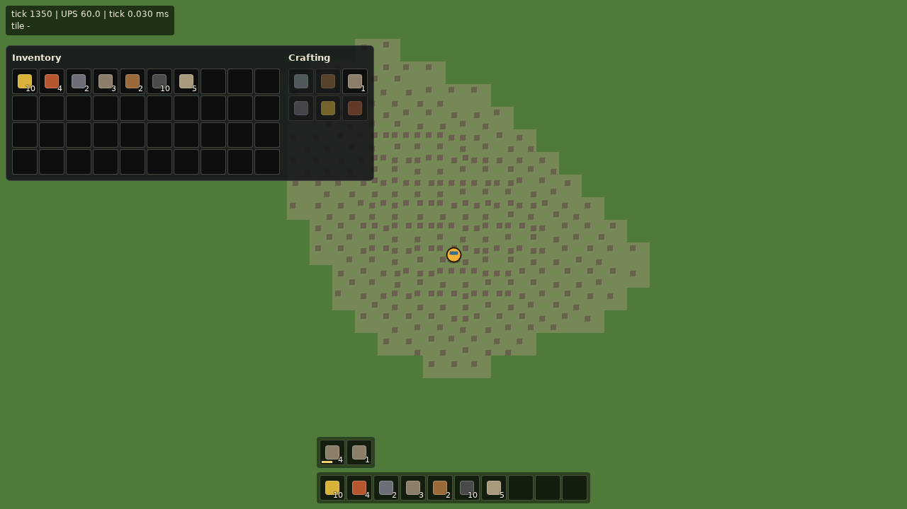
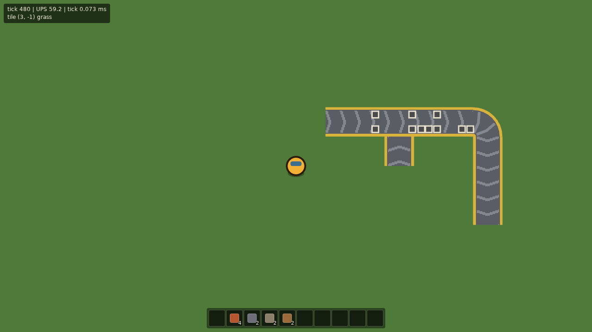

# Beltworks

A factory-automation game for the browser, inspired by Factorio. All art and names are original.

> Status: in development. Live build: https://zerone0x.github.io/beltworks-play/

Controls so far:

- **WASD**: walk (water blocks the way). The camera follows the player.
- **Hold right mouse** on an ore tile within reach (2.5 tiles): mine it by hand, one unit every 0.5 s.
- **E**: open or close the inventory (40 slots; the first 10 are shown in the hotbar at the bottom).
- **Crafting** (in the inventory window): each hand recipe shows how many you can craft; **click** crafts 1, **shift-click** 5. Ingredients are taken when the craft is queued, and missing intermediates (gears, a furnace for a drill) are queued first. The queue shows above the hotbar; **click** an entry to cancel it and get its ingredients back.
- **1–0**: select a hotbar slot (press it again, or **Q**, to deselect). A new game starts with a kit of belts, inserters, drills, furnaces, chests and coal.
- With a buildable item selected, a **ghost** follows the cursor: green where it can be placed, red where it can't (water, another entity, the player, or out of build reach, 10 tiles). **R** rotates it, **left click** places it (hold and drag to place a row).
- **R** with nothing selected rotates the entity under the cursor.
- **Left click** on a chest, furnace or mining drill with nothing to build selected opens its window: click a stack in your inventory to put it in (coal and wood go to a furnace's or drill's fuel slot, ores and stone to a furnace's input), **right-click** it to put in half, click one of its slots to take the contents. **Esc** closes it. A furnace smelts iron ore, copper ore, or two stone into a plate or brick every 3.2 s while it has fuel; its firebox glows while it works.
- A **burner mining drill** placed on ore mines one unit every 4 s while it has fuel, from the four tiles under it in turn, and puts it into the entity in front of it (the arrow shows which way it faces; a chest stores it, a furnace smelts it). With nothing there, or no room, it holds the unit and waits. Its ring lights up while it works; its window shows its fuel and whether it is working, out of fuel, blocked, or depleted.
- **Belts** move items towards the way they face. Belts in a row join up, a belt fed only from one side turns, and a belt pointing into the side of another feeds that side's lane. Removing a belt gives back the items on it.
- **Right click** on an entity removes it and puts it back into the inventory, together with what it holds (refused if there is no room); elsewhere the right button mines as above.
- **Middle-drag** or **arrow keys**: pan the camera freely; **F**: follow the player again.
- **Mouse wheel**: zoom (towards the cursor with a free camera, around the player while following).

The debug overlay shows the tile under the mouse.













## Docs

| Doc | Contents |
|---|---|
| [docs/GDD.md](docs/GDD.md) | Game design: core loop, scope, non-goals |
| [docs/ARCHITECTURE.md](docs/ARCHITECTURE.md) | Simulation core, rendering, data layout, determinism |
| [docs/ROADMAP.md](docs/ROADMAP.md) | Milestones and acceptance criteria |
| [docs/TOOLING.md](docs/TOOLING.md) | Toolchain, references, development rules |
| [docs/DECISIONS.md](docs/DECISIONS.md) | Decisions made and open questions |

## Development

Requires Node.js 22 (see `.nvmrc`).

```sh
npm ci
npm run dev        # start the Vite dev server
npm run lint       # ESLint (including the src/sim purity rules) + Prettier check
npm run typecheck  # tsc --noEmit
npm test           # Vitest unit tests (tests/sim, tests/worker, tests/render)
npm run build      # production build into dist/ (set BASE_PATH to change the base URL, default /)
npm run preview    # serve dist/
npm run test:e2e   # Playwright tests against a fresh test-mode build (Chromium)
```

Run `npx playwright install chromium` once before the first `npm run test:e2e`. The screenshot baselines live in `tests/e2e/render.spec.ts-snapshots/`; after an intended visual change, regenerate them with `npx playwright test --update-snapshots` and check the new images.

## Deployment

The source repo is private. CI builds `main` and pushes `dist/` to the `gh-pages` branch of the public repo
[`zerone0x/beltworks-play`](https://github.com/zerone0x/beltworks-play), which serves it with GitHub Pages.
The build uses the base path `/beltworks-play/`, and pushes authenticate with the `DEPLOY_KEY` Actions secret, an SSH deploy key with write access to that repo.
This is done by `.github/workflows/deploy.yml` on every push to `main` (or manually via `workflow_dispatch`). The build ships without sourcemaps, since the deploy repo is public.

## Copyright

This project does not use any Factorio assets, names, sounds, or code. All art and audio is original or CC0.
