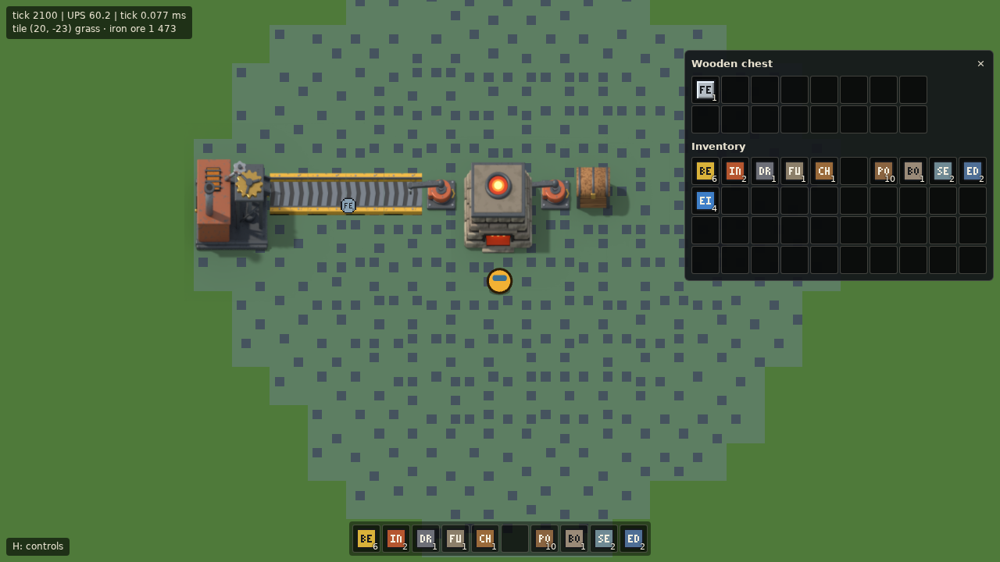
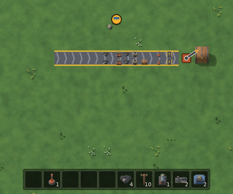
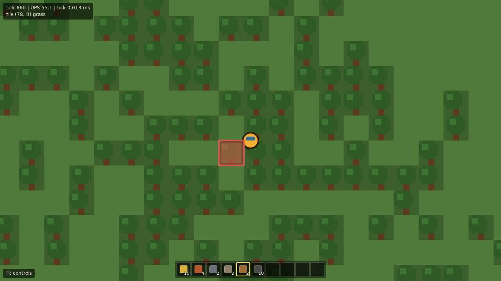
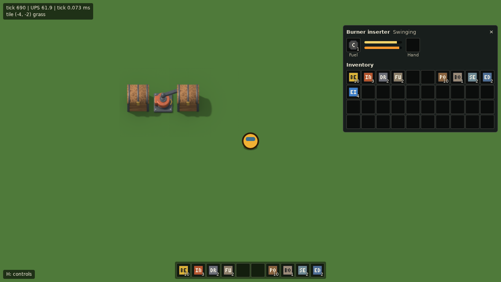
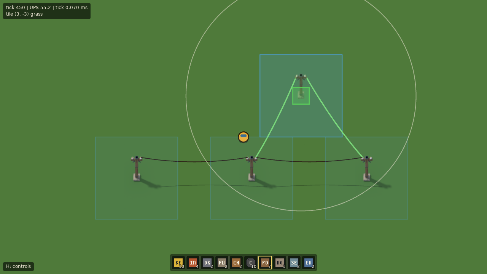
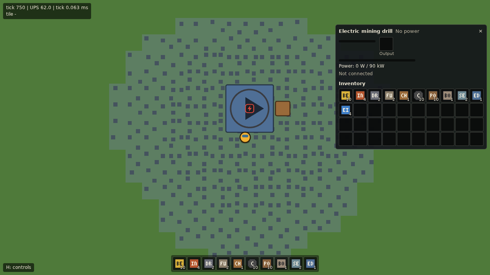
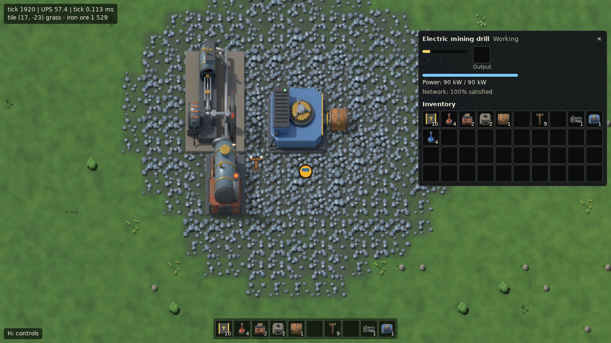
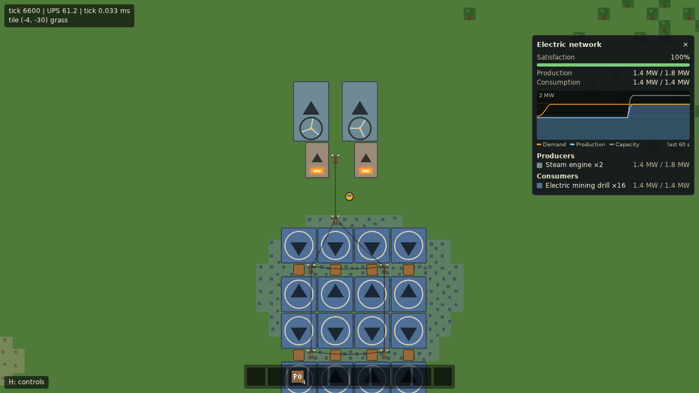
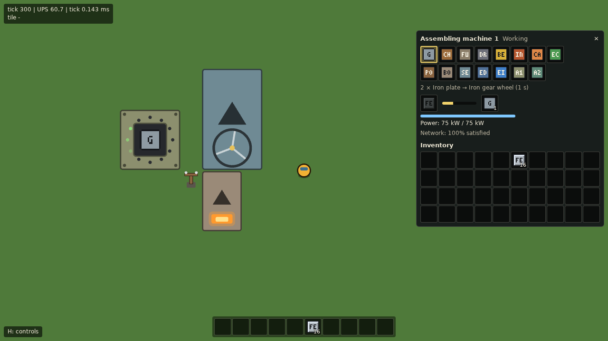

# Beltworks

A factory-automation game for the browser, inspired by Factorio. All art and names are original.

> Status: in development (M1, the core automation loop, and M2, power, are done). Live build: https://zerone0x.github.io/beltworks-play/

## Playing

A new game starts between four ore patches (iron, copper, coal, stone) with a kit of belts, burner inserters, burner mining drills, stone furnaces, wooden chests and coal in the hotbar. The first goal: a drill on iron ore drops ore onto a belt, an inserter feeds it into a furnace, and another inserter moves the plates into a chest, all on their own once fuelled with coal.



Press **H** in the game (or click the hint in the bottom-left corner) for a list of the controls. In full:

- **WASD**: walk (water blocks the way). The camera follows the player.
- **Hold right mouse** on an ore tile within reach (2.5 tiles): mine it by hand, one unit every 0.5 s. On a tree it fells the whole tree in 0.5 s for 4 wood. Trees grow in forests outside the starting area and block building until they are cut down.
- **E**: open or close the inventory (40 slots; the first 10 are shown in the hotbar at the bottom). With an entity window open, **E** closes it instead.
- **Crafting** (in the inventory window): each hand recipe shows how many you can craft; **click** crafts 1, **shift-click** 5. Ingredients are taken when the craft is queued, and missing intermediates (gears, a furnace for a drill) are queued first. The queue shows above the hotbar; **click** an entry to cancel it and get its ingredients back.
- **1–0** or a **click** on a hotbar slot: select it (press or click it again, **right-click** the hotbar, or press **Q** to deselect). A new game starts with a kit of belts, inserters, drills, furnaces, chests, coal, small electric poles, a boiler with two steam engines, and electric drills (key **0**) and inserters (in the inventory, past the hotbar).
- **Click** a buildable item in the inventory window (**E**) to select it for building, also past the hotbar (click it again, **right-click** the inventory, or press **Q** to deselect). When that stack runs out, the selection moves to another stack of the same item, if there is one. In an entity window, clicks on the inventory move stacks instead (see below).
- **Q** with nothing selected is the **pipette**: it selects the item of the entity under the cursor, if you have one, with the ghost facing the same way.
- With a buildable item selected, a **ghost** follows the cursor: green where it can be placed, red where it can't (water, a tree, another entity, the player, or out of build reach, 10 tiles). **R** rotates it, **left click** places it (hold and drag to place a row).
- **R** with nothing selected rotates the entity under the cursor.
- **Left click** on a chest, furnace, mining drill, inserter or assembling machine with nothing to build selected opens its window (in place of the inventory window): click a stack in your inventory to put it in (coal and wood go to a furnace's, drill's or inserter's fuel slot, ores and stone to a furnace's input), click one of the entity's slots to take it out. Both ways, a **click** or **shift-click** moves the whole stack, a **right click** half of it (rounded up), and a **ctrl-click** or **middle click** a single item, so the 10 starting coal can be shared between all the starting machines. **Esc** (or **E**) closes it. A furnace smelts iron ore, copper ore, or two stone into a plate or brick every 3.2 s while it has fuel; its firebox glows while it works.
- A **burner mining drill** placed on ore mines one unit every 4 s while it has fuel, from the four tiles under it in turn, and puts it into the entity in front of it (the arrow shows which way it faces; a chest stores it, a furnace smelts it). With nothing there, or no room, it holds the unit and waits. Its ring lights up while it works; its window shows its fuel and whether it is working, out of fuel, blocked, or depleted.
- A **burner inserter** takes one item at a time from the tile behind it and puts it onto the tile in front of it (the way its arrow points): out of a chest, a furnace's output, a drill or a belt, into a chest, a furnace (ores to the input, coal to the fuel), a drill (fuel only) or onto the far lane of a belt. A swing there and back takes 1.2 s and burns fuel only while the arm moves. With an empty fuel slot it takes one unit of coal from its source for itself, so an inserter next to coal starts on its own. Its window shows its fuel, the arm's position, the item in its hand, and whether it is swinging, out of fuel, or waiting for its source or target.
- **Belts** move items towards the way they face. Belts in a row join up, a belt fed only from one side turns, and a belt pointing into the side of another feeds that side's lane. Removing a belt gives back the items on it.
- **Small electric poles** wire themselves to every pole within 7 tiles, forming a network, and power electric machines that stand in the 5×5 area around them. While you hold a pole, the ghost shows its supply area, its wire reach and the wires it would get, and every placed pole's area shows faintly; with nothing selected, hovering a pole shows its area, reach and wires. The starting kit carries 10 poles, since the nearest trees for their wood are far from the spawn.
- An **electric mining drill** (3×3) mines the 5×5 area around it, one unit every 2 s at full power, and an **electric inserter** swings there and back in 0.87 s; neither has a fuel slot. They run at the speed their network can power (half speed at half power) and draw energy only while they work, apart from an inserter's small idle drain. A red bolt marks one without power (no pole, or no fuelled boiler and steam engine on its network), a yellow bolt one running on low power. Their window shows the power they draw and how well their network is supplied.
- A **boiler** burns fuel (coal, wood) for the **steam engines** lined up in front of it, up to two at 900 kW each, and only for the power they deliver. When a network asks for more than its engines give, every machine on it slows down in proportion; add generators to bring it back.
- An **assembling machine** (3×3, electric) makes the recipe you pick in its window: click one of the recipe buttons (every recipe but smelting; changing it gives back what the machine holds). Its input slots take up to twice what one craft needs, by hand or from inserters, and it crafts at half the hand speed (machine 1) or three quarters (machine 2) while it has power, ingredients and room for the result; inserters feed and empty it like any other machine. The product's icon shows on the machine, and a ring of lights runs around it while it works.
- **Left click** on an electric pole with nothing selected opens its **network panel**: satisfaction, production and consumption, a graph of the last minute (demand, production and capacity), and the producers and consumers by type with their totals. **Esc** closes it.
- **Right click** on an entity removes it and puts it back into the inventory, together with what it holds (refused if there is no room); elsewhere the right button mines as above.
- **Middle-drag** or **arrow keys**: pan the camera freely; **F**: follow the player again.
- **Mouse wheel**: zoom (towards the cursor with a free camera, around the player while following).
- **H**: show or hide the list of controls.

Items show as placeholder icons, the same on belts, in inserter hands and in the inventory: the item's color with a one- or two-letter label (**FE** iron, **CU** copper, **C** coal, **S** stone, ...). Ores are rough chunks, plates and bricks bevelled squares, and everything else rounded squares.



The debug overlay shows the tile under the mouse: its terrain, then a tree or the resource on it with the amount left (e.g. `grass · tree`, `grass · iron ore 1 594`).
















## Docs

| Doc | Contents |
|---|---|
| [docs/GDD.md](docs/GDD.md) | Game design: core loop, scope, non-goals |
| [docs/ARCHITECTURE.md](docs/ARCHITECTURE.md) | Simulation core, rendering, data layout, determinism |
| [docs/ROADMAP.md](docs/ROADMAP.md) | Milestones and acceptance criteria |
| [docs/TOOLING.md](docs/TOOLING.md) | Toolchain, references, development rules |
| [docs/DECISIONS.md](docs/DECISIONS.md) | Decisions made and open questions |

## Development

Requires Node.js 22 (see `.nvmrc`).

```sh
npm ci
npm run dev        # start the Vite dev server
npm run lint       # ESLint (including the src/sim purity rules) + Prettier check
npm run typecheck  # tsc --noEmit (app and tools/bench)
npm test           # Vitest unit tests (tests/sim, tests/worker, tests/render)
npm run test:bench # Vitest tests of the benchmark tooling (tests/bench)
npm run bench      # headless tick-time benchmark (see docs/TOOLING.md, "Benchmarks")
npm run build      # production build into dist/ (set BASE_PATH to change the base URL, default /)
npm run preview    # serve dist/
npm run test:e2e   # Playwright tests against a fresh test-mode build (Chromium)
```

Run `npx playwright install chromium` once before the first `npm run test:e2e`. The screenshot baselines live in `tests/e2e/render.spec.ts-snapshots/`; after an intended visual change, regenerate them with `npx playwright test --update-snapshots` and check the new images.

## Deployment

The source repo is private. CI builds `main` and pushes `dist/` to the `gh-pages` branch of the public repo
[`zerone0x/beltworks-play`](https://github.com/zerone0x/beltworks-play), which serves it with GitHub Pages.
The build uses the base path `/beltworks-play/`, and pushes authenticate with the `DEPLOY_KEY` Actions secret, an SSH deploy key with write access to that repo.
This is done by `.github/workflows/deploy.yml` on every push to `main` (or manually via `workflow_dispatch`). The build ships without sourcemaps, since the deploy repo is public.

## Copyright

This project does not use any Factorio assets, names, sounds, or code. All art and audio is original or CC0.
