# Beltworks

[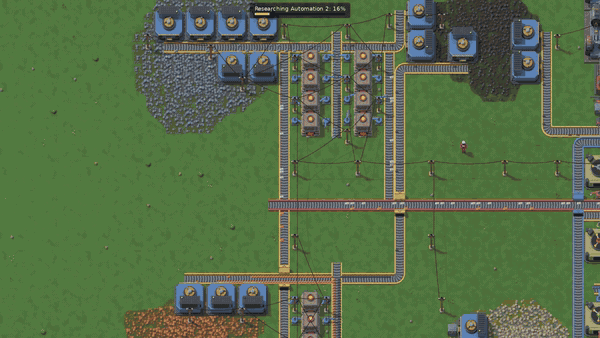](https://zerone0x.github.io/beltworks-play/?demo)

**[Try the demo](https://zerone0x.github.io/beltworks-play/?demo)**: a complete factory, from ore to research, running in your browser in one click (no account, no download).

A factory-automation game for the browser: start by mining ore by hand, then build drills, belts, furnaces, steam power, assembling machines and labs until the factory runs (and researches) on its own. Inspired by Factorio; all art, sound, names and code are original.

**Play the public beta: https://zerone0x.github.io/beltworks-play/** (v1.0.0-beta.1; free, no account, no download, no server: everything runs and is saved in your browser).

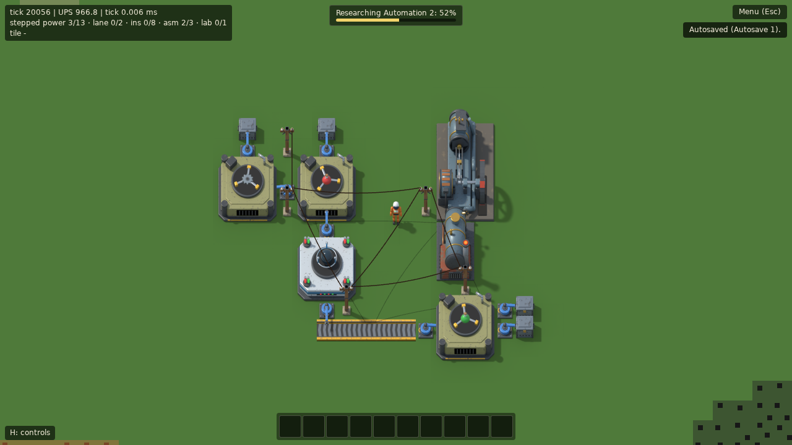

## Quick start

1. Open the link above on a desktop browser and click **New game** (or **Demo factory** to look around a finished one first).
2. Follow the **Getting started** objectives in the bottom-left corner: they walk you through your first automated iron plate line in about five minutes.
3. Press **H** at any time for the controls, **Esc** for the game menu (save, load, settings, About).

| Key | Action |
|---|---|
| **WASD** | Walk |
| **Hold right mouse** | Mine ore or fell a tree (a **right click** on a building picks it up) |
| **E** | Inventory and hand crafting |
| **1–0** | Select a hotbar item; **left click** builds it, **R** rotates, **Q** puts it away |
| **Left click** on a machine | Open its window (fuel, inputs, recipe) |
| **T** | Tech tree |
| **Mouse wheel**, pinch, **=** / **-** / middle drag | Zoom / pan; **F** follows the player again |
| **M** | Minimap |
| **C** + drag, **V**, **B** | Copy a blueprint, paste it again, blueprint library |
| **H** | All controls |
| **F3** | Debug info (ticks, UPS, the tile under the cursor) |
| **Esc** | Close windows, else the game menu |

Every key can be rebound in **Esc → Settings**, which also has graphics options (flat terrain and low detail for slower machines), the UI scale and the volumes.

### What you need

A recent desktop version of Chrome, Edge, Firefox or Safari (16.4 or later) with hardware acceleration (WebGL) on, a keyboard and a mouse. The game checks on start and says what is missing if your browser can't run it. Touch screens and phones are not supported.

### Saves

The game saves into your browser's storage (IndexedDB): your own saves from the game menu, and an autosave every 5 minutes of play (three rotating slots). They stay on this computer, in this browser: clearing site data deletes them, and private windows may not keep them at all (the game tells you when saves are off). Use **Export** in the game menu to download a `.bwsave` file as a backup, and **Import** to load it anywhere.

If the game ever stops with "The game stopped", it offers to continue from your last save.

### Public beta: what to expect

v1 covers the start of the game: hand mining, burner and electric machines, belts (three tiers, undergrounds, splitters), steam power, assembling machines, labs and red and green science. Not in yet: oil and fluids, blue science and beyond, enemies, trains and multiplayer (see [the roadmap](docs/ROADMAP.md)). Saves carry a format version and are migrated when the format changes, so beta saves should keep loading in later versions. Found a bug or have an idea? [Open an issue](https://github.com/zerone0x/beltworks/issues). What changed between versions is in [CHANGELOG.md](CHANGELOG.md).

## Playing in detail

The game opens on the **title screen**: **Continue** (the newest save), **New game** on a world seed (a random one is suggested; type a number, or any word or phrase, to get the same world every time, and **Copy** its number, the one the game menu shows, to share it), **Load** (any save), **Settings** and **About** (the version, the controls as bound, credits, the game's MIT license and the third-party licenses). The game menu (**Esc**) shows the seed of the game you are playing, with a copy button.

**Demo factory** (on the title screen, or the link [`?demo`](https://zerone0x.github.io/beltworks-play/?demo)) starts a game in a finished factory, built for you on world seed 59: electric drills on iron, copper, coal and stone, two columns of stone furnaces, a bus of iron and copper plates, assembling machines making gears, copper cable, circuits, electric inserters, belts and red and green science packs, three labs, and a steam power plant on coal mined on the spot. Nothing in it is pre-filled but a little starting coal: everything comes from ore. It has run for a few minutes when you arrive, the camera shows all of it (**F** follows you again), and the labs research automation 2 (the bar fills in about a minute and a half), then logistics, fast inserter, logistics 2 and logistics 3, for about an hour. From there it is a normal game: save it, build on, pick another research.

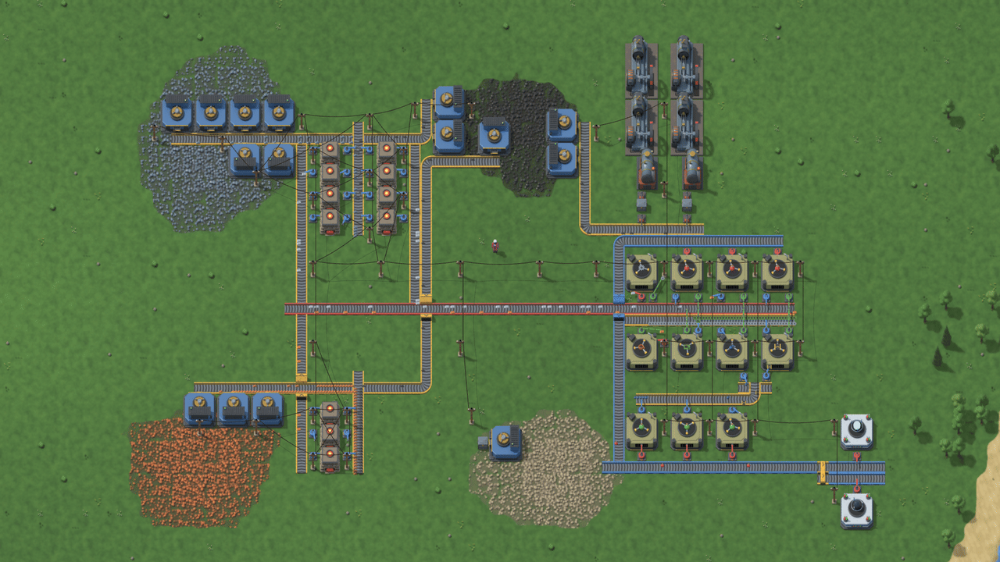

A new game starts between four ore patches (iron, copper, coal, stone) with a kit of belts, burner inserters, burner mining drills, stone furnaces, wooden chests and coal in the hotbar. The first goal: a drill on iron ore drops ore onto a belt, an inserter feeds it into a furnace, and another inserter moves the plates into a chest, all on their own once fuelled with coal. From there: steam power, assembling machines, and labs researching technologies from red and then green science packs, made by machines.

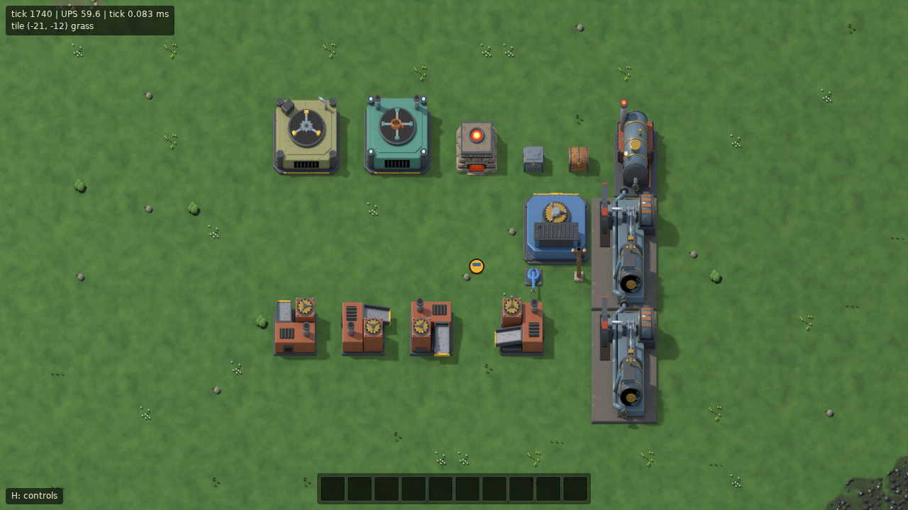

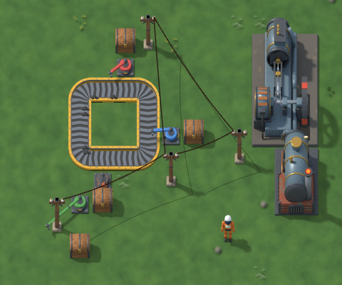


The **Getting started** panel in the bottom-left corner (above the controls hint) walks a new player through the first five minutes: mine stone, craft a furnace, place a drill on iron ore, lay a belt, place a furnace, feed it with an inserter, collect the plates with a second inserter and a chest, and fuel it all. Each objective is done when the game sees it done, not when you click anything; it names the keys to press (as bound), points the way to the ore patch it needs, and marks the hotbar slot or crafting recipe to use. **Skip** closes it for good; **Tutorial** in the game menu starts it again.

**Tooltips**: hover an item (inventory, hotbar, an entity's window), a crafting recipe or the name of an entity window for its recipe, crafting time and, for a machine, its power use, size and speed. Resting the mouse on a placed entity shows its tooltip too, on an ore tile how much ore is left there, and with a mining drill in hand how much ore its area holds.

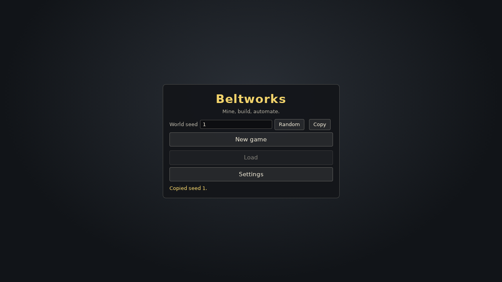

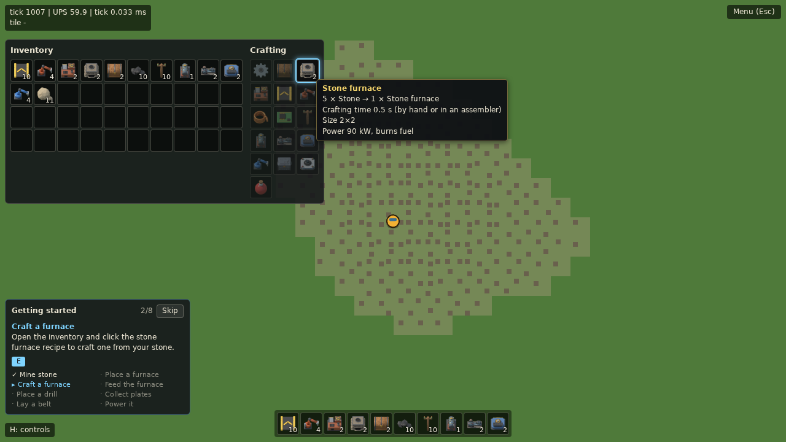

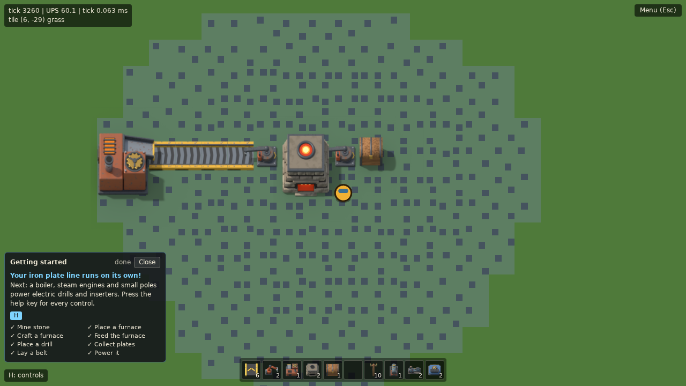

Press **H** in the game (or click the hint in the bottom-left corner) for a list of the controls. In full:

- **WASD**: walk (water blocks the way). The camera follows the player.
- **Hold right mouse** on an ore tile within reach (2.5 tiles): mine it by hand, one unit every 0.5 s. On a tree it fells the whole tree in 0.5 s for 4 wood. Trees grow in forests outside the starting area and block building until they are cut down.
- **E**: open or close the inventory (40 slots; the hotbar at the bottom shows the first 10, or the items pinned to its slots, see below). With an entity window open, **E** closes it instead.
- **Crafting** (in the inventory window): each hand recipe shows how many you can craft; **click** crafts 1, **shift-click** 5. Ingredients are taken when the craft is queued, and missing intermediates (gears, a furnace for a drill) are queued first. The queue shows above the hotbar; **click** an entry to cancel it and get its ingredients back.
- **1–0** or a **click** on a hotbar slot: select it (press or click it again, **right-click** the hotbar, or press **Q** to deselect). A new game starts with a kit of belts, inserters, drills, furnaces, chests, coal, small electric poles, a boiler with two steam engines, and electric drills (key **0**) and inserters (in the inventory, past the hotbar).
- **Cursor stack**: a **click** on a stack in the inventory window (**E**) picks it up onto the cursor (a **right click** half of it, a **ctrl-click** or **middle click** one item); a buildable item is then selected for building, also past the hotbar. With a stack on the cursor, a **click** on another slot puts it there (onto the same item as far as it fits; onto another item the two swap), a **ctrl-click** puts one item there, a click on its own slot, a **right click** or **Q** puts it away. Dragging a stack onto another slot moves it too. The items stay in their slot until dropped; when that stack runs out, the selection moves to another stack of the same item, if there is one. With a stack on the cursor, a click on an entity window's slots puts it into the entity.
- **Hotbar slots**: **Alt+1–0** pins the item on the cursor (or the one under the mouse in the inventory window) to that hotbar slot, and so does **dragging** an inventory stack onto it or **clicking** it while holding a stack picked up past the hotbar. A pinned slot (blue border) shows its item and how many you have wherever they are in the inventory, and its key takes them from there; a **middle click** unpins it. Unpinned slots show the first 10 inventory slots. Pins are saved with each save.
- **Q** with nothing selected is the **pipette**: it selects the item of the entity under the cursor, if you have one, with the ghost facing the same way.
- With a buildable item selected, a **ghost** follows the cursor: green where it can be placed, red where it can't (water, a tree, another entity, the player, or out of build reach, 10 tiles). **R** rotates it, **left click** places it (hold and drag to place a row).
- **R** with nothing selected rotates the entity under the cursor.
- **Left click** on a chest, furnace, mining drill, inserter, assembling machine or lab with nothing to build selected opens its window (in place of the inventory window): click a stack in your inventory to put it in (coal and wood go to a furnace's, drill's or inserter's fuel slot, ores and stone to a furnace's input), click one of the entity's slots to take it out. Both ways, a **click** or **shift-click** moves the whole stack, a **right click** half of it (rounded up), and a **ctrl-click** or **middle click** a single item, so the 10 starting coal can be shared between all the starting machines. **Esc** (or **E**) closes it. A furnace smelts iron ore, copper ore, or two stone into a plate or brick every 3.2 s while it has fuel; its firebox glows while it works.
- A **burner mining drill** placed on ore mines one unit every 4 s while it has fuel, from the four tiles under it in turn, and puts it into the entity in front of it (the arrow shows which way it faces; a chest stores it, a furnace smelts it). With nothing there, or no room, it holds the unit and waits. Its ring lights up while it works; its window shows its fuel and whether it is working, out of fuel, blocked, or depleted.
- A **burner inserter** takes one item at a time from the tile behind it and puts it onto the tile in front of it (the way its arrow points): out of a chest, a furnace's output, a drill or a belt, into a chest, a furnace (ores to the input, coal to the fuel), a drill (fuel only) or onto the far lane of a belt. A swing there and back takes 1.2 s and burns fuel only while the arm moves. With an empty fuel slot it takes one unit of coal from its source for itself, so an inserter next to coal starts on its own. Its window shows its fuel, the arm's position, the item in its hand, and whether it is swinging, out of fuel, or waiting for its source or target.
- **Belts** move items towards the way they face. Belts in a row join up, a belt fed only from one side turns, and a belt pointing into the side of another feeds that side's lane. Removing a belt gives back the items on it. Three tiers: the transport belt (yellow, 15 items/s), the fast (red, 30/s) and the express belt (blue, 45/s); a belt hands its items on to a belt of another tier in front of it.
- An **underground belt** comes in pairs: place the entrance, then the exit facing the same way, with up to 4 tiles between them (6 for fast, 8 for express); the ghost shows whether it becomes an entrance or an exit and which one it pairs with. Items travel under whatever stands in between. **R** on a placed one reverses the pair.
- A **splitter** (2 wide, across the way items move) takes up to two belts in and shares the items out evenly between its two outputs, sending everything to the other output when one is blocked.
- An **iron chest** holds 32 stacks (a wooden chest 16). A **fast inserter** swings in 0.43 s (twice as fast as an electric one), and a **long-handed inserter** picks up and drops 2 tiles away, reaching over whatever stands next to it; both are electric.
- **Small electric poles** wire themselves to every pole within 7 tiles, forming a network, and power electric machines that stand in the 5×5 area around them. While you hold a pole, the ghost shows its supply area, its wire reach and the wires it would get, and every placed pole's area shows faintly; with nothing selected, hovering a pole shows its area, reach and wires. The starting kit carries 10 poles, since the nearest trees for their wood are far from the spawn.
- An **electric mining drill** (3×3) mines the 5×5 area around it, one unit every 2 s at full power, and an **electric inserter** swings there and back in 0.87 s; neither has a fuel slot. They run at the speed their network can power (half speed at half power) and draw energy only while they work, apart from an inserter's small idle drain. A red bolt marks one without power (no pole, or no fuelled boiler and steam engine on its network), a yellow bolt one running on low power. Their window shows the power they draw and how well their network is supplied.
- A **boiler** burns fuel (coal, wood) for the **steam engines** lined up in front of it, up to two at 900 kW each, and only for the power they deliver. When a network asks for more than its engines give, every machine on it slows down in proportion; add generators to bring it back.
- An **assembling machine** (3×3, electric) makes the recipe you pick in its window: click one of the recipe buttons (every recipe but smelting; changing it gives back what the machine holds). Its input slots take up to twice what one craft needs, by hand or from inserters, and it crafts at half the hand speed (machine 1) or three quarters (machine 2) while it has power, ingredients and room for the result; inserters feed and empty it like any other machine. The product's icon shows on the machine, and a ring of lights runs around it while it works.
- **T**: open or close the **tech tree**. Each technology shows its cost (science packs per unit × units, and the time a unit takes in one lab), what it unlocks, and its progress; **click** an available one to research it (click the current one again to stop). Locked recipes stay hidden from the crafting panel and the assembling machine's recipe picker until their technology is researched; the M1 and M2 recipes, the lab and the automation science pack are available from the start. The current research and its progress show at the top of the screen.
- A **lab** (3×3, electric, 60 kW) researches the current technology from the science packs in its slots (one stack of each kind; fill it by hand or with inserters): each unit takes one of each of the technology's packs and its time per unit at full power. Several labs research several units at once. A unit a lab has started always counts for the technology it was started for, and switching research keeps every technology's progress. Its window shows its packs, the unit it researches and its progress, and whether it is working or has no research, no packs or no power.
- **Left click** on an electric pole with nothing selected opens its **network panel**: satisfaction, production and consumption, a graph of the last minute (demand, production and capacity), and the producers and consumers by type with their totals. **Esc** closes it.
- **Right click** on an entity removes it and puts it back into the inventory, together with what it holds (refused if there is no room); elsewhere the right button mines as above.
- **Middle-drag** or **arrow keys**: pan the camera freely; **F**: follow the player again.
- **Mouse wheel** or a trackpad **pinch** over the map: zoom (towards the cursor with a free camera, around the player while following). **=** (or **+**) and **-**, and the numpad's **+** and **-**, zoom in and out from the keyboard (hold to keep zooming). Zoomed out past 0.25×, the view fades into the **map view**: flat colours for the terrain, ore, trees, buildings and belts, down to 0.125×.
- **M**: show or hide the **minimap** in the bottom-right corner: what you have seen around the camera, the part on screen (white rectangle) and you (orange dot). **Click** or **drag** on it to move the camera there; **F** follows the player again.
- **Blueprints**: **C** and a **drag** with the left mouse button copies everything the box touches (type, position, direction, an assembling machine's recipe, whether an underground belt is an entrance or an exit; not what they hold) and puts the copy on the cursor; **V** takes the last copy again. While you hold one, its ghosts follow the cursor (red where an entity can't go or you don't have its item), **R** turns the whole blueprint, and a **left click** pastes it: whatever you have the items for and can place is built, the rest is skipped with a message saying what was missing. **Q**, a **right click** or **Esc** puts it away. **B** opens the **blueprint library**: save the copy under a name, paste, export (a `BW1.` string to share, copied to the clipboard) or delete a blueprint, and import a string someone shared by pasting it into the text field. The library is kept in the browser.
- **H**: show or hide the list of controls (with the keys as currently bound).
- **F3**: show or hide the **debug info** in the top-left corner (also in the settings): the simulation's tick, updates per second and tick time, and the tile under the mouse.
- **Esc** with no window open (or the **Menu** button in the top-right corner): the **game menu**. Save the game under a name (saving under an existing name replaces that save), load, export (download a `.bwsave` file) or delete a save, import a save file, start a new game (back on the title screen, to pick a seed), copy the world seed, restart the **Tutorial** objectives, open **About**, or open the **settings**: rebind every key (click it, press the new key; a key another action has swaps with it; reset to defaults), graphics (rendered or flat terrain, terrain detail, shadows, animations), the UI scale (75–200%), lettered item icons, the debug info, and the master, effects and music volumes. Settings are kept in the browser. The game also **autosaves** every 5 minutes of play (not while paused in the menu), rotating through three autosave slots. Saves live in the browser (IndexedDB); the game always opens on the title screen, whose **Continue** (shown once there is a save) loads the newest one.

Items show as rendered icons, the same on belts, in inserter hands and in the inventory; the settings offer the placeholder icons instead: the item's color with a one- or two-letter label (**FE** iron, **CU** copper, **C** coal, **S** stone, ...). Ores are rough chunks, plates and bricks bevelled squares, and everything else rounded squares.

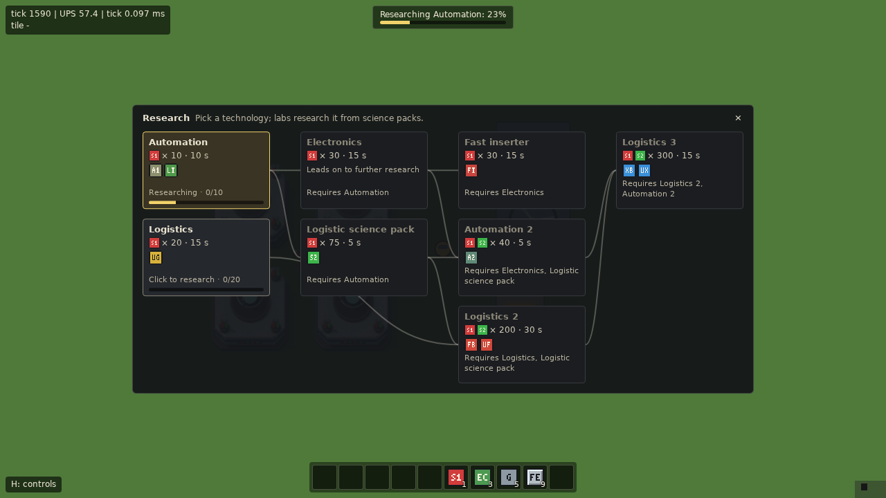

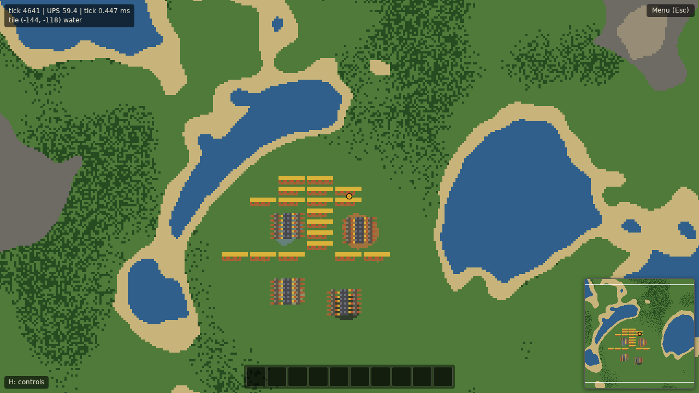

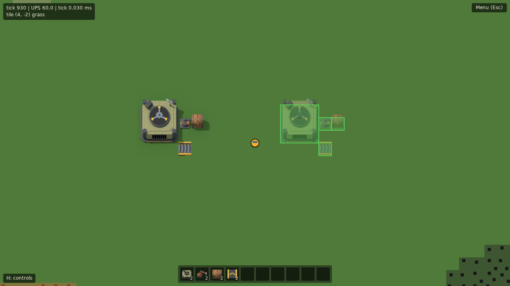

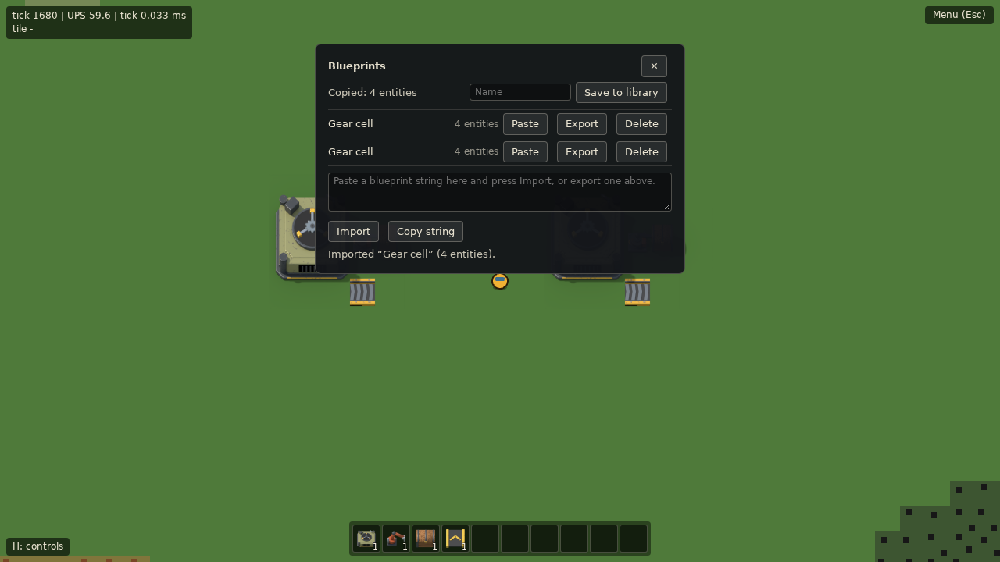


The debug info (**F3**) shows the tile under the mouse: its terrain, then a tree or the resource on it with the amount left (e.g. `grass · tree`, `grass · iron ore 1 594`).


## Docs

| Doc | Contents |
|---|---|
| [docs/GDD.md](docs/GDD.md) | Game design: core loop, scope, non-goals |
| [docs/ARCHITECTURE.md](docs/ARCHITECTURE.md) | Simulation core, rendering, data layout, determinism |
| [docs/ROADMAP.md](docs/ROADMAP.md) | Milestones and acceptance criteria |
| [docs/TOOLING.md](docs/TOOLING.md) | Toolchain, references, development rules |
| [docs/DECISIONS.md](docs/DECISIONS.md) | Decisions made and open questions |
| [docs/ART.md](docs/ART.md) | Art style guide and the Blender sprite pipeline (`npm run art`) |

## Development

Requires Node.js 22 (see `.nvmrc`).

```sh
npm ci
npm run dev        # start the Vite dev server
npm run lint       # ESLint (including the src/sim purity rules) + Prettier check
npm run typecheck  # tsc --noEmit (app and tools/bench)
npm test           # Vitest unit tests (tests/sim, tests/worker, tests/render)
npm run test:bench # Vitest tests of the benchmark tooling (tests/bench)
npm run bench      # headless tick-time benchmark (see docs/TOOLING.md, "Benchmarks")
npm run build      # production build into dist/ (set BASE_PATH to change the base URL, default /)
npm run preview    # serve dist/
npm run test:e2e   # Playwright tests against a fresh test-mode build (Chromium)
npm run test:release # the release check: the production build played with real input (docs/TOOLING.md)
npm run art        # re-render the Blender sprite models into public/sprites/ (needs Blender 4.2; see docs/ART.md)
npm run capture:promo # record the demo factory's promo footage and README clip (docs/TOOLING.md, "Demo factory and promo capture")
```

Run `npx playwright install chromium` once before the first `npm run test:e2e`. The screenshot baselines live in `tests/e2e/render.spec.ts-snapshots/`; after an intended visual change, regenerate them with `npx playwright test --update-snapshots` and check the new images. CI runs the suite in six shards (docs/TOOLING.md, "End-to-end tests").

## Deployment

CI builds `main` and pushes `dist/` to the `gh-pages` branch of the public repo
[`zerone0x/beltworks-play`](https://github.com/zerone0x/beltworks-play), which serves it with GitHub Pages.
The build uses the base path `/beltworks-play/`, and pushes authenticate with the `DEPLOY_KEY` Actions secret, an SSH deploy key with write access to that repo.
This is done by `.github/workflows/deploy.yml` on every push to `main` (or manually via `workflow_dispatch`). The build ships without sourcemaps. The version shown in the game is `version` in package.json; the build also writes `third-party-licenses.txt` (the bundled packages' licenses, linked from About).

## Credits and licenses

Made by zerone0x. This project does not use any Factorio assets, names, sounds, or code: the art is rendered in Blender from the project's own procedural models (no image textures, models or fonts from elsewhere), and the sound and music are synthesized in the browser (no samples). The only third-party code in the game is [PixiJS](https://pixijs.com) (MIT) and the small libraries it includes (earcut, ISC; tiny-lru, BSD-3-Clause; eventemitter3, @pixi/colord, ismobilejs, parse-svg-path, MIT); their license texts ship with every build as `third-party-licenses.txt` and are linked from the in-game About.

Beltworks itself is released under the [MIT License](LICENSE), copyright 2026 zerone0x.
