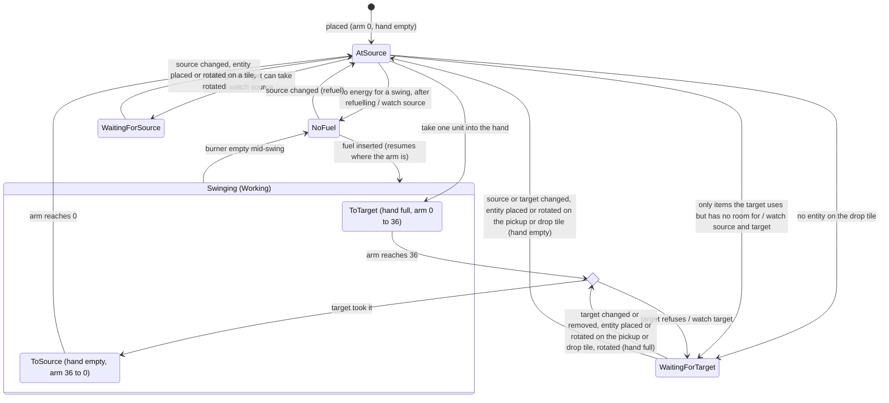

# Architecture

## Overview

```
┌──────────────── Main thread ───────────────┐      ┌────────── Sim Worker ──────────┐
│ Input ──► Command queue ──postMessage──────┼─────►│ fixed step, 60 ticks/s          │
│                                            │      │ World (TypedArray / SoA)        │
│ Renderer (PixiJS v8) ◄── Snapshot ◄────────┼──────│ emits a render snapshot per tick│
│ UI panels (DOM)                            │      │ save serialization              │
└────────────────────────────────────────────┘      └─────────────────────────────────┘
```

- **Simulation and rendering are fully separate.** The simulation knows nothing about pixels, and the renderer never changes state.
- Every player action becomes a **Command** (`Place`, `Remove`, `Rotate`, `SetRecipe`, `Craft`, `Move`, …) tagged with the tick it applies on. This is what makes determinism, replays, and future multiplayer possible.

## Stack

| Layer | Choice | Why |
|---|---|---|
| Language | TypeScript (strict) | Fast iteration; hot paths can move to Rust→WASM later |
| Build | Vite | Fast, supports Workers natively |
| Rendering | PixiJS v8 | Best 2D sprite batching, WebGPU and WebGL backends |
| UI | Plain DOM, or Preact if it grows | Panels, inventory, and tech tree are DOM |
| Tests | Vitest (unit and determinism) + Playwright (E2E and screenshots) | |
| Saves | IndexedDB + binary format | |
| Hosting | GitHub Pages on a public deploy repo | Static site; see README |

## Simulation core

### Time
- A fixed 60 ticks/s, independent of frame rate. The Worker drives ticks from an accumulator; if it falls behind it catches up at most N ticks and drops the rest (single-player only).
- All speeds and progress are **integers** (for example, progress in units of 1/65536 and belt positions in units of 1/256 tile). **No floating-point value may end up in simulation state.** This keeps runs identical across browsers.
- Randomness comes from a seeded PRNG (xoshiro128**) that is only used inside the simulation.

### World and chunks
- The map is stored in 32×32 chunks: terrain tiles (`Uint8Array`), resources and their amounts (`Uint32Array`), and trees (`Uint8Array`, 1 where a tree stands).
- Chunks are generated lazily from noise whose output is integerized.
- **Trees** (`src/sim/world/trees.ts`, numbers in `src/data/trees.ts`): forest noise (2 octaves, lattice about every 51 tiles) sets a density of up to 550 trees per 1 000 tiles, and a per-tile hash decides each tile. Trees only grow on grass without a resource, never within 48 tiles of the origin, and fade in (linearly in squared distance) up to 80 tiles, so the starting area stays open. `World.treeAt`/`removeTree`; felling one marks its chunk modified like mining does, so the world hash covers trees exactly like resources (only modified chunks, which also keeps felled trees from growing back when unmodified chunks are dropped). Players walk through trees.
- Spatial index: a list of entity ids per chunk, plus a per-tile occupancy table for placement collision.

### Entity storage
- Data-oriented: one struct-of-arrays table per entity type, with an `id → index` sparse set.
- Example: `Assembler { recipe: Uint16, progress: Int32, inputs: Uint16[k], output: Uint16, energy: Int32, state: Uint8 }`.
- No generic ECS library. Like Factorio, each system is specialized and its hot loop only walks compact arrays.
- Implemented in `src/sim/entities/` (`Entities` in `entities.ts` ties the pieces together):
  - **Ids**: uint32s handed out in increasing order from 1 and never reused, so an id held by another entity can't come to mean a different one; 0 is "no entity".
  - **Generic table** (`store.ts`): type, top-left tile, and direction (N/E/S/W, `direction.ts`) of every entity, in the row order of a `SparseSet` (`sparseSet.ts`; removal moves the last row into the hole).
  - **Per-type tables** implement `EntityTypeTable` (`table.ts`) and are registered in `createEntityTables` (`registry.ts`). A table can hold several types (`types`; the belt table holds every belt tier, since lines run across them); it is registered for each and hashed once. They get hooks when an entity of their type is placed, rotated or removed (belts relink their lines there), report its contents (refunded on removal, which is refused if they don't fit), can react to any entity being placed, rotated or removed (`entityPlaced`/`entityRotated`/`entityRemoved`, e.g. inserters finding their source and target), and are hashed in type id order. Next to its `hashInto` hook every table has `save` and `load` hooks that write and restore its complete state (see "Saves").
  - **Occupancy** (`occupancy.ts`): per 32×32 chunk, the entity covering each tile and the entities whose origin lies in the chunk (to collect the entities around the viewport).
  - **Wake subscriptions** (`wake.ts`): an entity can subscribe to another; `Entities.notify(target)` hands each subscriber to its table's `wake` hook. Removing an entity wakes its subscribers. A new subscription calls the target table's `watched` hook. See "Machine sleep".
  - **Item hooks** (`slots`, `accepts`, `insertable`, `insert`, `take`, `outputSlot` on `EntityTypeTable`, forwarded by `Entities`): the one way items move in and out of entities, for the GUI commands, drill output and inserters. `insert` routes items itself (a furnace puts ores into its input and fuel into its fuel slot, a belt puts them on the middle of its tile); every change calls `notify`. `accepts` says whether an entity takes an item at all, however full it is (a chest or belt anything, a furnace ores and fuel, a drill or inserter fuel), `insertable` how many units it takes right now (an assembling machine up to its input limit, a furnace's fuel slot up to a stack; a table whose `insertable` grows, by consuming ingredients or fuel, notifies), `hasRoom` whether that is above 0 for anything at all (true when absent), and `outputSlot` names the slot an inserter picks up from (a chest's first non-empty slot, a furnace's output, a drill's held unit), optionally only among slots holding an item a filter accepts.
- Per-type tables so far:
  - **Wooden chest** (`chest.ts`): 16 slots per chest in two flat `Uint16Array`s; no per-tick work.
  - **Stone furnace** (`furnace.ts`): input slot, burner, output slot (at most 100 units), the recipe in progress and its progress in ticks, and a `MachineState` (`machine.ts`: `Working | NoInput | NoFuel | OutputFull`). The recipe follows from the input item (the smelting recipe in `src/data/recipes.ts` that takes it). Each tick a furnace without a recipe in progress needs a full set of ingredients and room for the result, then burns its energy and only then takes the ingredients; after `ticks` working ticks the result lands in the output. A furnace that ends a tick not `Working` leaves the furnace system's active list and rejoins it when its slots change.
  - **Burner mining drill** (`drill.ts`; the shared drill logic is `MiningDrillTable` there, which the electric drill reuses): a burner, mining progress in ticks, a round-robin cursor over its 2×2 tiles, one held output unit, and a `MachineState` (`Working | NoFuel | OutputFull | Depleted`). Each tick a drill holding a unit first tries to drop it (`OutputFull` while it can't); before starting a unit it needs a resource left under it (`Depleted` otherwise, for good); then it burns 2 500 J (`NoFuel`), and every `miningTicks` (240) working ticks it takes one unit out of the world (`World.mine`) from the next covered tile that still has one (row-major, starting after the tile mined last) and drops it. **Output hook**: the unit goes through `entities.insert` into whatever entity covers the drop tile, the tile in front of the left half of the front edge (`drillDropTile`: north `(x, y-1)`, east `(x+2, y)`, south `(x+1, y+2)`, west `(x-1, y+1)`), so chests store it, furnaces smelt ores and burn coal, and belts put it on the middle of their tile (right lane first, see "Belts: transport lines"). With nothing there or no room it holds the unit. Mined coal never fuels the drill itself. A drill that isn't `Working` leaves the active list and is woken by changes to its own slots, by its drop-tile entity changing or going away (an `OutputFull` drill subscribes to it until the unit drops), by an entity being placed on its drop tile (`entityPlaced`), and by rotation.
  - **Belts** (`src/sim/belts/belts.ts`): one table for the transport belt, fast and express belts and the underground belt of each tier: line id, index in the line, drawn shape, tier (belt speed), underground mode (entrance or exit) and partner per belt; the lines and their lanes live in the same table. See "Belts: transport lines" and "Belts: tiers and underground belts".
  - **Burner inserter** (`inserter.ts`; the shared inserter logic is `InserterTableBase` there, which the electric inserter reuses): a burner, the item in the hand, the arm position in ticks, and the state (`WaitingForSource | WaitingForTarget | Swinging | NoFuel`, stored as `MachineState` values with `Swinging` = `Working`). It picks up from the tile behind it and drops onto the tile in front of it; see "Burner inserter".
  - **Electric mining drill** (`electricDrill.ts`) and **electric inserter** (`electricInserter.ts`): the burner drill's and inserter's behavior with the electric numbers and no fuel slot; see "Power: consumers".
  - **Assembling machines 1 and 2** (`assembler.ts`, one `AssemblerTable` per type): the recipe set (`SetRecipe`), whether a craft is under way, its progress in 1/65536 ticks, the state (`Working | NoInput | OutputFull | NoPower | NoRecipe`), and per machine up to 6 input and 2 output counts (the items follow from the recipe). See "Assembling machines".
  - **Fast and long-handed inserters**: one more `ElectricInserterTable` each, built from their prototypes (their swing time, energy, drain and reach); see "Burner inserter".
  - **Chests**: one `ChestTable` (`chest.ts`) per chest type, built from its prototype: the wooden chest (16 slots) and the iron chest (32).
  - **Labs** (`src/sim/research/lab.ts`): per lab the technology of the unit under way and its progress in 1/65536 ticks, the state (`Working | NoResearch | NoInput | NoPower`) and one pack count per science pack type. See "Research".
  - **Power grid** (`src/sim/power/grid.ts`): the table of the small electric pole, holding the poles, their wires and networks, which network each electric entity belongs to, and the power solver. See "Power".
  - **Boiler** (`src/sim/power/boiler.ts`) and **steam engine** (`src/sim/power/steamEngine.ts`): a boiler's burner, supply and output this tick and state (`Working | NoFuel | NoDemand`); an engine's boiler and place in its boiler's list, its share of the boiler's supply and output this tick, and state (`Working | NoInput` (no steam) `| NoDemand`). See "Power: steam".
  - **Burner** (`burner.ts`): the fuel component of every burner entity: one fuel slot and an energy buffer in integer joules. `consume(row, joules)` burns the next fuel unit when the buffer runs short and keeps any remainder, so one coal (4 MJ) runs a 1 500 J/tick furnace for exactly 2 666 ticks with 1 000 J carried over to the next unit. Fuel values are in `src/data/items.ts`, energy use per entity in `src/data/entities.ts`.
- Prototypes (size, rotatable, placing item, placeholder color, energy source and use, slots, a drill's ticks per unit) are in `src/data/entities.ts`; footprints swap width and height when facing east or west. The M2 power entities (small electric pole, boiler, steam engine, electric mining drill, electric inserter) carry the shared design numbers there (wire reach, supply area, max output, electric energy use and idle drain, mining area, swing ticks, and `SAT_ONE`); the small electric pole, the boiler and the steam engine have their tables in `src/sim/power/` (see "Power"), the electric drill and inserter theirs in `src/sim/entities/`.
- **Building** (`build.ts`, `placement.ts`): `Place {item, x, y, dir}` takes one item and needs the whole footprint inside the map, on buildable terrain without trees, free of entities and of every player's collision box, and its center within build reach (10 tiles, an exact integer comparison of squared distances). `Remove {x, y}` and `Rotate {x, y}` act on the entity covering that tile and need reach too; `Rotate` turns it a quarter turn clockwise, or wherever its table's `rotation` hook says (underground belts reverse). Commands that don't apply are ignored without touching state. The renderer colors the ghost preview with the same `checkPlacement`, fed from its snapshot data. Players walk through entities for now.
- **Entity GUI** (`transfer.ts`): `Insert {entity, item, count}` moves items from the player's inventory into an entity (wherever `insert` routes them) and `Take {entity, slot, count}` moves a slot's contents back, as many as fit. Entities are named by id (ids are never reused, so a stale id can't hit another entity) and must be within build reach; transfers that don't apply are ignored.
- A new game gives every player the starting kit from `src/data/start.ts`.

### Update order (per tick)
1. Apply this tick's Commands
2. Power: compute the satisfaction of each network and tell its producers what to deliver
3. Mining drills (burner, then electric)
4. Belts (transport lines)
5. Inserters (burner, then electric)
6. Furnaces, then assembling machines (1, then 2), then labs
7. Players: movement, hand-mining, hand-crafting
8. Emit the render snapshot and events

The order is fixed and covered by tests.

### Belts: transport lines
This is Factorio's core optimization (Friday Facts #176), and it has to be there from day one. Implemented in `src/sim/belts/`:

- Connected belts merge into one **transport line** (`line.ts`): belt F continues belt B when B points into F and either sits right behind F facing the same way, or is the only belt pointing into one of F's sides while nothing feeds F from behind (F is then a **curve**). Each line has a left and a right lane that move independently. A closed loop is one line cut at its belt with the smallest id; its end feeds its own start.
- Positions are distances from the line's end in subtiles; the belt at index `k` of a line spans `[256k, 256k + 256)`. Curves count as a full tile on both lanes.
- A lane (`lane.ts`) stores the **gaps between items**, not each item's absolute position: the distance from the end to the first item, then from each item to the next (at least `BELT_ITEM_SPACING` = 64, a quarter tile). Gaps and items are ring buffers, so items leave the front and join the back in O(1).
- Each tick (by the line's speed, from its belts' prototype: 8, 16 or 24 subtiles/tick) only the first movable gap shrinks: `gap[0]` while the first item hasn't reached the end, otherwise the first gap behind the packed run of items behind it. The run length is cached and only grows while items close up, so moving a whole lane costs O(1) amortized. That gives exactly 7.5 / 15 / 22.5 items/s per lane and 15 / 30 / 45 per belt.
- **Line end**: items stop at the end of a line, unless it hands them on: a loop's end feeds its own start, and a line feeding a belt of another tier (straight on or as a curve) feeds that belt's line's start, lane by lane (the slower side sets the pace: a faster line backs up behind a slower one); a belt pointing into the side of another belt **side-loads** it, putting the items of both its lanes onto the middle of that belt's near lane (the lanes take turns when both are waiting). Belts facing each other don't connect. An item is handed on in the tick it reaches the end, as soon as there is room, and the item behind it moves on with the rest of the tick's movement (`Lane.move` with an outlet), so items leave at exactly speed / spacing even at the express belt's 24, which doesn't divide 64. A side-loaded item may enter the target lane up to one tick of that lane's movement behind the side-load point (`Lane.fitNear`), so a lane fed at a fixed point fills at exactly the spacing too. Where a line hands on to the start of another line (a tier boundary, or a loop made of several lines), the spacing holds across the boundary too: a lane's first item only comes as close to the end as keeps it 64 behind the last item of the lane it feeds (`LaneOutlet.minFront`), and when it is handed on it keeps what is left of the tick's movement, scaled to the target's speed, but lands no closer than 64 to that last item, so the item behind it can keep moving; a side-load near that start (an underground entrance's rear half) lands no closer than 64 to the feeding lane's first item either. A lane blocked at its end by a lane that moved this tick or the last stays awake to try again next tick instead of sleeping (a lane woken during the belt step only runs from the next tick, which would cost a tick per hand-over); lanes that don't move don't keep their feeders awake, so a jammed cycle of lines falls asleep. So every tier boundary and side-load runs at exactly the slower lane's rate.
- **API** for drills and inserters (`BeltTable`): `insertAt(line, lane, pos, item)` (false when there is no room; `pos` may be anything from 0 to `line.length`), `takeAt(line, lane, from, to)` and `peekAt` (the item closest to the end in that range), `peekEnd(line, lane)`, `laneAwake`, `dropOnTile(belt, x, y, lane, item)` and `dropSpot` (where an inserter drops: see "Burner inserter", Targets), plus `beltLine`/`beltOffset`/`beltEnd` to find a belt's stretch of its line: `[256k, 256k + 255]`, except that the belt at the line's start (the highest index) also owns everything at or past its start edge, i.e. an item at `pos == line.length` (where a loop hands items on to its own start) or pushed back past the start by a rebuild. That is also the belt the renderer draws such items on. Inserting or taking in the middle of a lane walks and shifts it locally. The generic `insert` hook (a drill's output, a hand's `Insert`) puts one unit on the right lane and one on the left lane at the middle of the belt, as far as they have room.
- **Rebuilds**: placing, rotating or removing a belt can only change links within two tiles of it, so the lines through belts there are taken apart, keeping every item's belt, lane and position on the belt, and rebuilt; every other line keeps its id and items. Where two lines join, items closer than the spacing are pushed back towards the line's start (past it if need be; they move on once there is room). Where a rebuilt line hands on to another line's start, the spacing is restored across that boundary too: items pushed past the target's start edge physically sit on the feeding line's end belt, so they move into the feeding lane, whose items are pushed back to stay 64 behind the target's last item; when that pushes the feeding lane's last item back, the line feeding it settles in turn (each line once per rebuild). Items left past a start (nothing feeds it, or a loop of lines too full) hold the feeding lane back the spacing behind them (`minFront` may then be more than 64), so motion never brings items closer than 64 across a boundary. Removing a belt refunds the items on it, or is refused if they don't fit.
- **Sleep**: a lane that neither moved nor handed an item on during its step leaves the active list (empty lanes too), unless it is waiting at its end for room on a lane that moved this tick or the last. It wakes when items are put on it or taken from it, when the lane it feeds changes, or when its line is rebuilt.
- **Notifications**: each line keeps a list of its belts that something subscribed to (the table's `watched` hook, called on every new subscription). Every tick a lane of the line changes (items move, arrive or leave), the line notifies those of its belts that the change could affect (`entities.notify`): the stretch of the lane that changed must come within `BELT_ITEM_SPACING` of the belt's own stretch (`beltOffset` to `beltEnd`). For a moving lane that stretch runs from the first item that moved (item 0, or the first one behind the packed run, whose position is O(1) to find because the run is packed at exactly the spacing) to where the last item was before the move; for an item put on, taken off, or handed on, it is that item's position (or the range it was taken from). When the first item of a lane that hands on to another line's start leaves it without being handed on (taken, or sent across inside a splitter), the watched belts at that line's start are notified too: the spacing across the boundary no longer holds an item dropped there back (`dropSpot`). So a drill blocked on a full belt, or an inserter waiting for an item, sleeps while the lanes there sleep or only move elsewhere on the line (behind the last item or ahead of the first one that moves), and is woken while items move near it; lines nobody watches pay nothing. What is left: an inserter whose tile lies between moving items of the same lane (a sparse lane that moves as a whole) is still woken every tick; it then only peeks at its tile (`peekAt`) and goes back to sleep.
- The table hashes every belt row (with its mode and partner, and a splitter's right half and alternation), every line (in id order) with its speed, belts, hand-over, splitter half and lanes' gaps, items and spacing, and the active list in order.

### Belts: tiers and underground belts
Numbers in `src/data/entities.ts` (`beltSpeed`, `undergroundMaxGap`); pairing in `src/sim/belts/underground.ts`, shared with the renderer.

- **Tiers**: transport belt 8, fast 16, express 24 subtiles/tick (15 / 30 / 45 items/s per belt; spacing stays 64). The belt speed *is* the tier: lines only merge belts of the same speed, and where a line feeds a belt of another tier it hands items on at that belt's start edge (see "Line end"). Curves follow geometry, whatever the tiers.
- **Underground belts**: an entrance and an exit of the same tier, both facing the way items move, at most `undergroundMaxGap` (4 / 6 / 8) tiles apart. An entrance pairs with the nearest underground of its tier on its axis in front of it within reach if that is an exit facing the same way; any other same-tier underground there (an entrance, or one facing back) blocks it; other tiers and perpendicular ones are ignored. Exits look the same way backwards, so pairing is symmetric and a pure function of positions, directions and modes. A new underground becomes an exit when an entrance behind it would pair with it, otherwise an entrance (so the second one placed in a row is the exit). `Rotate` reverses an underground: it swaps entrance and exit and faces the other way, together with its partner, so the pair carries items the other way between the same tiles. Turned any other way (`setDirection`), it keeps its mode and the pair breaks.
- **In lines**: an exit continues its entrance, so a pair is part of one line, and the tiles between count as belt length: `line.belts` has an entry of 0 for each, right behind the exit, so positions stay `256 × index`. Items there are on no belt (not drawn, not reachable by inserters) and belong to the exit: removing the exit refunds them, removing the entrance leaves them to come out of the exit (a rebuild pushes them back past the exit's line start). An entrance feeds nothing in front of it and is fed only from behind (never as a curve); an exit is fed only by its entrance and feeds the tile in front like any belt; a belt pointing into the back of an exit does nothing. Placing, rotating or removing an underground also rebuilds the lines through the nearest same-tier underground on each side of it on its axes (and their partners), whose pairing it can change.
- **Side-loading** onto an underground: only the open half takes items (an entrance's rear half, an exit's front half), so only the feeding line's lane on that side gets through (`TransportLine.outOnly`), onto the middle of that half of the near lane; the other lane waits at the end (asleep).
- Drills and inserters treat every belt type alike (`isBeltType`); on an underground they use its own tile.

### Belts: splitters
Geometry in `src/sim/belts/splitter.ts` (shared with the snapshot and the renderer), behavior in `belts.ts`; D44.

- **Entity**: a splitter of each tier (`splitter`, `fast-splitter`, `express-splitter`: 8 / 16 / 24) is one belt-table entity, 2 tiles across the way items move and 1 along it. Half 0 is its left half (looking the way items move), half 1 its right. `Rotate` reverses it on the same two tiles (each item stays on its tile); turned across (only from code), it rebuilds around its old tiles too, and the items of the tile it left go onto the half on its new tile.
- **Lines**: each half is a transport line of its own, one belt long (`line.splitter`, `half`, `tileX`/`tileY`, `sibling`), that never merges with the belts around it. The belt behind a half facing the same way hands on to the half's start (like a tier boundary, whatever the tiers), and a half's `out` is the line the belt in front of it starts, if that belt continues it straight on or as a curve, or the half of another splitter in front facing the same way. A splitter never side-loads (a belt in front that is fed from behind gets nothing), belts pointing into its sides or front do nothing, and nothing continues it. `beltLine` gives the left half's line; `beltLineAt(id, x, y)` the half on a tile (inserters use it for the tile they reach).
- **Sharing out**: each half's first item goes to the output its lane's alternation bit picks (one bit per splitter and lane, `nextCol`, hashed), else to the other one. Going to the picked output flips the bit, going to the other leaves it, so the items of a lane alternate between the outputs (both halves together), and all of them go to the other output while one can't take any. **Straight on** is the ordinary hand-over onto another line's start: the half's first item only comes 64 behind the output's last item, counted across, and is handed on with its leftover movement at the target's speed. **Across**, it moves over onto the other half's lane (same lane index), as close to that lane's end as the spacing and that half's rate allow: from `crossFront` (that half's `minFront`, or further back while the output's last item left the half less than 64 ago counted at the half's speed, and further back again by the half's speed when it goes in front of that half's items before that half has stepped this tick, `LineLane.due`, since that step moves it on) back by at most `CROSS_REACH` (128), 64 from the items on both sides, and no closer than the lane's spacing to the first item of the line feeding that half. It is marked there (`Lane.marked`, a bit kept with the item while it stays on the lane), so it goes straight on, or back across if its output got blocked meanwhile. So everything that leaves by one side passes through that half: the splitter's tier caps each side (one belt of its tier), and the spacing across both boundaries is kept by the ordinary rules. An item only goes across while the other half's output is open: it exists, and has room at its start or moved this tick or the last (`outputOpen`). An item held back by its own blocked output is offered across from where it waits (`LaneOutlet.early`).
- **Stepping**: halves step after every other lane of the belt step (in active-list order), so they decide with the outputs where those end the tick. A blocked half stays awake while either output or the other half moved this tick or the last, else it sleeps; it wakes when its lane, the other half's lane or either output's lane changes (`wakeFeeders` of an output wakes both halves). A jammed loop through splitters sleeps like any other.
- **Merging**: while a half has items whose output isn't open and they come close together (two less than 64 plus one tick of the half's movement apart; a first item waiting to go across counts towards going on keeping slots, not towards starting to: `dense`), the other half's lane of that index closes up only to `MERGE_SPACING` (128, `Lane.setSpacing`) instead of 64, and the line feeding it hands on 128 apart (it still comes as close as 64 across the boundary while it waits), so a slot stays free behind each of its own items for an item sent across. The output then gets the two inputs' items in turn, at the rate of that half or the output, whichever is slower (or all of both, when they carry less). Set per lane on both halves whenever a half or an output changes (O(1)); opening up again wakes the lane and its feeder.
- **Sparse merging** (D58): while the items waiting to go across come further apart, no slots are kept (they could go out empty). Instead, when the first one is ready to go across (where it stops, or within a tick of it), the merged-into half's first item, if it is its own (unmarked) and not yet too close to the end, stops the spacing further back (`mergeHold`, as the outlet's `minFront`), and the item crossing over goes in front of it: right behind the output's last item, or, from its own half's end with movement left, straight on through the other half onto the output (`crossOn`, the ordinary hand-over with its leftover movement). Both the spacing on the output and the half's own rate hold: the slot is counted at the half's speed since the output's last item left it (`crossCarry`, `crossFront`). A half that made way sets a yield bit (in the row's `nextCol`, bit `2 + 2 × half + lane`) and doesn't make way again until its own item has gone on, so the two inputs at most take turns. The output loses no slot; the half gives up the slot its item would have taken, or nothing where its items come more than the spacing apart (its lane closes up behind the item held). O(1) per lane: a half holds at most a handful of items.
- **Throughput**: 15 / 30 / 45 items/s per belt through each half; a one-input split exactly 50/50 per lane; a two-input merge (no belt in front of one half, or a blocked one) puts min(splitter, output, both inputs) onto the open output, half from each input, for every splitter, input and output tier, onto a curve and into another splitter; mixed tiers run at the slower rate (`tests/sim/splitters.test.ts`). With one input full and the other sparse (items arriving evenly, a quarter or half of its belt), the output in front of the full one's half gets min(splitter, output, both inputs), the sparse input all it carries up to half of that, for every tier combination (`tests/sim/splitterMerge.test.ts`).
- **Other systems**: the generic `insert` hook (drills, a hand's `Insert`) uses the left half first, then the right; inserters pick from and drop onto the half on the tile they reach, as on any belt. `contents` and removal cover both halves. The snapshot sends a splitter as two belt records, one per half (left first), with `mode` `SPLITTER_HALF_MODE + half`; the belt layer draws each as a straight belt of its tier and the left one adds the gantry over both.
- **Hashed**: per row the right half's line and the alternation and yield bits; per line the splitter and half; per lane its spacing, and a half's marks.

### Machine sleep
- Entity state (`MachineState` in `src/sim/entities/machine.ts`): `Idle | Working | NoInput | NoFuel | OutputFull | Depleted` (a drill with nothing left to mine) `| WaitingForSource | WaitingForTarget` (inserters) `| NoDemand` (a boiler or steam engine that could deliver energy but none is drawn) `| NoPower` (electric consumers) `| NoRecipe` (an assembling machine) `| NoResearch` (a lab with nothing to research), more as machines need them. `LowPower` is only ever shown, never stored: the snapshot reports it for a `Working` electric consumer on a network with satisfaction below 1 (`displayStatus` in `src/sim/snapshot.ts`).
- An entity that isn't Working leaves the active list and waits on the event that would wake it (a chest gets a new item, an output slot is emptied, and so on). Once woken, it rejoins the active list. `NoPower` is the exception: power can come back on any tick without any entity changing, so unpowered electric machines stay on the list and look again every tick.
- An inserter waiting to pick up only wakes when the items at its source change (for a belt source, when items change near its tile), one holding an item for a full target only when the target changes, and one whose source only has items its target uses but has no room for when either changes.
- Belt lanes sleep the same way, on their own active list (see "Belts: transport lines").
- The subscriptions live in `src/sim/entities/wake.ts` and are part of the state hash; the active lists are each system's own (and hashed with its table). Furnaces need no subscriptions: only changes to their own slots can make them work again. A drill blocked on output subscribes to the entity on its drop tile. An inserter subscribes to the entity it waits on, or to its source and its target when it waits for room (see "Burner inserter").

### Burner inserter
Implemented in `src/sim/entities/inserter.ts`, stepped by the inserter system after the belts and before the furnaces.

- **Geometry**: 1×1. An inserter faces the way it drops: it picks up from the tile behind it and drops onto the tile in front of it. A long-handed inserter (`reach` = 2 in its prototype) uses the tiles 2 behind and 2 in front of it instead, whatever stands on the tiles in between; on a belt there it still drops onto the far lane. Source and target are looked up on the occupancy index at every pickup and drop, never cached, so placing, rotating or removing a neighbour can't leave a stale link; the `entityPlaced`/`entityRotated` hooks only wake the inserters whose pickup or drop tile the entity covers.
- **Sources**: a chest's first slot holding something the target can take, a furnace's output, a drill's held unit (`outputSlot`), or a belt: the item the target can take closest to the end of its left lane, else its right lane, within the belt's own stretch (`takeAt(line, lane, beltOffset, beltEnd, accept)`, so an inserter at a line's start also reaches an item sitting exactly on the start edge). An inserter only picks up items its target can take **now** (`insertable` > 0; for a belt target, anything it `accepts`, since a belt frees up as it moves), so it never ends up holding something the target will never take (a drill target makes it pick coal and leave ore), nor an ingredient an assembling machine is full of while it waits for another one (it picks the copper plate behind the gears instead; D47). A furnace with a full fuel slot gets the ore behind the coal.
- **Targets**: the target's `insert` hook (a chest stores the item; a furnace puts ores into its input and fuel into its fuel slot when the input doesn't take it; a drill or another inserter takes fuel only), or a belt: its far lane as seen from the inserter (the right lane when the inserter is in line with the belt), anywhere on the tile it reaches where the item fits, as close to the middle of the tile as it can (`dropOnTile`, D49): the free spot in `[offset, offset + 255]` nearest `offset + 128`, the one nearer the line's end on a tie (`Lane.fitBetween`, one walk of the lane up to the tile, like `insertAt`). So an inserter fills any free slot on a busy, moving belt as it passes its tile, whatever its phase against the tile, on every tier. On an underground belt only the open half takes items (an entrance's rear half `[offset + 128, offset + 255]`, an exit's front half `[offset, offset + 128]`, as for side-loads); on a splitter, the half on that tile. The spacing holds within the lane (its own spacing, so a merging splitter half keeps its free slots) and across hand-overs: no closer than 64 to the last item of the line it hands on to (counted across, as `minFront`) nor to the first item of the line handing on to its start (`backLimit`). An inserter waiting to drop is woken whenever its belt's items change within 64 of its tile (see "Notifications"), which covers every free spot entering it.
- **Timing** (`swingTicks` = 36 in `src/data/entities.ts`): the arm takes 36 ticks from the pickup end to the drop end and 36 back. An inserter whose source and target are always ready picks up on tick 0, drops on tick 36 and picks up again on tick 72: one item per 72 ticks (1.2 s). It burns 1 667 J on every tick its arm moves and nothing while it waits, so an item costs 72 × 1 667 J and one coal runs 2 399 moving ticks (33 items and a bit), with 867 J carried over.
- **Refuelling** (the optional rule from the issue, adopted): at the pickup end, an inserter whose fuel slot is empty first takes one unit of fuel from its source into its own fuel slot, whatever its target, then picks up for its target as usual. This needs no energy (the hand is already at the source), so an unfuelled inserter next to coal starts on its own. After the first unit burns the slot is empty again, so the next pickup takes a second unit: an inserter on a fuel source keeps one unit in reserve. One that runs dry mid-swing stops where it is until it gets fuel.
- **Sleep**: an inserter that ends a tick in any state but `Swinging` leaves the active list, subscribed to what it waits on: its source while `WaitingForSource` (or `NoFuel` with an empty hand at the pickup end, to refuel from it), its target while it holds an item the target won't take yet, and its source and its target (in that order) while `WaitingForTarget` at the pickup end because the source only has items the target uses but has no room for (the target consuming, or the source offering another item, can let it go on), the target alone if it has no room for anything it accepts (`hasRoom`: an assembling machine with every input slot at its limit, D47). Nothing at all while `WaitingForTarget` with no entity on the drop tile (placing one wakes it) or `NoFuel` mid-swing (fuel wakes it). Waiting costs nothing per tick.
- The table hashes its rows (hand, arm, state, burner) and its active list in order.

The state machine as a statechart. `Swinging` is the only state on the active list; every other state sleeps until one of the events on its outgoing transitions. The two choice points are evaluated on the tick the arm is at that end (and again on every wake-up).



| State | On the active list | Subscribed to | Leaves on |
|---|---|---|---|
| `Swinging` | yes | nothing | the arm arriving at either end (the choice points), running out of fuel |
| `WaitingForSource` | no | source | the source changing or being removed; an entity placed or rotated on the pickup or drop tile; the inserter rotated |
| `WaitingForTarget` | no | target (nothing if there is none); source and target at the pickup end with an empty hand (the target alone if it has no room for anything) | the target (or, at the pickup end, the source) changing or being removed; an entity placed or rotated on the pickup or drop tile; the hand emptied through the GUI; the inserter rotated |
| `NoFuel` | no | source (at the pickup end with an empty hand), else nothing | fuel inserted; the source changing (to refuel from it) |

A wake-up only puts the inserter back on the active list; its next tick runs from the top, so the state it ends up in depends only on the world, never on why it woke.

Inserter types (one table each, numbers in `src/data/entities.ts`):

| Type | Energy | Swing (each way, full power) | Cycle | Working draw | Idle drain | Reach |
|---|---|---|---|---|---|---|
| Burner inserter | fuel | 36 ticks | 72 ticks | 1 667 J/tick | none | 1 |
| Electric inserter | electric | 26 ticks | 52 ticks | 220 J/tick (13.2 kW) | 7 J/tick | 1 |
| Fast inserter | electric | 13 ticks | 26 ticks | 770 J/tick (46.2 kW) | 15 J/tick | 1 |
| Long-handed inserter | electric | 25 ticks | 50 ticks | 333 J/tick (20 kW) | 7 J/tick | 2 |

The electric, fast and long-handed inserters (`ElectricInserterTable` in `electricInserter.ts`) run the same state machine with `NoPower` in place of `NoFuel` and no refuelling: at the pickup end it needs satisfaction above 0 before it picks anything up, mid-swing its arm stops where it is, and either way it stays on the active list subscribed to nothing, moving on as soon as its network has power again (see "Power").

### Assembling machines
Implemented in `src/sim/entities/assembler.ts`; numbers in `src/data/entities.ts` (D32).

- **Recipes**: any recipe but smelting (`isAssemblerRecipe`) that the player's force has unlocked: `isRecipeUnlocked(state, force, recipe)` in `src/sim/research/unlocks.ts` (see "Research"; one force, `forceOf`). `SetRecipe {entity, recipe}` (in `transfer.ts`, like the GUI transfers; needs reach) refunds the machine's contents (slots and the ingredients of a craft under way) to the player and empties it, or is ignored if the refund doesn't fit; recipe 0 clears it. It then calls every table's `entityReconfigured` hook, so inserters around the machine look again (what it accepts changed).
- **Slots**, sized from the recipe: one input slot per ingredient in recipe order, then one output slot per product (none without a recipe). Item hooks: `accepts` the ingredients, `insertable` and `insert` up to 2× the recipe's amount per input slot (so inserters only pick up an ingredient while it is below that) (`ASSEMBLER_INPUT_MULTIPLIER`, from inserters and by hand alike), `outputSlot` only the output slots (an inserter never takes ingredients back out), `take` any slot.
- **Per tick**: without a craft under way a machine needs every ingredient (`NoInput`), room for every product within a stack (`OutputFull`) and power (`NoPower`); then it takes the ingredients (notifying its subscribers: inserters waiting to drop can go on). It advances by its network's satisfaction in 1/`SAT_ONE` ticks; after `craftingTicks(recipe ticks, crafting speed)` working ticks at full power (speed 1/2: twice the recipe's ticks; 3/4: four thirds, rounded up) the products go to the output slots (notifying again) and the next craft starts on the next tick. So a gear takes exactly 60 ticks in machine 1 and 40 in machine 2, twice that at half power.
- **Power** (D26): it asks for its `energyPerTick` (1 250 J, 2 500 J) while on the active list with a craft under way or one it can start, else 0 (no idle drain), and only advances on ticks it was granted; one woken after the power step (an inserter dropped its last ingredient) takes the ingredients at once and advances from the next tick.
- **Sleep**: a machine that ends a tick in any state but `Working` or `NoPower` leaves the active list; changes to its slots and a new recipe put it back. It needs no subscriptions, like furnaces.
- Hashed: rows (recipe, craft flag, progress, state, input and output counts) and the active list in order.

### Power
Implemented in `src/sim/power/`; the shared numbers (`SAT_ONE`, a pole's wire reach and supply area, energy use and output) are on the prototypes and constants in `src/data/entities.ts`. Energy is in integer joules per tick.

- **Poles** (`grid.ts`, `geometry.ts`): a small electric pole is 1×1, wires to every pole whose center is within 7 tiles (squared distance ≤ 49, compared in half tiles so poles of other sizes measure from their true centers), and supplies the 5×5 tiles centered on it. Placing a pole finds the poles in reach on the occupancy index; wires are symmetric and each pole lists its neighbours by ascending id. `geometry.ts` is shared with the renderer.
- **Networks** are the connected components of the wire graph, kept with union-find over pole ids (path compression, union by size); the root holds the network's id (from a counter, never reused). Placing a pole unions it with each neighbour; merged networks keep the lowest id. Removing a pole rebuilds only its own network: a breadth-first walk from each of its neighbours (ascending ids) finds the pieces left; the first keeps the id, the others get new ones, and each gets a flat union-find tree. A lone pole's network goes with it.
- **Membership**: a type whose table implements `powerDemand` (consumer) or `powerMaxOutput` (producer) is electric. Each electric entity is tied to the lowest-id pole whose supply area covers any of its tiles and belongs to that pole's network (D21). It is re-tied only when it is placed or rotated, or a pole is placed (it takes the new pole if it had none) or removed (if it was tied to it) nearby; merges and splits only refresh the cached network ids.
- **Solver** (`solver.ts`, run as the power system before every consumer): first every table's `powerPrepare` hook (in type id order; for setup that spans entities, see "Power: steam"); then per network, sum the consumers' `powerDemand` and the producers' `powerMaxOutput`; satisfaction `s = min(1, supply / demand)` in units of 1/65536 (`SAT_ONE`), rounded down, 0 with demand and no supply, 1 with supply and no demand; the load `min(supply, demand)` is split among the producers in proportion to their maximum output with cumulative rounding, so the shares add up to it exactly, and each producer gets `powerDraw(id, joules)` (0 when not connected). Consumers read `PowerGrid.satisfaction(id)` when their own system runs, work at speed `s` and use `floor(demand × s / SAT_ONE)` (`poweredEnergy`), so up to 1 J per consumer per tick is lost to rounding (D22). Generators burn fuel for what they deliver, nothing when nothing is drawn.
- **Consumers** (`src/sim/power/consumer.ts`, D26): the electric mining drill, the electric inserter and the assembling machines (see "Assembling machines"). Their progress (mining progress, arm position) is kept in 1/`SAT_ONE` ticks and advances by the network's satisfaction `s` per working tick, so a drill mines a unit every 120 ticks at full power and every 240 at half power, and an inserter swings 26 ticks each way at full power and 52 at half; progress past the end of a unit or swing is not carried over. A consumer's demand is what it is about to use: a drill asks for 1 500 J while it is on the active list and any unit it holds has room in front, else 0 (sleeping, depleted and blocked drills ask for nothing); an inserter asks for 220 J while it is on the active list and for its 7 J idle drain while it sleeps (only while connected, since the grid only asks connected entities; the drain costs no wake-ups because the power step asks every connected consumer each tick anyway). Asking for the working energy *grants* it for the tick (`PowerBudget`): a consumer only advances on a tick it was granted, so it never uses energy its network did not deliver. One woken after the power step (an inserter whose belt or chest source gets an item from the belts or drills) still picks up or drops on that tick, but starts moving on the next. At satisfaction 0, or with no pole, a consumer is `NoPower` and stays on its active list (and keeps asking, which changes nothing on a network with no supply).
- The grid hashes its poles (each with its network and wires), networks (poles, demand, supply, satisfaction, load) and electric entities (pole, network, demand, maximum output, energy delivered) in row order. Union-find parents are not hashed: path compression changes them on reads, without changing any network.

### Power: steam
Boilers (`boiler.ts`) and steam engines (`steamEngine.ts`); no real fluids in v1 (D25).
- **Steam connections** are a pure function of positions and directions. A boiler's output side is the edge it faces; an engine's ends are its short edges. A boiler feeds an engine that has a tile in the row right in front of its output side and the boiler right off one of its ends; an engine passes steam to an engine lined up end to end with it. So two engines fit side by side in front of a boiler's 2-tile output side and rows continue end to end, while an engine merely touching a boiler's side, or lying across its front, isn't fed. Each engine has at most one boiler: boilers claim engines in ascending id order, breadth first from the output side (neighbours by ascending id), which also gives each boiler's engines their order. The engine table rebuilds every link whenever a boiler or engine is placed, rotated or removed.
- **Per tick** (the engine table's `powerPrepare`): every boiler's supply is `min(30 000, buffer + one unit of its fuel)` (`NoFuel` at 0, else `NoDemand` until drawn from); each boiler shares it out among its engines in their order, each connected engine taking `min(15 000, what is left)` and unconnected ones nothing. `powerMaxOutput` reports that share, so the solver never sees more supply than the boilers have, however many engines there are (1 boiler + 3 engines: 15 000, 15 000, 0). `powerDraw` burns what the engine delivers in its boiler's burner (`Working`), so fuel burnt equals energy delivered exactly and nothing burns without demand; a supply counting at most one fuel unit beyond the buffer means a tick's draws burn at most that unit.
- Engines are `Working` while they deliver, `NoDemand` with steam but nothing drawn (or no network), `NoInput` (no steam) without a boiler or with an empty one. Boilers take fuel through the generic item hooks, so inserters fuel them.
- Hashed: a boiler's burner, supply, output and state; an engine's boiler, place in its list, share, output and state, in row order.
### Research
Implemented in `src/sim/research/`; technologies in `src/data/technologies.ts` (D38, tree in docs/GDD.md).

- **Technologies**: prerequisites (lower ids), the packs one unit takes (one of each), units, ticks per unit, and the recipes they unlock. A recipe no technology unlocks is available from the start. `recipeUnlockedBy` is pure, so the main thread answers "is it unlocked" from the snapshot exactly as the simulation does.
- **Research state** (`research.ts`, `SimState.research`, hashed after the entities): per force the current research (0: none) and the units researched of every technology; researched means units ≥ `units`. `SetResearch {tech}` (no reach needed) picks any technology that isn't researched and whose prerequisites are, or 0 to stop; it wakes every lab. Switching keeps all progress. A completed technology stops being current.
- **Unlocks** (`unlocks.ts`): `isRecipeUnlocked(state, force, recipe)` gates `SetRecipe`, the recipe picker's options (entity detail) and hand crafting: `CraftingTable.queue` and the planner take an `unlocked` filter, so a locked recipe is neither queued nor auto-queued as an intermediate. Placing an item already held is never gated. New games can start with technologies researched (`SimOptions.researched`; dev and test builds' `?research=`).
- **Labs** (`lab.ts`, 3×3, 1 000 J/tick): slots for every science pack (a stack each, any pack whatever is researched; item hooks, so inserters fill them; `outputSlot` is always -1). Each tick a lab on the active list without a unit under way needs a technology to work on (the current research, with units left that no lab is already researching: `NoResearch`), one of each of its packs (`NoInput`) and power (`NoPower`); it then takes the packs and starts a unit of that technology. It advances by its network's satisfaction and after `ticksPerUnit` working ticks at full power calls `ResearchState.completeUnit` for the unit's technology (even if the current research changed meanwhile); the next unit starts on the next tick. So `n` labs research a technology of `u` units in `ceil(u / n) × ticksPerUnit` ticks at full power. Power as for assembling machines (D26): `energyPerTick` while on the active list with a unit under way or one it can start, else nothing. Sleep: off the active list unless `Working` or `NoPower`; slot changes wake one lab, and every change to the research (new current research, a completed technology, a unit freed by a removed lab) wakes all labs. Removing a lab refunds its packs and the packs of its unit under way. The per-technology count of units in progress follows from the labs' rows and isn't hashed.
- Hashed: the research state (current research and units per force), and the lab table's rows (unit technology, progress, state, packs) and active list.

### Players
- `PlayerTable` (`src/sim/player.ts`) holds every player as columns: position in subtiles, movement intent, mining target and progress, and a 40-slot inventory (`src/sim/inventory.ts`, item id and count per slot as `Uint16Array`s; stack sizes come from `src/data/items.ts`).
- Movement: a constant integer speed (38 subtiles/tick, 27 per axis diagonally). The player is a 0.4-tile box that can't overlap a non-walkable tile (water); each axis is resolved separately, so pushing diagonally into a shore slides along it.
- Hand-mining: `MineStart {x, y}` sets a target tile. While the tile's center is within 2.5 tiles of the player (an exact integer comparison of squared distances), one unit is mined every 30 ticks, taken out of the world (`World.mine`) and added to the inventory. A tree tile is felled whole after 30 ticks (`World.removeTree`) for 4 wood. Out of reach, mining pauses with its progress reset and resumes once the player is back; a depleted tile, a tile without a resource or tree, or an inventory with no room for all the next unit gives (all 4 wood for a tree) ends it. `MineStop` cancels.
- Hand-crafting (`src/sim/crafting/`): every player has a queue of up to 32 entries (`CraftingTable`: recipe, crafts left, and an intermediate flag per entry, plus the progress of the front craft), hashed with the rest of the state. `Craft {recipe, count}` queues as many of `count` crafts of a hand recipe as the inventory allows and takes their inputs out of the inventory right away. Inputs the player lacks are auto-queued, before the craft, from their hand recipe when the player has what that needs (`planCraft` in `plan.ts`; recursively, and only for recipes that make exactly one unit, so every unit an intermediate makes is used by its craft). Each tick the front craft advances; a craft takes exactly the recipe's ticks, and its outputs go to the inventory, or wait at the front, blocking the queue, until they fit. Intermediates never reach the inventory. `CancelCraft {index}` removes that entry together with the intermediates queued for it (or, for an intermediate, with the craft it is for) and refunds the inputs of their remaining crafts minus what the remaining intermediates would still have made; it is ignored if the refund doesn't fit. The UI (`src/ui/crafting.ts`) runs the same planner on the snapshot to show craftable counts.
- On the main thread, WASD and the right mouse button become commands only when they change (`src/render/playerInput.ts`); a right-button press that starts on an entity sends `Remove` instead and never turns into mining. Hotbar selection (1–0, or a click on a hotbar slot), the ghost, `R` and left-click placement are in `src/render/buildInput.ts`. The renderer draws players between ticks by gliding from where they are drawn to each new snapshot position (`src/render/playerTrack.ts`), and the camera follows the local player until the user pans.

### Prototypes and data
- Every prototype (item, entity, recipe, technology) is defined in `src/data/*.ts` and compiled at startup into numeric-id tables.
- Recipes (`src/data/recipes.ts`) are `{ id, inputs: [item, count][], outputs: [item, count][], ticks, category: 'hand' | 'smelting' }`. Raw items (`RAW_ITEMS`) are what players mine plus wood, from trees. Hand recipes that make more than one unit (belts, copper cable, poles) are never auto-queued as intermediates, so circuits and poles need their cable crafted first.
- The data is validated, and a test checks that every item can be crafted from raw resources.

## Rendering

- Only chunks in the viewport, plus a one-chunk margin, are rendered. Chunks that leave that window are destroyed together with their textures, so memory stays flat while panning.
- Camera (`src/render/camera.ts`): world position at the screen center plus a zoom clamped to 0.125×–4× (one tile is 32 px at 1×; below 0.25× only map mode shows). Middle-mouse drag or arrow keys pan, the wheel zooms towards the cursor. Camera math lives only in the render layer.
- Terrain: each chunk is baked into one texture (`src/render/chunkBake.ts`) and re-baked when it changes. Trees are baked in too, as a placeholder canopy on a trunk over a shaded tile, so felling one re-bakes its chunk. The placeholder art is made of whole-texel blocks, so it is baked at 8 texels per tile and sampled with nearest filtering: crisp at every zoom level, at 1/16 of the memory of 32 px per tile. Bakes are spread over frames: a few per frame, and while the view moves the rendered look bakes the chunks around it in bands of tile rows (see docs/ART.md, "Terrain").
- Entity sprites (D34, D40, docs/ART.md): pre-rendered Blender sprites from the atlases in `public/sprites/` (`entities`, and `logistics` for belts, inserters and poles), loaded at startup and merged by `src/render/sprites.ts` (`loadSpriteAtlases`; placeholders until they load, if they fail, and for every entity type without a model). An atlas model is keyed by entity prototype name and has a shadow frame per direction and layers drawn in order (a body, then overlays such as fire or a rotor), each with frames per direction, a frame rate, when it shows (always, or only while working or idle) and when it animates. `src/render/entitySprites.ts` draws them: shadows at full strength into one container below the buildings that an alpha filter fades as a whole (so overlapping shadows don't darken), the layers above the placeholder shapes, sorted by the footprint's bottom row so entities further south stand in front (inserters too: their base, their arm and the held item are sorted in with the buildings); re-sorted only when the snapshot's entities change, animated each frame on a clock per entity that runs while it works (`Working`, or `LowPower` at half speed) and stops when it doesn't. Sprites are 64 texels per tile drawn at half scale (whole world pixels at 1×, texel for texel at 2×), with mipmaps for zoomed-out views. The ghost of an entity with a model shows its idle sprite, faded, under the placement tint.
- Entities: separate Containers per layer (ground → items on belts → shadows → buildings → inserters → overlays), with pooled sprites. **Viewport culling** (`src/render/cull.ts`): a snapshot carries the whole chunk window (the view plus a chunk on every side, about ten times the tiles on screen at 1×), but every entity layer (belts and their items, entity sprites and shadows, inserter arms, placeholder shapes and power icons, assembler icons, flywheels, wires and their shadows) only draws what overlaps the cull rectangle: the tiles on screen plus a 4-tile margin for overhangs, snapped outwards to an 8-tile grid so it changes only every 8 tiles of panning or on a zoom step. Layers that hand out pooled sprites (the y-sorted entity sprite layer) re-assign them only when that rectangle or the entities change. `EntityIndex` keeps two versions: `structureVersion` changes when entities come, go, move or turn; when only states or recipes change (every tick in a busy factory) it updates the existing views in place and bumps only `version`, so the sprite layer doesn't re-sort or rebuild. The wires are redrawn only when poles or wires change, not when the networks' figures do. For entity types without a sprite model, `src/render/entityLayer.ts` draws placeholder blocks in each prototype's color (with a direction marker on rotatable ones, a firebox on furnaces that glows while they are `Working`, a drill head ring on drills that lights up while they are `Working`, a small platform for inserters, and a post with a crossbar for electric poles), redrawn only when the snapshot's entities change, plus the ghost preview above the players. Electric consumers without enough power get a lightning-bolt badge above the inserter arms and wires: red while `NoPower`, yellow while `LowPower`.
- Inserter arms (`src/render/inserterLayer.ts`): each frame, the angle of every arm and what it holds (`poses`); an inserter with a sprite model is drawn by the entity sprite layer with its arm sprite at that angle (the nearest of 32 pre-rendered angles, turned the rest of the way) and the held item at its hand, the others get a placeholder arm above the buildings: an arm from the inserter's center that turns half a circle clockwise from its pickup tile (arm position 0) to its drop tile (the record's `span`: 36 ticks for a burner inserter, 26 × 65 536 for an electric one, whose arm is in 1/65536 ticks), drawn `swing × (1 − α)` behind the snapshot's arm position (`α` the fraction of a tick since the snapshot arrived), with the held item at its tip. The arm reaches 0.8 tile into the tile it serves (1.8 tiles for the long-handed inserter); fast and long-handed arms have colors of their own. An inserter ghost marks the tile it would pick up from (a blue ring) and drop onto (an orange dot), `reach` tiles away.
- Assembling machines (`src/render/assemblerLayer.ts`, above the buildings): the icon of the product of the recipe each one is set to (from the entity records' `recipe` field), on a sprite at the model's `icon` point (over its rotor, which turns in the sprite while the machine works); for a machine without a model (the entity layer draws its placeholder body with a recessed work area) the icon at its center and a ring of twelve lights around the work area with a bright one chasing around it, one turn per 1.5 s while the machine works (yellow and half as fast on low power), dark otherwise.
- Entity GUI (`src/ui/entityPanel.ts`): a left click on a chest (wooden or iron), furnace, drill or inserter (of any type), boiler, steam engine or assembling machine with nothing to build selected opens a DOM panel with its slots (an inserter's fuel and hand, a boiler's fuel; electric drills and inserters have no fuel slot or fuel bar), a furnace's, drill's, inserter's or boiler's state (a working inserter shows "Swinging"; electric consumers can show "No power" and "Low power"), progress (an inserter's arm position) and fuel, a boiler's or steam engine's output out of its maximum (`Output: 450 kW / 900 kW`, 60 ticks/s), an electric drill's or inserter's draw out of its full-power draw (`Power: 45 kW / 90 kW`), an engine's or electric consumer's network satisfaction ("Not connected" without one; "No steam" as its state without a boiler), and the player's inventory. An assembling machine's panel has a recipe picker (one button per recipe the detail's `recipeOptions` list, with the product's icon; a click sends `SetRecipe`), the recipe as text with its time in that machine, the input slots, the craft's progress and the output slots (empty slots show their item faintly), and its power draw. Clicks become `Insert`/`Take` commands, both ways moving the whole stack (click, shift-click), half of it (right click) or one item (ctrl-click, middle click); the panel redraws from the snapshot and closes when the entity is gone or out of reach. It replaces the inventory window while open (opening it closes that one, and `E` closes it like `Escape`).
- Power panel (`src/ui/powerPanel.ts`, D30): a left click on an electric pole with nothing to build selected opens a DOM panel about the pole's whole network: satisfaction (with a bar), production (delivered out of what the generators could deliver) and consumption (drawn out of what the consumers asked for), a canvas graph of the last 60 s of demand, production and capacity, and the producers and consumers by entity type with their count and totals (`Electric mining drill ×16 — 900 kW / 1.4 MW`). It shares the worker's `inspect` slot with the entity GUI, so opening one closes the other; it only reads, so it doesn't need the pole in reach, and closes with `Escape` or when the pole is gone. The graph is not simulation state: `src/ui/powerHistory.ts` samples every network of every snapshot's power section (and the open panel's network) on the main thread, averaging each simulated second (60 ticks) into one sample and keeping 60 per network, so a panel opened on a network that was in view already has a minute of history.
- Tech tree (`src/ui/techTree.ts`, plain DOM, D39): `T` toggles a panel with every technology as a card at a fixed position (column = depth in the tree, row by id) with SVG links from its prerequisites; a card shows its state (`researched`, `current`, `available`, `locked`, with the missing prerequisites), its packs per unit, units and time per unit, the icons of what it unlocks, and a progress bar (units researched plus the work on units under way, from the snapshot's research section). A click on an available card sends `SetResearch`, on the current one `SetResearch 0`. The current research and its progress also show at the top of the screen (a click opens the tree). The crafting panel hides recipes that aren't unlocked. A lab's entity window shows its pack slots, the technology of its unit under way and that unit's progress.
- Controls help (`src/ui/help.ts`): an "H: controls" hint in the bottom-left corner; `H` or a click on it toggles a panel listing every control, with the keys as bound (the minimap's included).
- Settings (`src/ui/settings.ts`, `settingsPanel.ts`, `keybindings.ts`, `uiScale.ts`; D50): one JSON object in `localStorage` (`beltworks.settings`), parsed field by field with defaults so old or damaged settings load, applied by main.ts on every change; the panel opens from the game menu, in its place. Key bindings are module state that every input handler asks per key press (`actionFor(code)`), by `KeyboardEvent.code`. Graphics: the terrain look (`GameView.setTerrainArt`, loading the art the first time it is needed; `?art=` overrides it until changed), terrain detail (a lower `maxTexels`), shadows (`GameView.setShadows`: the shadow containers' visibility, and the trees' shadows in the terrain bakes) and animation (`GameView.animate`: frame time 0 for the decorative clocks, belt surfaces still). The UI scale is a CSS transform on each registered DOM element around its anchor point. Audio volumes go to the audio engine (`followVolumeSettings` in `src/audio/volume.ts`, D55) at startup and on every change.
- Hotbar and cursor stack (`src/ui/inventory.ts`, `src/render/buildInput.ts`, `src/ui/cursorStack.ts`; D51, D52): the build input's `selection` is what the cursor holds, a hotbar slot or a stack picked up in a window, resolved each frame to the inventory slot it takes from. The hotbar shows the inventory slot of each index or the item pinned to it (`hotbarSlots`); pins live on the main thread and in the save slot's metadata. Moving a stack between inventory slots is the `MoveStack` command; dropping it into an entity is `Insert`.
- Boilers show a firebox at their rear that glows while they work. Steam engines (`src/render/generatorLayer.ts`, above the buildings) have a flywheel that turns each frame at a speed proportional to what the engine delivered on the latest tick (one turn per second at 900 kW).
- Power (`src/render/powerLayer.ts`): wires between connected poles, hanging in a shallow parabola from the insulators of the pole sprites (their `wire-west` / `wire-east` points) or the placeholder's crossbar, above the buildings, with faint shadows on the ground below the buildings; while a pole ghost is held, every pole's supply area faintly, the ghost's supply area and wire reach, and the wires it would get (with the simulation's own `polesConnect`); with nothing held, the supply area, reach and wires of the pole under the pointer.
- Belts (`src/render/beltLayer.ts`, `beltSprites.ts`): with sprites (D40), each belt is its moving surface (a frame picked from how far the belt has moved, so the slats run at the items' speed at every tier) under its side frames in the tier color (yellow, red, blue), and an underground belt gets its hood over its closed half (an entrance's front, an exit's rear), drawn above the items, which hides the items there; without, straight belts are tiling sprites of a placeholder texture that scrolls with the tick at the belt's speed, with rails in the tier color, curves are arcs with bars sweeping around them, and undergrounds get a flat placeholder hood. While an underground belt is held, an overlay shows the tiles its partner can be on and the partner it would get, and the ghost shows whether it would be an entrance or an exit (the simulation's pairing rule on the snapshot's belts). Items on belts are drawn from the snapshot's per-belt item records along each belt's path (`beltPath.ts`), each `moved × (1 − α)` behind its position, with `α` the fraction of a tick since the snapshot arrived, so motion looks smooth. They are particles in a `ParticleContainer` per icon texture source (in practice one: one draw call), whose positions and texture coordinates are uploaded each frame (every icon has the same size, so the rest is uploaded once); the belt buffer is read straight into flat typed arrays in draw order (each belt's items from back to front) without an object per item, and only the belts in the cull rectangle are walked per frame.
- Item icons (`src/render/itemIcons.ts`): placeholder 13×13 pixel art drawn in code, the item's color in a shape per kind (ore chunk, bevelled plate, rounded square) with a one- or two-letter label in a built-in 3×5 pixel font, so it looks the same on every machine. Belts and inserter hands draw them as sprites from one atlas texture, at one texel per world pixel (about 0.4 tile); inventory, hotbar, entity and crafting slots show the same bitmap scaled 2× in the DOM.
- All textures are packed into atlases: the entity sprites by `npm run art` (`tools/art/pack.js`), the item icons in code.
- **Map colours** (`src/render/mapStore.ts`, D53): one RGBA texel per tile per chunk (4 KiB), shared by map mode and the minimap, built on the main thread from what it already has: each snapshot's chunk data (the terrain's colour, ore tinted strongly towards its colour, trees dark green) with the entity footprints of the `EntityIndex` over it (belts included) in their prototype's colour, the right column and bottom row of a footprint larger than a tile darker so neighbours stay apart. Incremental: a chunk is rebuilt (at most 32 per frame) when its data arrives or changes, or when the entities over it change, which is checked only on a structural change of the index (`structureVersion`), with a per-chunk, order-independent signature of the entities' ids, types, places and directions; state changes (every tick in a busy factory) cost nothing. Chunks that leave the snapshot's chunk window keep their last colours (the explored map) and get no more updates; at most 1 024 are kept (4 MiB), those furthest from the window dropped first.
- **Map mode** (`src/render/mapLayer.ts`): zoomed out below 0.25× (`MAP_ZOOM`, the sprite view's old minimum; the zoom now goes down to 0.125×) the view fades over 250 ms into flat colours: a sprite per chunk of the window with a 32 × 32 texture of its map colours (nearest filtering), above the entity layers and below the players and overlays, plus a player marker that keeps its size on screen. Once the fade is done, the terrain and every entity layer are hidden and not drawn (no culling, bakes or sprite pools run), so a frame is a few dozen sprites whatever the factory holds; zooming back in fades the sprite view back in and frees the map's textures. The render profile can force either view (`map`) to compare them at the same zoom (docs/TOOLING.md, "Render profile").
- **Minimap** (`src/ui/minimap.ts`, plain DOM): the `minimap` key binding (`M` by default) toggles a 200 × 200 px canvas in the bottom-right corner (scaled by the UI scale around that corner, drawn at device pixels × UI scale), one tile per CSS pixel, centered on the camera: the map colours, the rectangle on screen and the local player (an orange dot, pinned to the edge when off the map). A click moves the camera there (and stops following the player); a drag keeps the map still under the pointer while the camera follows it. The chunks around the view live in a backing canvas of 10 × 10 chunks at a pixel per tile, into which a chunk is copied (`putImageData`) only when its colours changed, and the whole region only when the view leaves it; each frame copies the visible part and draws the markers, and only when something on it moved by a device pixel. `M` is registered like the other panels' keys (a `keydown` listener) until there is a keybinding system.

### Worker protocol
- Messages are typed in `src/worker/protocol.ts`. Main → worker: `init {seed, startingKit?, researched?, save?}` (the kit and the researched technologies only from dev and test builds, D29, D38; `save` continues from a save instead of a new game), `commands [...]`, `setViewport {x, y, w, h}` (tiles), `inspect {entity}` (the entity whose GUI is open, 0 for none), `save {id}`, `setPaused {paused}` (and in dev and test builds `setTimeScale`, D42, and `crashForTest`). Worker → main: `snapshot`, `stats {tick, tickMs, droppedTicks}`, `saved {id, data, meta}` (the gzipped save), `loaded {meta, error}`, `error` (a rejected message; the worker goes on), `crashed {message}` (a tick threw: the simulation stops for good, D61). The worker handles messages one at a time, in order (loading a save is asynchronous). Each snapshot carries every player (`encodePlayers`), the inventory and crafting queue of the local player (`encodeInventory`, `encodeCraftQueue`; the main thread is player `LOCAL_PLAYER_ID` = 0), its force's research (`encodeResearch`: current research, and per technology the units researched, the units labs are researching and the work done on them), every entity whose origin lies in the chunk window (`encodeEntities`: id, type, top-left tile, direction, machine state as shown, with `LowPower`, and the recipe an assembling machine is set to), the belts in that window with the items on them (`encodeBelts`: a block of belts, each its tile, direction, shape, type and underground mode, which only changes when belts do, then each belt's item count, then the items, two int32s each: the distance from the belt's end edge, and the lane, how far it moved on the last tick and the item packed into one), the inserters in that window, of every type (`encodeInserters`: tile, direction, arm position, held item, how the arm moved on the last tick, and the arm position at the drop end, all in the type's arm units, and the entity type), the electric poles in that window with their networks, the wires between them, their networks' supply, demand and satisfaction, and every electric entity in that window with its network, demand, maximum output and energy delivered (`encodePower`), and the inspected entity's GUI data (`encodeEntityDetail`: reachability, state, recipe, progress, burner energy, power delivered or drawn, network and its satisfaction, slots, and for an assembling machine the recipes its picker offers, from `isRecipeUnlocked`), and, when the inspected entity is a pole, its whole network for the power panel (`encodeNetworkDetail`: poles, demand, supply, satisfaction and load, then per entity type on the network its count, demand, maximum output and power delivered or drawn; computed only while a panel asks for it).
- The main thread sends commands without a tick; the worker stamps each one with the next tick it will run, so a command can never land on a tick that already ran.
- The worker loop (`src/worker/loop.ts`) accumulates wall time and runs whole 60 Hz ticks, at most 5 per wake-up; any further backlog is dropped. Paused (`setPaused`, while the game menu is open in single-player; D57) it runs no ticks and sends no snapshots or stats, but still handles commands (they wait for the next tick) and saves; resuming restarts the clock from the current tick, without catching up on the pause. The simulation never sees a pause, so determinism is unaffected.
- **One snapshot per wake-up, not per tick.** When the worker catches up several ticks at once, only the newest state is useful for rendering; the snapshot carries `ticksRun` so the renderer can tell. At full speed a wake-up runs one tick, so this is usually one snapshot per tick.
- `stats` go out every 30 ticks; the main thread derives UPS from them and shows it in the debug overlay (F3).
- **Failures** (D61). A tick that throws stops the loop for good: the state may be half-updated, so the worker runs no more ticks and refuses saves, and sends `crashed`; so does an `init` that throws (no game to go on with). `SimClient.onCrash` reports it, and also a worker that fails to load or lets an error escape (`onerror`, `onmessageerror`); main.ts stops autosaving and offers the newest save or the title screen (`src/ui/fatal.ts`). A start that fails in main.ts terminates the worker and offers Reload. Before any of this, main.ts checks the browser has what the game needs (module workers, WebGL, compression streams, Web Crypto) and shows what is missing instead of starting.
- **Chunk streaming.** Each snapshot carries a `chunkWindow` (the chunks of the last viewport plus a one-chunk margin) and a `chunks` buffer (terrain, resources, trees and amounts per chunk) with the chunks in that window the main thread doesn't have yet or that changed since they were sent (`encodeChunks` in `src/sim/snapshot.ts`). The main thread caches chunks and drops those outside each snapshot's `chunkWindow`; the worker (`src/worker/chunkStream.ts`) mirrors that cache, so a chunk that comes back into view is sent again. Snapshots are applied in order, so both sides always agree. At most 16 chunks go into one snapshot, nearest to the viewport center first. Unmodified chunks that leave the window are also released from the worker's `World`, since they can be regenerated from the seed.

### Audio
- Main thread only (`src/audio/`, D55); the simulation knows nothing about sound and sends no events. Every sound is synthesized with WebAudio nodes (oscillators, filtered noise, envelopes): no samples, nothing to download or license.
- **Events from snapshots** (`events.ts`, `SoundEventDiffer`): each snapshot is compared with the one before. An entity id that appears or disappears while its origin chunk stays in the chunk window is `place` / `remove` (entities that scroll in or out make no sound); the local player's hand-mining progress crossing a stroke (`mine-hit`, every 15 ticks) or wrapping (`mined`); the front hand craft's count going down after its progress reached the recipe's time (`craft-done`; cancelling is silent); an inserter's `swing` turning positive (`inserter`); a technology becoming researched (`research-complete`); a network in view drawing below full satisfaction (`low-power`, when it starts and every 10 s while it lasts). DOM clicks on buttons and slots are `ui-click`. Working machines (`Working` or `LowPower`) and belts whose items moved are states, played as loops: furnace, drill, assembler, lab, boiler, steam engine, and one combined belt hum.
- **Positional mixing** (`mix.ts`): the listener is the camera's center. Volume is 1 within 4 tiles, then inverse-distance rolloff, faded to 0 at 40 tiles; zoomed out the scene is up to half as loud; sources are panned by their horizontal offset. The 8 nearest working machines get a loop voice (re-chosen 10 times a second, voices fade in and out), the belts share one hum whose volume grows with the number of moving belts nearby. One-shots are capped at 12 at once, with a per-kind limit and minimum gap.
- **Music** (`music.ts`): three generative ambient tracks (a chord progression, key and color each), played with detuned pads, a soft bass and sparse random bell notes through a feedback echo; a track fades in over 8 s, plays 12–18 chords, fades out over 10 s, then 30–90 s of silence. Notes are scheduled a second ahead on the audio clock.
- **Engine** (`engine.ts`): buses one-shots and loops → effects, music → music, both → master → compressor (threshold −12 dB, ratio 4, 12 dB knee, 1 ms attack) → trim (0.75) → destination (`createBuses`). The compressor adds makeup gain, so the trim is what keeps the loudest mix below full scale: `loudestMix.ts` schedules every loop voice, the music and bursts of every one-shot the limiter lets start at 100% volume, and the e2e spec renders it in an `OfflineAudioContext` (peak 0.75; 1.53 with the browser's default attack and knee and no trim). No `AudioContext` exists until the first pointer, key or touch gesture (`gameAudio.ts`); a hidden tab sets the master to 0 and suspends the context (which also stops the music clock), showing it resumes. Volumes are the player settings' `audio {master, sfx, music}` percentages (D50), on a squared curve; main.ts hands them to `setVolumes` at startup and on every change (`followVolumeSettings`), so the settings' sliders apply at once.

### Snapshot transfer
Transferable `ArrayBuffer`s, sent as deltas (D56; `src/worker/snapshotDelta.ts`):
- **Encoders write into reused memory.** The worker keeps a `SnapshotWriter` (`src/sim/snapshotWriter.ts`, a growable int32 buffer) per section, and the section encoders (`encodePlayers`, `encodeResearch`, `encodeEntities`, `encodeBelts`, `encodeInserters`, `encodePower`) write straight into it, with their other scratch reused too (the entity id list, `ScratchSet`s for the power encoder's poles and networks and the belt encoder's lines, typed arrays): no per-tick arrays, maps, closures, spreads or per-entity objects, so once everything has grown to the scene an encoder call allocates only the small view of its writer it returns, whatever the number of entities (the snapshot benchmark measures it). Without a writer (tests, tools) they return a fresh array as before.
- **Deltas.** Those six sections (`DELTA_SECTIONS` in `src/worker/protocol.ts`) go on the wire (`SnapshotWireMessage`) as the whole section, as a patch on the one sent before, or as `null` when nothing changed. A patch is `[length, then runs of [start, count, words...]]`; changes up to two words apart share a run, and when a patch would be no shorter than the section the whole section goes instead. The worker keeps a copy of what it sent per section; `SimClient` keeps the latest whole section and rebuilds the next one from it (`SnapshotDecoder`), into a new buffer, so a buffer it handed out is never written to. Snapshots are applied in order, and a new game (`start`) resets the worker side, so its first snapshot carries every section whole, like the chunk streamer resends every chunk. The other parts (inventory, crafting queue, entity and network detail, chunks) are small or streamed already and go whole.
- **Consumers skip what didn't change.** `onSnapshot` gets whole sections (`SnapshotMessage`, unchanged for consumers), and a section that didn't change is the very same `ArrayBuffer` as in the previous snapshot: `EntityIndex`, `PowerLayer`, `InserterLayer` and `BeltLayer` skip it by identity (the belt and inserter layers only move their interpolation clock on). `BeltLayer` keeps its draw order and per-belt fields while the belts block stays the same (items move, belts don't) and only re-reads the items; `InserterLayer` updates arms and hands in place while the inserters are the same.
- In a busy factory most sections change every tick, so the win there is the faster encoders and the smaller belt records; the belts block, idle machines and unchanged power figures are not resent. On the 10k scene with the whole factory in the window: 1.31 MiB and 14.2 ms of encoding per snapshot before, 0.38 MiB and 4.3 ms (encoding, deltas and the transfer) after (docs/TOOLING.md, "Benchmarks"). The render profile reports the cost per stage in the browser (docs/TOOLING.md, "Render profile").
- **No SharedArrayBuffer** (D56, settles Q2): it needs cross-origin isolation (COOP/COEP headers), which GitHub Pages can't send. A service worker that adds the headers (the coi-serviceworker approach) works on Pages but costs a reload on the first visit and doesn't work where service workers don't (Firefox private windows), so the transferable path would stay as a fallback; measured, double-buffering would save about 0.1 ms of a 4 ms snapshot.

## Saves and blueprints

### Saves
Implemented in `src/sim/save/` (format, codec, migrations), `src/save/` (gzip, IndexedDB, slots) and `src/ui/saves.ts` / `src/ui/gameMenu.ts` (startup, autosave, menu); D46.

- **Format** (`save.ts`, `container.ts`): a container of named sections, each the bytes one part of the state wrote with its `save` hook, which sits next to its `hashInto` hook (`codec.ts`: little-endian integers, length-prefixed strings, JSON and typed arrays as raw bytes). Sections: `meta` (JSON: tick, seed, players, entities; for slot lists and imports, never read back into the state), `sim` (tick, seed, PRNG state, players), `commands` (commands queued for ticks that haven't run, JSON), `players`, `crafting`, `world` (the modified chunks: terrain, resources, amounts, trees, and their modification counts; everything else follows from the seed), `entities` (the generic store, each occupancy chunk's origin order, the subscriptions), one `table:<prototype name>` per entity table, and `research`. The container is the magic `BWSV`, `SAVE_VERSION`, the sections, and an FNV-1a checksum; it is gzipped (`CompressionStream`) for storage and export. Ids from `src/data` are saved as numbers, so they are never renumbered without a migration.
- **What is saved**: everything that can change what the simulation does later, hashed or not: rows and active lists in their order, belt lines with their links, watched belts, lanes (gaps, items with their marks, spacing, the cached packed run, the last step's movement, `changedAt`) and the belt system's tick, union-find parents and sizes, steam links, the grid's cached member networks and dirty flag, every subscription in order. Derived data is rebuilt on load instead: the occupancy tiles (from the footprints), the labs' units in progress per technology (from their rows), the subscriptions per watcher (from those per target). Per-tick scratch (power grants, which are all clear between ticks, the solver's sums, flags that only live within one call) is not saved; the tables only allocate room for it.
- **The rule: every new piece of simulation state must be saved** (in its table's `save`/`load`, or rebuilt exactly in `load`). **The round-trip tests enforce it**: `loadSim(saveSim(sim))` must hash the same, save to the same bytes, and then run identically, with the hashes compared after every tick: the determinism scenario relayed through a save and load at 32 checkpoints (through every scripted build and the random phase) ending on its expected hash (`tests/sim/save.test.ts`), and every bench scene but 50k for 300 ticks (`tests/bench/save.test.ts`). State that isn't saved, or a cache that loads differently, shows up as a different hash a few ticks later.
- **Versions and migrations** (`migrations.ts`): a change to what a section holds bumps `SAVE_VERSION` and adds a migration from the previous version that rewrites the old sections into the new layout on the save document (sections in, sections out), never on live objects. Loading runs the migrations from the save's version up; a save from a newer version is refused with a message saying so. `tests/fixtures/saves/` keeps one save per format (made at tick 2000 of the determinism scenario); every build must load them all, and a test runs the current one through a simulated schema bump (a table with an extra column and its migration).
- **Worker** (D3): the main thread asks for a save (`save`), the worker serializes the state between two ticks (synchronously: about 8 ms for the 10k scene), gzips it off its message queue and transfers it back (`saved`). A save to continue from goes to the worker with `init`, which loads it (or starts a new game and says why, `loaded`). Sizes: the 1k scene 93 KiB (12 KiB gzipped), the 10k scene 934 KiB (149 KiB gzipped).
- **Storage and UI**: IndexedDB database `beltworks` with the slot list and the saves in separate stores, so listing never reads saves. A slot's metadata also carries the hotbar pins (UI state, D51) and the onboarding step (D60); neither is in the save bytes, so exports and imports leave them out. `Esc` with no window open, or the corner button, opens the game menu (plain DOM, D39): save under a name, load, export a `.bwsave` file, delete (asks twice), import a file (checked for format, checksum and version first; a file whose gzip stream is damaged is refused as "damaged", not with the stream's own error), new game. The game is paused while the menu is open (single-player: the worker runs no ticks, see "Worker protocol"). Autosaves every 5 minutes of play into three rotating slots: the clock counts the snapshots' ticks (D60), so time paused behind the menu never counts. On startup the title screen (`src/ui/titleScreen.ts`) offers Continue (the newest save), New game on a world seed (suggested at random on the main thread, typed as a number or hashed from any text; the simulation only ever gets the uint32, which it already saves and hashes), Load (any slot) and Settings; a loaded game's seed is read from its save's `meta` section. Test builds skip it unless there are saves or the URL asks (`?title=1`), so the end-to-end specs start straight in a game on seed 1. Loading or starting over from the menu reloads the page with the choice in `sessionStorage`, so the main thread (renderer caches, panels, histories) always starts fresh.

### Onboarding and tooltips
- **Onboarding** (`src/ui/onboarding.ts`, D54): eight objectives (mine, craft, drill, belt, furnace, inserter, chest, power) whose conditions are pure functions of what the main thread already has from the snapshots: the inventory, the crafting queue, the entities around the view with their machine states (the drill on iron ore, a belt on its drop tile, an inserter dropping into a furnace, one taking from a furnace into a chest, and finally that output inserter working), and the rendered terrain's resources. A step finishes once its condition holds while it is current; a game that already has the line skips ahead. It runs every sixth snapshot, with the entities indexed by tile once per entity list. Progress is UI state, never in the save bytes: whether it is closed lives in `localStorage` (`beltworks.onboarding`), per browser; the current step lives in each save slot's metadata, so every world has its own (a new game starts at the first step, a loaded save at its slot's; D60); the panel (`onboardingPanel.ts`) marks the hotbar slot and the crafting recipe to use and names keys through the key bindings.
- **Tooltips** (`src/ui/tooltip.ts`): text from the prototypes alone (recipe and crafting time, power use, size, speed), for any element with a `data-tip` attribute (`item:<id>`, `recipe:<id>`, `recipe:<id>@<machine type>` with the time a craft takes in that machine, as the assembler's recipe picker uses, `entity:<type>`; slot grids set it from what they show), and for the entity under a resting pointer (main.ts).

### Blueprints
Implemented in `src/blueprint/` (model, string format, library), `src/render/blueprintInput.ts` (copy and paste input) and `src/ui/blueprintPanel.ts` (the library panel); D59. None of it is simulation state.

- **Model** (`blueprint.ts`): a list of entities relative to the blueprint's top-left corner: the prototype, the footprint's top-left tile, the direction (north for entities that can't turn), an assembling machine's recipe and an underground belt's mode (entrance or exit). Splitters have no settings yet; contents are never copied. Entities are sorted by row and never overlap.
- **Copy**: the copy key (`C`) starts a box selection; the entities whose footprints the dragged box touches are captured from the renderer's `EntityIndex` (and the undergrounds' modes from the belt records), and become the clipboard, which the cursor then holds. The paste key (`V`) holds the clipboard again.
- **Rotation**: `R` turns the blueprint a quarter turn clockwise: tile `(x, y)` goes to `(-y - 1, x)`, so a footprint of `w × h` at `(x, y)` lands at `(-(y + h), x)` as `h × w`, and the blueprint is moved back to start at `(0, 0)`. Rotatable entities turn with it; undergrounds keep their mode, so pairs stay pairs, and splitters turn across their new direction like any 2×1 footprint.
- **Paste** (`planPaste`): the ghosts follow the cursor, centered on it like a single entity's ghost, green where an entity would be placed and red where it would be skipped. A click sends one `Place` per entity that can be placed (the renderer's placement check: terrain, trees, other entities, players, build reach) and that the inventory still affords after the ones before it; the rest is skipped and a message says what was missing or blocked. Underground belts go last, upstream first, so an exit is placed after its entrance and becomes an exit (D36); the planner replays the pairing rule (`placedMode`) on the world's undergrounds plus the ones it placed, and an underground that would still get the wrong mode is placed reversed and turned back with `Rotate` (which swaps entrance and exit). Recipes wait until the machine appears in a snapshot (`SetRecipe` names it by id; given up after 3 s). The simulation only ever sees commands a player could send by hand, so determinism, reach and item checks are unchanged.
- **Strings** (`string.ts`): `BW<format>.` and the blueprint as JSON (entity, recipe and mode by name), gzipped (`src/save/compress.ts`) and base64url-encoded without padding. Reading checks everything (known names, integer positions in range, directions, recipes the machine can make, no overlaps, at most 10 000 entities and 1 000 tiles a side) and refuses anything else with a message; a string from a newer format is refused as such, an older one goes through the format migrations first.
- **Library** (`library.ts`, `blueprintPanel.ts`): named blueprint strings in `localStorage` (`beltworks.blueprints`), per browser and never in a save. The panel (`B`) saves the clipboard under a name, and pastes, exports (the string in its text field and on the clipboard) or deletes an entry; a string pasted into the field is imported into the library.

## Determinism and testing

- **Determinism test:** the same seed and the same Command sequence, run for N ticks, must produce the same state hash. CI runs it in both Node and Chromium and compares the hashes.
  - The scenario lives in `src/sim/scenarios/determinism.ts`; the expected hash lives only in `tests/sim/determinism.expected.ts`, and both `tests/sim/determinism.test.ts` (Node) and `tests/e2e/determinism.spec.ts` (Chromium) compare against it.
  - Chromium reaches the scenario through `window.__beltworks` (`src/testHook.ts`), which exists only in dev builds and `vite build --mode test` (what Playwright serves). Production builds don't contain it.
  - The hash covers the tick counter, seed, PRNG state, every entity table (players, crafting queues, the generic entity table, occupancy, the per-type tables including belt lines and lanes and the power grid, wake subscriptions), the research state, and the world (through its `hashInto` hook: the modified chunks' terrain, resources, amounts and trees). Commands queued for future ticks are input, not state, and are not hashed.
- **System unit tests:** belt throughput (exact items per second for each tier, `tests/sim/belts.test.ts` and `tests/sim/beltTiers.test.ts`, also end to end with more drills than a belt carries feeding it, through underground pairs, across every tier boundary and in side-loads), underground pairing and a random place/remove/rotate stress test over every belt type, inserter swing timing and energy (`tests/sim/inserter.test.ts`), electric drill and inserter rates at satisfaction 1, 1/2 and 0 and their demand (`tests/sim/electric.test.ts`, with a fake producer table for exact satisfactions, and on a real boiler and steam engine at full load and overloaded), fast and long-handed inserter timing at satisfaction 1 and 1/2, reach and iron chest capacity (`tests/sim/inserterTypes.test.ts`), assembling machine craft times for both tiers at satisfaction 1 and 1/2, research (`tests/sim/research.test.ts`: technology data, prerequisites, unlocks gating crafting, exact research times with 1, 2 and 3 labs and at half power, pack use, switching research, lab removal, inserters filling labs), input limits, output-full blocking, recipe-change refunds and an inserter chain making gears from plates (`tests/sim/assembler.test.ts`).
- **E2E tests** (Playwright, `tests/e2e/`) drive the deployed build (plus the test hook) with real keyboard and mouse input. `chain.spec.ts` is the M1 acceptance test: from a new game it walks to the iron patch, builds drill → belts → inserter → furnace → inserter → chest, fuels everything through the entity windows, and waits until the chest fills with plates. `overload.spec.ts` is the M2 acceptance test: from a test kit (D29) it builds a boiler and steam engine, poles and eight electric drills into chests on the iron patch, measures the drills' rate from the ore reaching a chest (full speed), adds eight more drills (satisfaction 62.5%, every drill `LowPower`, the rate drops to about 0.62), then a second boiler and engine (full speed again), checking the power panel at each step. Its rate measurements run the simulation at 8× speed (D42). The suite runs in six CI shards (docs/TOOLING.md, "End-to-end tests"). The hook is only used to read state; every wait polls it with generous timeouts, since CI's Chromium renders in software at a low frame rate.
- **Save round trip:** see "Saves": a loaded copy must behave like the original tick for tick.
- **Replays:** Command logs are recorded and can be replayed to debug.
- **Render profile:** a scripted run through bare terrain and the 10k benchmark factory (with about 50 000 items on belts) at several zoom levels, standing and panning, reports frame-time percentiles (docs/TOOLING.md, "Render profile").
- **Benchmarks:** fixed scenes (1k / 10k / 50k entities) measure mean and P99 tick time, and CI reports regressions. The runner lives in `tools/bench/` and builds every scene through Commands only; the 1k and power scenes exist so far (see docs/TOOLING.md, "Benchmarks").

## Multiplayer (v2+, reserved)

- Deterministic lockstep: the server only relays Commands, every client simulates on its own, and state hashes are compared regularly to catch desyncs.
- Already in place: Commands carry a player id and a tick, and the simulation has no local clock and no floating-point state.

## Performance targets

| Scene | Target tick time (16.6 ms budget) |
|---|---|
| 1k entities | < 1 ms |
| 10k entities + 50k items on belts | < 8 ms |
| 50k entities | < 16 ms (if missed, evaluate moving to WASM) |

Each target has a benchmark scene (`npm run bench -- 1k`, `10k`, `50k`; docs/TOOLING.md, "Benchmarks"), and `--profile` breaks the tick down per system.

## Directory layout

```
src/
  sim/            # pure simulation: no DOM, runs in Node
    world/        # chunks, terrain generation, spatial index
    entities/     # SoA tables and systems for each entity type
    belts/        # transport lines
    power/
    research/     # research state, unlocks, labs
    scenarios/    # scripted runs shared by tests (determinism)
    commands.ts   # Command union, validation, ordered queue
    state.ts      # SimState (including the World), state hash
    tick.ts       # Sim: enqueue/step/hash, fixed system order
    fixed.ts      # fixed-point helpers (1/256 tile, 1/65536 progress)
    save/         # save format, codec, migrations
    snapshot.ts   # render snapshot encoding (into reused SnapshotWriters, snapshotWriter.ts)
    hash.ts
    rng.ts
  save/           # gzip, IndexedDB save store, save slots
  data/           # prototypes (items, recipes, technologies), fuel values, energy use
  worker/         # Worker entry point, message protocol, chunk streaming, snapshot deltas
  render/         # PixiJS rendering
  ui/             # DOM panels
  audio/          # procedural sound effects and music (main thread)
  version.ts      # the version shown in the game (package.json's, D61)
  main.ts
art/blender/      # procedural Blender models of the sprites, and their render driver (docs/ART.md)
public/sprites/   # the rendered sprite atlases (committed; `npm run art`)
tools/            # atlas packing (tools/art), benchmark scripts (tools/bench)
tests/
  sim/            # Vitest
  audio/          # Vitest, against a fake AudioContext
  e2e/            # Playwright
```
