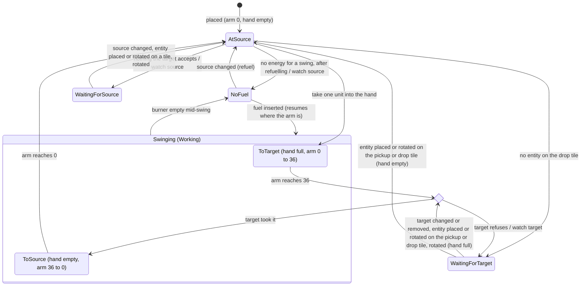

# Architecture

## Overview

```
┌──────────────── Main thread ───────────────┐      ┌────────── Sim Worker ──────────┐
│ Input ──► Command queue ──postMessage──────┼─────►│ fixed step, 60 ticks/s          │
│                                            │      │ World (TypedArray / SoA)        │
│ Renderer (PixiJS v8) ◄── Snapshot ◄────────┼──────│ emits a render snapshot per tick│
│ UI panels (DOM)                            │      │ save serialization              │
└────────────────────────────────────────────┘      └─────────────────────────────────┘
```

- **Simulation and rendering are fully separate.** The simulation knows nothing about pixels, and the renderer never changes state.
- Every player action becomes a **Command** (`Place`, `Remove`, `Rotate`, `SetRecipe`, `Craft`, `Move`, …) tagged with the tick it applies on. This is what makes determinism, replays, and future multiplayer possible.

## Stack

| Layer | Choice | Why |
|---|---|---|
| Language | TypeScript (strict) | Fast iteration; hot paths can move to Rust→WASM later |
| Build | Vite | Fast, supports Workers natively |
| Rendering | PixiJS v8 | Best 2D sprite batching, WebGPU and WebGL backends |
| UI | Plain DOM, or Preact if it grows | Panels, inventory, and tech tree are DOM |
| Tests | Vitest (unit and determinism) + Playwright (E2E and screenshots) | |
| Saves | IndexedDB + binary format | |
| Hosting | GitHub Pages on a public deploy repo | Static site; see README |

## Simulation core

### Time
- A fixed 60 ticks/s, independent of frame rate. The Worker drives ticks from an accumulator; if it falls behind it catches up at most N ticks and drops the rest (single-player only).
- All speeds and progress are **integers** (for example, progress in units of 1/65536 and belt positions in units of 1/256 tile). **No floating-point value may end up in simulation state.** This keeps runs identical across browsers.
- Randomness comes from a seeded PRNG (xoshiro128**) that is only used inside the simulation.

### World and chunks
- The map is stored in 32×32 chunks: terrain tiles (`Uint8Array`), resources and their amounts (`Uint32Array`), and trees (`Uint8Array`, 1 where a tree stands).
- Chunks are generated lazily from noise whose output is integerized.
- **Trees** (`src/sim/world/trees.ts`, numbers in `src/data/trees.ts`): forest noise (2 octaves, lattice about every 51 tiles) sets a density of up to 550 trees per 1 000 tiles, and a per-tile hash decides each tile. Trees only grow on grass without a resource, never within 48 tiles of the origin, and fade in (linearly in squared distance) up to 80 tiles, so the starting area stays open. `World.treeAt`/`removeTree`; felling one marks its chunk modified like mining does, so the world hash covers trees exactly like resources (only modified chunks, which also keeps felled trees from growing back when unmodified chunks are dropped). Players walk through trees.
- Spatial index: a list of entity ids per chunk, plus a per-tile occupancy table for placement collision.

### Entity storage
- Data-oriented: one struct-of-arrays table per entity type, with an `id → index` sparse set.
- Example: `Assembler { recipe: Uint16, progress: Int32, inputs: Uint16[k], output: Uint16, energy: Int32, state: Uint8 }`.
- No generic ECS library. Like Factorio, each system is specialized and its hot loop only walks compact arrays.
- Implemented in `src/sim/entities/` (`Entities` in `entities.ts` ties the pieces together):
  - **Ids**: uint32s handed out in increasing order from 1 and never reused, so an id held by another entity can't come to mean a different one; 0 is "no entity".
  - **Generic table** (`store.ts`): type, top-left tile, and direction (N/E/S/W, `direction.ts`) of every entity, in the row order of a `SparseSet` (`sparseSet.ts`; removal moves the last row into the hole).
  - **Per-type tables** implement `EntityTypeTable` (`table.ts`) and are registered in `createEntityTables` (`registry.ts`). They get hooks when an entity of their type is placed, rotated or removed (belts relink their lines there), report its contents (refunded on removal, which is refused if they don't fit), can react to any entity being placed, rotated or removed (`entityPlaced`/`entityRotated`/`entityRemoved`, e.g. inserters finding their source and target), and are hashed in type id order.
  - **Occupancy** (`occupancy.ts`): per 32×32 chunk, the entity covering each tile and the entities whose origin lies in the chunk (to collect the entities around the viewport).
  - **Wake subscriptions** (`wake.ts`): an entity can subscribe to another; `Entities.notify(target)` hands each subscriber to its table's `wake` hook. Removing an entity wakes its subscribers. A new subscription calls the target table's `watched` hook. See "Machine sleep".
  - **Item hooks** (`slots`, `accepts`, `insertable`, `insert`, `take`, `outputSlot` on `EntityTypeTable`, forwarded by `Entities`): the one way items move in and out of entities, for the GUI commands, drill output and inserters. `insert` routes items itself (a furnace puts ores into its input and fuel into its fuel slot, a belt puts them on the middle of its tile); every change calls `notify`. `accepts` says whether an entity takes an item at all, however full it is (a chest or belt anything, a furnace ores and fuel, a drill or inserter fuel), and `outputSlot` names the slot an inserter picks up from (a chest's first non-empty slot, a furnace's output, a drill's held unit), optionally only among slots holding an item a filter accepts.
- Per-type tables so far:
  - **Wooden chest** (`chest.ts`): 16 slots per chest in two flat `Uint16Array`s; no per-tick work.
  - **Stone furnace** (`furnace.ts`): input slot, burner, output slot (at most 100 units), the recipe in progress and its progress in ticks, and a `MachineState` (`machine.ts`: `Working | NoInput | NoFuel | OutputFull`). The recipe follows from the input item (the smelting recipe in `src/data/recipes.ts` that takes it). Each tick a furnace without a recipe in progress needs a full set of ingredients and room for the result, then burns its energy and only then takes the ingredients; after `ticks` working ticks the result lands in the output. A furnace that ends a tick not `Working` leaves the furnace system's active list and rejoins it when its slots change.
  - **Burner mining drill** (`drill.ts`): a burner, mining progress in ticks, a round-robin cursor over its 2×2 tiles, one held output unit, and a `MachineState` (`Working | NoFuel | OutputFull | Depleted`). Each tick a drill holding a unit first tries to drop it (`OutputFull` while it can't); before starting a unit it needs a resource left under it (`Depleted` otherwise, for good); then it burns 2 500 J (`NoFuel`), and every `miningTicks` (240) working ticks it takes one unit out of the world (`World.mine`) from the next covered tile that still has one (row-major, starting after the tile mined last) and drops it. **Output hook**: the unit goes through `entities.insert` into whatever entity covers the drop tile, the tile in front of the left half of the front edge (`drillDropTile`: north `(x, y-1)`, east `(x+2, y)`, south `(x+1, y+2)`, west `(x-1, y+1)`), so chests store it, furnaces smelt ores and burn coal, and belts put it on the middle of their tile (right lane first, see "Belts: transport lines"). With nothing there or no room it holds the unit. Mined coal never fuels the drill itself. A drill that isn't `Working` leaves the active list and is woken by changes to its own slots, by its drop-tile entity changing or going away (an `OutputFull` drill subscribes to it until the unit drops), by an entity being placed on its drop tile (`entityPlaced`), and by rotation.
  - **Transport belt** (`src/sim/belts/belts.ts`): line id, index in the line and drawn shape per belt; the lines and their lanes live in the same table. See "Belts: transport lines".
  - **Burner inserter** (`inserter.ts`): a burner, the item in the hand, the arm position in ticks, and the state (`WaitingForSource | WaitingForTarget | Swinging | NoFuel`, stored as `MachineState` values with `Swinging` = `Working`). It picks up from the tile behind it and drops onto the tile in front of it; see "Burner inserter".
  - **Power grid** (`src/sim/power/grid.ts`): the table of the small electric pole, holding the poles, their wires and networks, which network each electric entity belongs to, and the power solver. See "Power".
  - **Burner** (`burner.ts`): the fuel component of every burner entity: one fuel slot and an energy buffer in integer joules. `consume(row, joules)` burns the next fuel unit when the buffer runs short and keeps any remainder, so one coal (4 MJ) runs a 1 500 J/tick furnace for exactly 2 666 ticks with 1 000 J carried over to the next unit. Fuel values are in `src/data/items.ts`, energy use per entity in `src/data/entities.ts`.
- Prototypes (size, rotatable, placing item, placeholder color, energy source and use, slots, a drill's ticks per unit) are in `src/data/entities.ts`; footprints swap width and height when facing east or west. The M2 power entities (small electric pole, boiler, steam engine, electric mining drill, electric inserter) are prototype stubs there with the shared design numbers (wire reach, supply area, max output, electric energy use and idle drain, mining area, swing ticks, and `SAT_ONE`); the small electric pole has its table in `src/sim/power/` (see "Power"), the others are plain placeholders until a table gives them behavior.
- **Building** (`build.ts`, `placement.ts`): `Place {item, x, y, dir}` takes one item and needs the whole footprint inside the map, on buildable terrain without trees, free of entities and of every player's collision box, and its center within build reach (10 tiles, an exact integer comparison of squared distances). `Remove {x, y}` and `Rotate {x, y}` act on the entity covering that tile and need reach too. Commands that don't apply are ignored without touching state. The renderer colors the ghost preview with the same `checkPlacement`, fed from its snapshot data. Players walk through entities for now.
- **Entity GUI** (`transfer.ts`): `Insert {entity, item, count}` moves items from the player's inventory into an entity (wherever `insert` routes them) and `Take {entity, slot, count}` moves a slot's contents back, as many as fit. Entities are named by id (ids are never reused, so a stale id can't hit another entity) and must be within build reach; transfers that don't apply are ignored.
- A new game gives every player the starting kit from `src/data/start.ts`.

### Update order (per tick)
1. Apply this tick's Commands
2. Power: compute the satisfaction of each network and tell its producers what to deliver
3. Mining drills
4. Belts (transport lines)
5. Inserters
6. Furnaces, assemblers, labs
7. Players: movement, hand-mining, hand-crafting
8. Emit the render snapshot and events

The order is fixed and covered by tests.

### Belts: transport lines
This is Factorio's core optimization (Friday Facts #176), and it has to be there from day one. Implemented in `src/sim/belts/`:

- Connected belts merge into one **transport line** (`line.ts`): belt F continues belt B when B points into F and either sits right behind F facing the same way, or is the only belt pointing into one of F's sides while nothing feeds F from behind (F is then a **curve**). Each line has a left and a right lane that move independently. A closed loop is one line cut at its belt with the smallest id; its end feeds its own start.
- Positions are distances from the line's end in subtiles; the belt at index `k` of a line spans `[256k, 256k + 256)`. Curves count as a full tile on both lanes.
- A lane (`lane.ts`) stores the **gaps between items**, not each item's absolute position: the distance from the end to the first item, then from each item to the next (at least `BELT_ITEM_SPACING` = 64, a quarter tile). Gaps and items are ring buffers, so items leave the front and join the back in O(1).
- Each tick (speed 8 subtiles/tick from the belt prototype) only the first movable gap shrinks: `gap[0]` while the first item hasn't reached the end, otherwise the first gap behind the packed run of items behind it. The run length is cached and only grows while items close up, so moving a whole lane costs O(1) amortized. That gives exactly 7.5 items/s per lane and 15 per belt.
- **Line end**: items stop at the end of a line, unless it hands them on: a loop's end feeds its own start; a belt pointing into the side of another belt **side-loads** it, putting the items of both its lanes onto the middle of that belt's near lane (the lanes take turns when both are waiting). Belts facing each other don't connect.
- **API** for drills and inserters (`BeltTable`): `insertAt(line, lane, pos, item)` (false when there is no room; `pos` may be anything from 0 to `line.length`), `takeAt(line, lane, from, to)` and `peekAt` (the item closest to the end in that range), `peekEnd(line, lane)`, `laneAwake`, plus `beltLine`/`beltOffset`/`beltEnd` to find a belt's stretch of its line: `[256k, 256k + 255]`, except that the belt at the line's start (the highest index) also owns everything at or past its start edge, i.e. an item at `pos == line.length` (where a loop hands items on to its own start) or pushed back past the start by a rebuild. That is also the belt the renderer draws such items on. Inserting or taking in the middle of a lane walks and shifts it locally. The generic `insert` hook (a drill's output, a hand's `Insert`) puts one unit on the right lane and one on the left lane at the middle of the belt, as far as they have room.
- **Rebuilds**: placing, rotating or removing a belt can only change links within two tiles of it, so the lines through belts there are taken apart, keeping every item's belt, lane and position on the belt, and rebuilt; every other line keeps its id and items. Where two lines join, items closer than the spacing are pushed back towards the line's start (past it if need be; they move on once there is room). Removing a belt refunds the items on it, or is refused if they don't fit.
- **Sleep**: a lane that neither moved nor handed an item on during its step leaves the active list (empty lanes too). It wakes when items are put on it or taken from it, when the lane it feeds changes, or when its line is rebuilt.
- **Notifications**: each line keeps a list of its belts that something subscribed to (the table's `watched` hook, called on every new subscription). Every tick a lane of the line changes (items move, arrive or leave), the line notifies those of its belts that the change could affect (`entities.notify`): the stretch of the lane that changed must come within `BELT_ITEM_SPACING` of the belt's own stretch (`beltOffset` to `beltEnd`). For a moving lane that stretch runs from the first item that moved (item 0, or the first one behind the packed run, whose position is O(1) to find because the run is packed at exactly the spacing) to where the last item was before the move; for an item put on, taken off, or handed on, it is that item's position (or the range it was taken from). So a drill blocked on a full belt, or an inserter waiting for an item, sleeps while the lanes there sleep or only move elsewhere on the line (behind the last item or ahead of the first one that moves), and is woken while items move near it; lines nobody watches pay nothing. What is left: an inserter whose tile lies between moving items of the same lane (a sparse lane that moves as a whole) is still woken every tick; it then only peeks at its tile (`peekAt`) and goes back to sleep.
- The table hashes every belt row, every line (in id order) with its lanes' gaps and items, and the active list in order.

### Machine sleep
- Entity state (`MachineState` in `src/sim/entities/machine.ts`): `Idle | Working | NoInput | NoFuel | OutputFull | Depleted` (a drill with nothing left to mine) `| WaitingForSource | WaitingForTarget` (inserters), more as machines need them (`NoPower`).
- An entity that isn't Working leaves the active list and waits on the event that would wake it (a chest gets a new item, an output slot is emptied, and so on). Once woken, it rejoins the active list.
- An inserter waiting to pick up only wakes when the items at its source change (for a belt source, when items change near its tile), and one holding an item for a full target only when the target changes.
- Belt lanes sleep the same way, on their own active list (see "Belts: transport lines").
- The subscriptions live in `src/sim/entities/wake.ts` and are part of the state hash; the active lists are each system's own (and hashed with its table). Furnaces need no subscriptions: only changes to their own slots can make them work again. A drill blocked on output subscribes to the entity on its drop tile. An inserter subscribes to the one entity it waits on (see "Burner inserter").

### Burner inserter
Implemented in `src/sim/entities/inserter.ts`, stepped by the inserter system after the belts and before the furnaces.

- **Geometry**: 1×1. An inserter faces the way it drops: it picks up from the tile behind it and drops onto the tile in front of it. Source and target are looked up on the occupancy index at every pickup and drop, never cached, so placing, rotating or removing a neighbour can't leave a stale link; the `entityPlaced`/`entityRotated` hooks only wake the inserters whose pickup or drop tile the entity covers.
- **Sources**: a chest's first slot holding something the target accepts, a furnace's output, a drill's held unit (`outputSlot`), or a belt: the item closest to the end of its left lane, else its right lane, within the belt's own stretch (`takeAt(line, lane, beltOffset, beltEnd)`, so an inserter at a line's start also reaches an item sitting exactly on the start edge). An inserter only picks up items its target `accepts`, so it never ends up holding something the target will never take (a drill target makes it pick coal and leave ore).
- **Targets**: the target's `insert` hook (a chest stores the item; a furnace puts ores into its input and fuel into its fuel slot when the input doesn't take it; a drill or another inserter takes fuel only), or a belt: the middle of its far lane as seen from the inserter (`insertAt(line, farLane, offset + 128)`; the right lane when the inserter is in line with the belt).
- **Timing** (`swingTicks` = 36 in `src/data/entities.ts`): the arm takes 36 ticks from the pickup end to the drop end and 36 back. An inserter whose source and target are always ready picks up on tick 0, drops on tick 36 and picks up again on tick 72: one item per 72 ticks (1.2 s). It burns 1 667 J on every tick its arm moves and nothing while it waits, so an item costs 72 × 1 667 J and one coal runs 2 399 moving ticks (33 items and a bit), with 867 J carried over.
- **Refuelling** (the optional rule from the issue, adopted): at the pickup end, an inserter whose fuel slot is empty first takes one unit of fuel from its source into its own fuel slot, whatever its target, then picks up for its target as usual. This needs no energy (the hand is already at the source), so an unfuelled inserter next to coal starts on its own. After the first unit burns the slot is empty again, so the next pickup takes a second unit: an inserter on a fuel source keeps one unit in reserve. One that runs dry mid-swing stops where it is until it gets fuel.
- **Sleep**: an inserter that ends a tick in any state but `Swinging` leaves the active list, subscribed to at most one entity: its source while `WaitingForSource` (or `NoFuel` with an empty hand at the pickup end, to refuel from it), its target while it holds an item the target won't take yet. Nothing at all while `WaitingForTarget` with no entity on the drop tile (placing one wakes it) or `NoFuel` mid-swing (fuel wakes it). Waiting costs nothing per tick.
- The table hashes its rows (hand, arm, state, burner) and its active list in order.

The state machine as a statechart. `Swinging` is the only state on the active list; every other state sleeps until one of the events on its outgoing transitions. The two choice points are evaluated on the tick the arm is at that end (and again on every wake-up).



| State | On the active list | Subscribed to | Leaves on |
|---|---|---|---|
| `Swinging` | yes | nothing | the arm arriving at either end (the choice points), running out of fuel |
| `WaitingForSource` | no | source | the source changing or being removed; an entity placed or rotated on the pickup or drop tile; the inserter rotated |
| `WaitingForTarget` | no | target (nothing if there is none) | the target changing or being removed; an entity placed or rotated on the pickup or drop tile; the hand emptied through the GUI; the inserter rotated |
| `NoFuel` | no | source (at the pickup end with an empty hand), else nothing | fuel inserted; the source changing (to refuel from it) |

A wake-up only puts the inserter back on the active list; its next tick runs from the top, so the state it ends up in depends only on the world, never on why it woke.

### Power
Implemented in `src/sim/power/`; the shared numbers (`SAT_ONE`, a pole's wire reach and supply area, energy use and output) are on the prototypes and constants in `src/data/entities.ts`. Energy is in integer joules per tick.

- **Poles** (`grid.ts`, `geometry.ts`): a small electric pole is 1×1, wires to every pole whose center is within 7 tiles (squared distance ≤ 49, compared in half tiles so poles of other sizes measure from their true centers), and supplies the 5×5 tiles centered on it. Placing a pole finds the poles in reach on the occupancy index; wires are symmetric and each pole lists its neighbours by ascending id. `geometry.ts` is shared with the renderer.
- **Networks** are the connected components of the wire graph, kept with union-find over pole ids (path compression, union by size); the root holds the network's id (from a counter, never reused). Placing a pole unions it with each neighbour; merged networks keep the lowest id. Removing a pole rebuilds only its own network: a breadth-first walk from each of its neighbours (ascending ids) finds the pieces left; the first keeps the id, the others get new ones, and each gets a flat union-find tree. A lone pole's network goes with it.
- **Membership**: a type whose table implements `powerDemand` (consumer) or `powerMaxOutput` (producer) is electric. Each electric entity is tied to the lowest-id pole whose supply area covers any of its tiles and belongs to that pole's network (D21). It is re-tied only when it is placed or rotated, or a pole is placed (it takes the new pole if it had none) or removed (if it was tied to it) nearby; merges and splits only refresh the cached network ids.
- **Solver** (`solver.ts`, run as the power system before every consumer): per network, sum the consumers' `powerDemand` and the producers' `powerMaxOutput`; satisfaction `s = min(1, supply / demand)` in units of 1/65536 (`SAT_ONE`), rounded down, 0 with demand and no supply, 1 with supply and no demand; the load `min(supply, demand)` is split among the producers in proportion to their maximum output with cumulative rounding, so the shares add up to it exactly, and each producer gets `powerDraw(id, joules)` (0 when not connected). Consumers read `PowerGrid.satisfaction(id)` when their own system runs, work at speed `s` and use `floor(demand × s / SAT_ONE)` (`poweredEnergy`), so up to 1 J per consumer per tick is lost to rounding (D22). Generators burn fuel for what they deliver, nothing when nothing is drawn.
- The grid hashes its poles (each with its network and wires), networks (poles, demand, supply, satisfaction, load) and electric entities (pole, network, demand, maximum output, energy delivered) in row order. Union-find parents are not hashed: path compression changes them on reads, without changing any network.
### Players
- `PlayerTable` (`src/sim/player.ts`) holds every player as columns: position in subtiles, movement intent, mining target and progress, and a 40-slot inventory (`src/sim/inventory.ts`, item id and count per slot as `Uint16Array`s; stack sizes come from `src/data/items.ts`).
- Movement: a constant integer speed (38 subtiles/tick, 27 per axis diagonally). The player is a 0.4-tile box that can't overlap a non-walkable tile (water); each axis is resolved separately, so pushing diagonally into a shore slides along it.
- Hand-mining: `MineStart {x, y}` sets a target tile. While the tile's center is within 2.5 tiles of the player (an exact integer comparison of squared distances), one unit is mined every 30 ticks, taken out of the world (`World.mine`) and added to the inventory. A tree tile is felled whole after 30 ticks (`World.removeTree`) for 4 wood. Out of reach, mining pauses with its progress reset and resumes once the player is back; a depleted tile, a tile without a resource or tree, or an inventory with no room for all the next unit gives (all 4 wood for a tree) ends it. `MineStop` cancels.
- Hand-crafting (`src/sim/crafting/`): every player has a queue of up to 32 entries (`CraftingTable`: recipe, crafts left, and an intermediate flag per entry, plus the progress of the front craft), hashed with the rest of the state. `Craft {recipe, count}` queues as many of `count` crafts of a hand recipe as the inventory allows and takes their inputs out of the inventory right away. Inputs the player lacks are auto-queued, before the craft, from their hand recipe when the player has what that needs (`planCraft` in `plan.ts`; recursively, and only for recipes that make exactly one unit, so every unit an intermediate makes is used by its craft). Each tick the front craft advances; a craft takes exactly the recipe's ticks, and its outputs go to the inventory, or wait at the front, blocking the queue, until they fit. Intermediates never reach the inventory. `CancelCraft {index}` removes that entry together with the intermediates queued for it (or, for an intermediate, with the craft it is for) and refunds the inputs of their remaining crafts minus what the remaining intermediates would still have made; it is ignored if the refund doesn't fit. The UI (`src/ui/crafting.ts`) runs the same planner on the snapshot to show craftable counts.
- On the main thread, WASD and the right mouse button become commands only when they change (`src/render/playerInput.ts`); a right-button press that starts on an entity sends `Remove` instead and never turns into mining. Hotbar selection (1–0, or a click on a hotbar slot), the ghost, `R` and left-click placement are in `src/render/buildInput.ts`. The renderer draws players between ticks by gliding from where they are drawn to each new snapshot position (`src/render/playerTrack.ts`), and the camera follows the local player until the user pans.

### Prototypes and data
- Every prototype (item, entity, recipe, technology) is defined in `src/data/*.ts` and compiled at startup into numeric-id tables.
- Recipes (`src/data/recipes.ts`) are `{ id, inputs: [item, count][], outputs: [item, count][], ticks, category: 'hand' | 'smelting' }`. Raw items (`RAW_ITEMS`) are what players mine plus wood, from trees. Hand recipes that make more than one unit (belts, copper cable, poles) are never auto-queued as intermediates, so circuits and poles need their cable crafted first.
- The data is validated, and a test checks that every item can be crafted from raw resources.

## Rendering

- Only chunks in the viewport, plus a one-chunk margin, are rendered. Chunks that leave that window are destroyed together with their textures, so memory stays flat while panning.
- Camera (`src/render/camera.ts`): world position at the screen center plus a zoom clamped to 0.25×–4× (one tile is 32 px at 1×). Middle-mouse drag or arrow keys pan, the wheel zooms towards the cursor. Camera math lives only in the render layer.
- Terrain: each chunk is baked into one texture (`src/render/chunkBake.ts`) and re-baked when it changes. Trees are baked in too, as a placeholder canopy on a trunk over a shaded tile, so felling one re-bakes its chunk. The placeholder art is made of whole-texel blocks, so it is baked at 8 texels per tile and sampled with nearest filtering: crisp at every zoom level, at 1/16 of the memory of 32 px per tile. Bakes are spread over frames (a few per frame).
- Entities: separate Containers per layer (ground → items on belts → buildings → inserters → overlays), with pooled sprites. For now `src/render/entityLayer.ts` draws placeholder blocks in each prototype's color (with a direction marker on rotatable ones, a firebox on furnaces that glows while they are `Working`, a drill head ring on drills that lights up while they are `Working`, a small platform for inserters, and a post with a crossbar for electric poles), redrawn only when the snapshot's entities change, plus the ghost preview above the players.
- Inserter arms (`src/render/inserterLayer.ts`, above the buildings): each frame, an arm from the inserter's center that turns half a circle clockwise from its pickup tile (arm position 0) to its drop tile (36), drawn `swing × (1 − α)` ticks behind the snapshot's arm position (`α` the fraction of a tick since the snapshot arrived), with the held item at its tip.
- Entity GUI (`src/ui/entityPanel.ts`): a left click on a chest, furnace, drill or inserter with nothing to build selected opens a DOM panel with its slots (an inserter's fuel and hand), a furnace's, drill's or inserter's state (a working inserter shows "Swinging"), progress (an inserter's arm position) and fuel, and the player's inventory. Clicks become `Insert`/`Take` commands, both ways moving the whole stack (click, shift-click), half of it (right click) or one item (ctrl-click, middle click); the panel redraws from the snapshot and closes when the entity is gone or out of reach. It replaces the inventory window while open (opening it closes that one, and `E` closes it like `Escape`).
- Controls help (`src/ui/help.ts`): an "H: controls" hint in the bottom-left corner; `H` or a click on it toggles a panel listing every control.
- Power (`src/render/powerLayer.ts`): wires between connected poles, sagging slightly, above the buildings; while a pole ghost is held, every pole's supply area faintly, the ghost's supply area and wire reach, and the wires it would get (with the simulation's own `polesConnect`); with nothing held, the supply area, reach and wires of the pole under the pointer.
- Belts (`src/render/beltLayer.ts`): straight belts are tiling sprites of a placeholder texture that scrolls with the tick; curves are arcs with bars sweeping around them. Items on belts are drawn from the snapshot's per-belt item records along each belt's path (`beltPath.ts`), each `moved × (1 − α)` behind its position, with `α` the fraction of a tick since the snapshot arrived, so motion looks smooth.
- Item icons (`src/render/itemIcons.ts`): placeholder 13×13 pixel art drawn in code, the item's color in a shape per kind (ore chunk, bevelled plate, rounded square) with a one- or two-letter label in a built-in 3×5 pixel font, so it looks the same on every machine. Belts and inserter hands draw them as sprites from one atlas texture, at one texel per world pixel (about 0.4 tile); inventory, hotbar, entity and crafting slots show the same bitmap scaled 2× in the DOM.
- All textures are packed into atlases.
- Zooming out past a threshold switches to a "map mode" of flat colors.

### Worker protocol
- Messages are typed in `src/worker/protocol.ts`. Main → worker: `init {seed}`, `commands [...]`, `setViewport {x, y, w, h}` (tiles), `inspect {entity}` (the entity whose GUI is open, 0 for none). Worker → main: `snapshot`, `stats {tick, tickMs, droppedTicks}`, `error`. Each snapshot carries every player (`encodePlayers`), the inventory and crafting queue of the local player (`encodeInventory`, `encodeCraftQueue`; the main thread is player `LOCAL_PLAYER_ID` = 0), every entity whose origin lies in the chunk window (`encodeEntities`: id, type, top-left tile, direction, machine state), the belts in that window with the items on them (`encodeBelts`: tile, direction, shape, and per item lane, distance from the belt's end edge, and how far it moved on the last tick), the inserters in that window (`encodeInserters`: tile, direction, arm position, held item, and how the arm moved on the last tick), the electric poles in that window with their networks, the wires between them and their networks' supply, demand and satisfaction (`encodePower`), and the inspected entity's GUI data (`encodeEntityDetail`: reachability, state, recipe, progress, burner energy, slots).
- The main thread sends commands without a tick; the worker stamps each one with the next tick it will run, so a command can never land on a tick that already ran.
- The worker loop (`src/worker/loop.ts`) accumulates wall time and runs whole 60 Hz ticks, at most 5 per wake-up; any further backlog is dropped.
- **One snapshot per wake-up, not per tick.** When the worker catches up several ticks at once, only the newest state is useful for rendering; the snapshot carries `ticksRun` so the renderer can tell. At full speed a wake-up runs one tick, so this is usually one snapshot per tick.
- `stats` go out every 30 ticks; the main thread derives UPS from them and shows it in the debug overlay.
- **Chunk streaming.** Each snapshot carries a `chunkWindow` (the chunks of the last viewport plus a one-chunk margin) and a `chunks` buffer (terrain, resources, trees and amounts per chunk) with the chunks in that window the main thread doesn't have yet or that changed since they were sent (`encodeChunks` in `src/sim/snapshot.ts`). The main thread caches chunks and drops those outside each snapshot's `chunkWindow`; the worker (`src/worker/chunkStream.ts`) mirrors that cache, so a chunk that comes back into view is sent again. Snapshots are applied in order, so both sides always agree. At most 16 chunks go into one snapshot, nearest to the viewport center first. Unmodified chunks that leave the window are also released from the worker's `World`, since they can be regenerated from the seed.

### Snapshot transfer
- v1: after each wake-up that ran a tick, the Worker writes the state visible in the viewport into a transferable `ArrayBuffer` and sends it to the main thread.
- Later: a double-buffered SharedArrayBuffer. This needs COOP/COEP headers, which GitHub Pages can't set, so it would need a service-worker workaround or another host.

## Saves and blueprints

- A save holds the seed, every modified chunk, the entity tables, and global state, serialized to binary with a version number and migration functions.
- A blueprint is a list of entities in relative coordinates, turned into JSON, compressed, and base64-encoded into a copyable string.

## Determinism and testing

- **Determinism test:** the same seed and the same Command sequence, run for N ticks, must produce the same state hash. CI runs it in both Node and Chromium and compares the hashes.
  - The scenario lives in `src/sim/scenarios/determinism.ts`; the expected hash lives only in `tests/sim/determinism.expected.ts`, and both `tests/sim/determinism.test.ts` (Node) and `tests/e2e/determinism.spec.ts` (Chromium) compare against it.
  - Chromium reaches the scenario through `window.__beltworks` (`src/testHook.ts`), which exists only in dev builds and `vite build --mode test` (what Playwright serves). Production builds don't contain it.
  - The hash covers the tick counter, seed, PRNG state, every entity table (players, crafting queues, the generic entity table, occupancy, the per-type tables including belt lines and lanes and the power grid, wake subscriptions), and the world (through its `hashInto` hook: the modified chunks' terrain, resources, amounts and trees). Commands queued for future ticks are input, not state, and are not hashed.
- **System unit tests:** belt throughput (exact items per second for each tier, `tests/sim/belts.test.ts`, also end to end with more drills than a belt carries feeding it), inserter swing timing and energy (`tests/sim/inserter.test.ts`), assembler output rate.
- **E2E tests** (Playwright, `tests/e2e/`) drive the deployed build (plus the test hook) with real keyboard and mouse input. `chain.spec.ts` is the M1 acceptance test: from a new game it walks to the iron patch, builds drill → belts → inserter → furnace → inserter → chest, fuels everything through the entity windows, and waits until the chest fills with plates. The hook is only used to read state; every wait polls it with generous timeouts, since CI's Chromium renders in software at a low frame rate.
- **Replays:** Command logs are recorded and can be replayed to debug.
- **Benchmarks:** fixed scenes (1k / 10k / 50k entities) measure mean and P99 tick time, and CI reports regressions. The runner lives in `tools/bench/` and builds every scene through Commands only; the 1k scene exists so far (see docs/TOOLING.md, "Benchmarks").

## Multiplayer (v2+, reserved)

- Deterministic lockstep: the server only relays Commands, every client simulates on its own, and state hashes are compared regularly to catch desyncs.
- Already in place: Commands carry a player id and a tick, and the simulation has no local clock and no floating-point state.

## Performance targets

| Scene | Target tick time (16.6 ms budget) |
|---|---|
| 1k entities | < 1 ms |
| 10k entities + 50k items on belts | < 8 ms |
| 50k entities | < 16 ms (if missed, evaluate moving to WASM) |

## Directory layout

```
src/
  sim/            # pure simulation: no DOM, runs in Node
    world/        # chunks, terrain generation, spatial index
    entities/     # SoA tables and systems for each entity type
    belts/        # transport lines
    power/
    scenarios/    # scripted runs shared by tests (determinism)
    commands.ts   # Command union, validation, ordered queue
    state.ts      # SimState (including the World), state hash
    tick.ts       # Sim: enqueue/step/hash, fixed system order
    fixed.ts      # fixed-point helpers (1/256 tile, 1/65536 progress)
    snapshot.ts   # render snapshot encoding
    hash.ts
    rng.ts
  data/           # prototypes (items, recipes, technologies), fuel values, energy use
  worker/         # Worker entry point and message protocol
  render/         # PixiJS rendering
  ui/             # DOM panels
  main.ts
assets/           # source art
tools/            # atlas packing, benchmark scripts
tests/
  sim/            # Vitest
  e2e/            # Playwright
```
