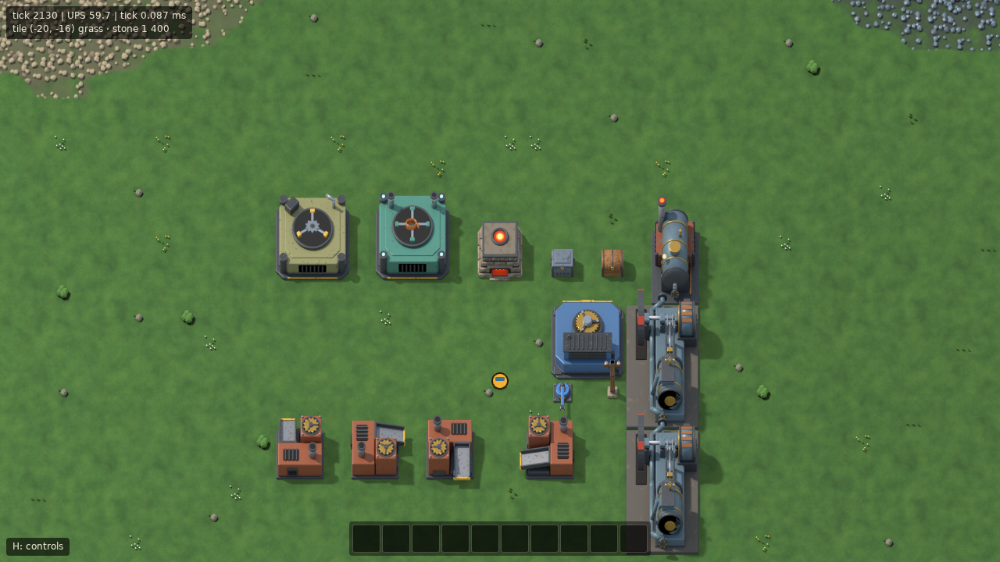
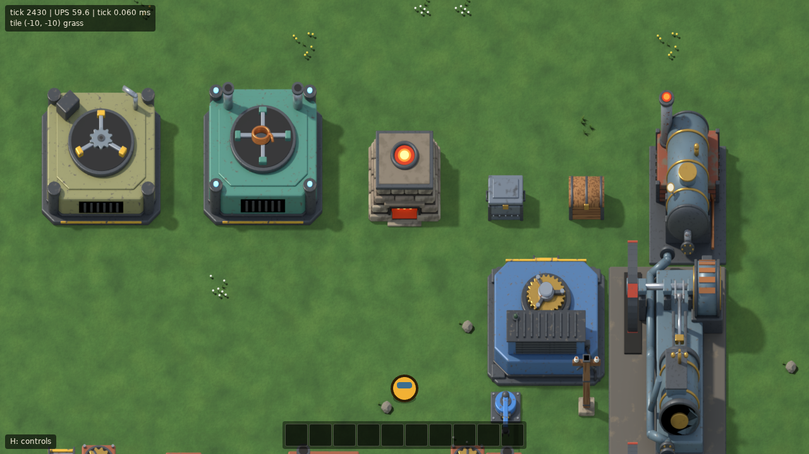
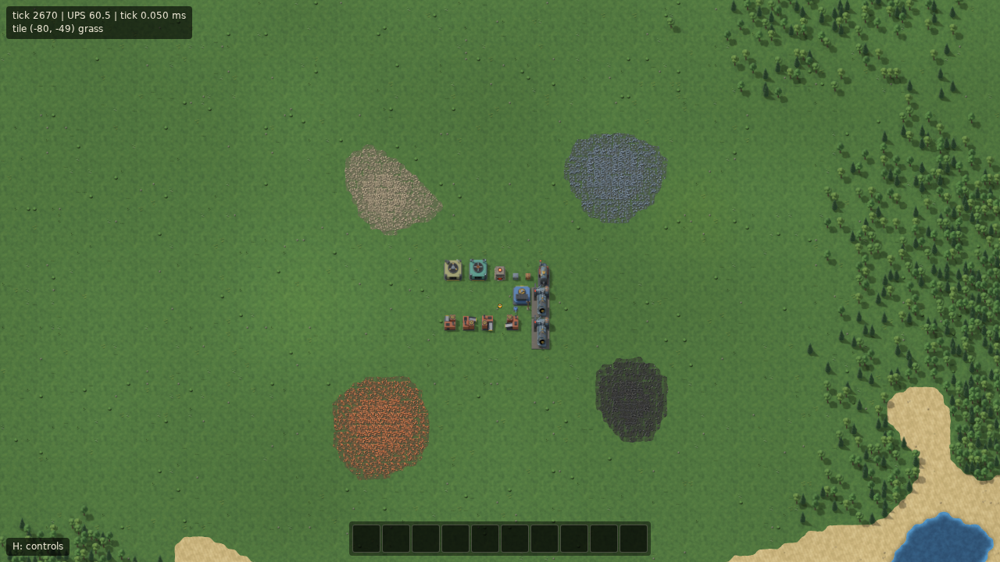
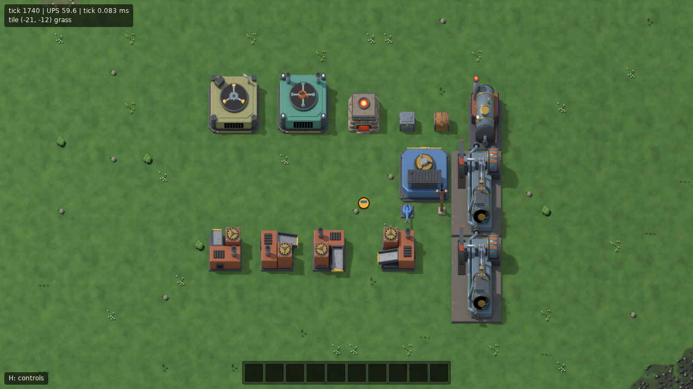
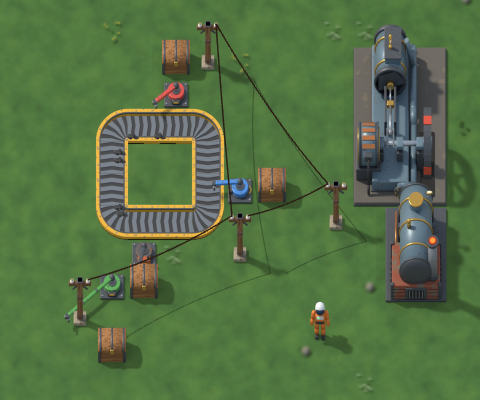
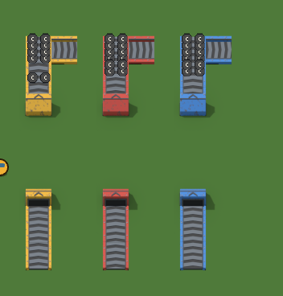
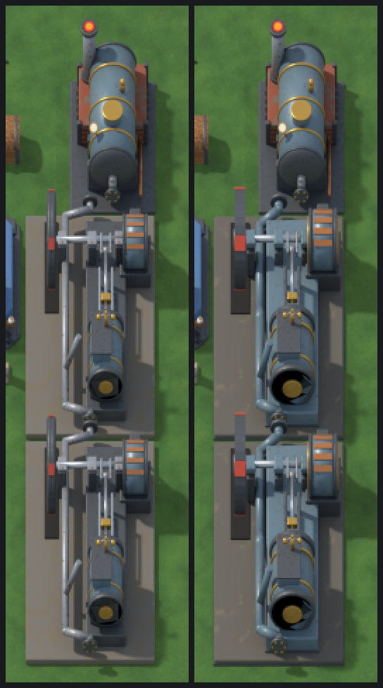
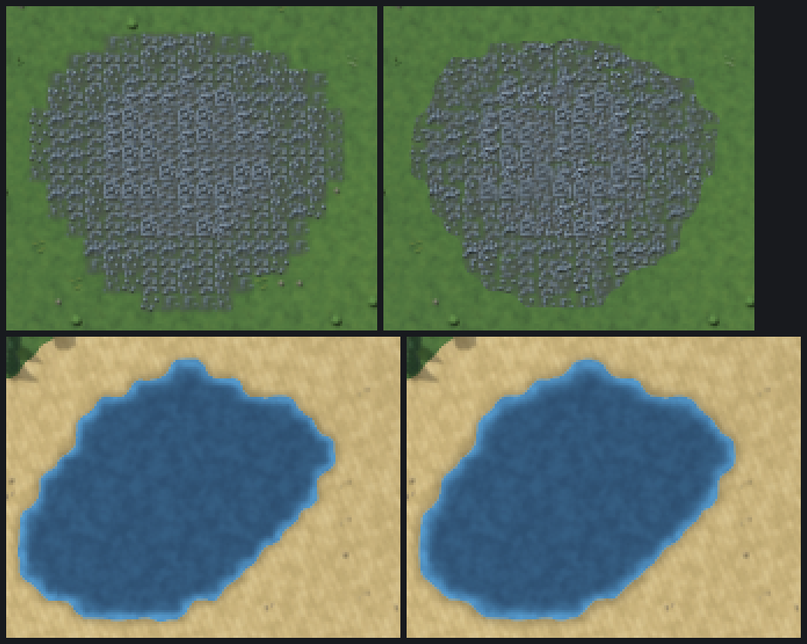
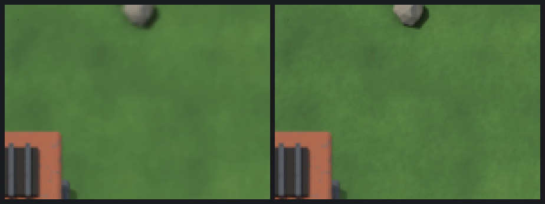
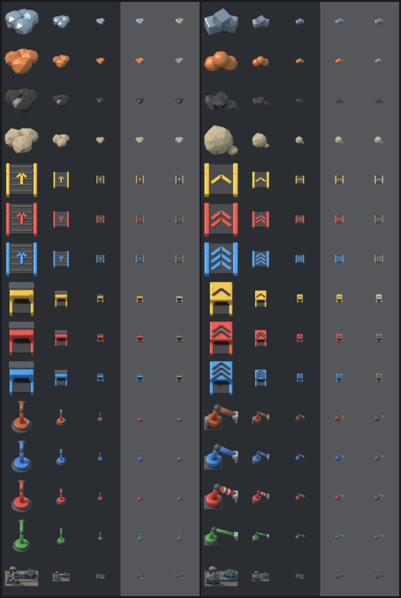

# Art

Beltworks' entities, terrain and item icons are pre-rendered 3D, the way Factorio does it: every model is a procedural Blender script, rendered headless to PNG frames and packed into texture atlases that the game loads (docs/DECISIONS.md, D34, D40, D41, D43). Anything without a model keeps its placeholder look, so art lands one model at a time.











## Style guide

- **Camera**: orthographic, looking down at 50° from the south. The image is stretched vertically by 1 / sin 50° (through the render's pixel aspect ratio), so the ground footprint of a model is square and lines up with the game's grid; 1 tile of height shows as 0.84 tile on screen. Never change this per model: every sprite in the game has to agree.
- **Light**: one warm key light (a sun, 4° wide for slightly soft edges) from the upper left, a little north of west and 50° up, plus a soft blue-gray sky. Tops are brightest, west faces next, south (front) faces are lit mostly by the sky: three clear tones that keep shapes readable at 1×. An invisible ground plane bounces a little light onto the lower parts.
- **Shadows** are a separate pass: the model, unseen by the camera, casts onto a shadow catcher. The game draws every shadow at full strength into one layer below all buildings and fades the layer as a whole (`SHADOW_ALPHA`, 0.5), so overlapping shadows don't get darker. Shadow texels under the opaque body are dropped by the packer.
- **Resolution**: 64 texels per tile. The game draws a tile as 32 world pixels, so sprites show at half scale at 1× zoom and texel for texel at 2×. Frames are trimmed on even texels, so at 1× they land on whole pixels. Atlases have mipmaps for zoomed-out views.
- **Silhouette first, detail second.** At 1× a 1×1 entity is 32 px wide: what reads is the outline, the big color areas and the light/shade split. Check every model at 1× in the game (or in the preview's 1× sheet) before adding detail. Details a few texels wide (rivets, slats) only show at 2×.
- **Materials**: slightly worn industrial surfaces from `bwart/materials.py`, all procedural (noise patterns over object coordinates, no image textures): painted steel with worn patches showing darker metal, dark iron, rusted iron, brass, rough stone, planked wood. Keep the wear subtle: strong blotches turn into camouflage at 1×.
- **Palette**: each entity family has one dominant color, so it is recognizable from its color alone. Burner tier: rust-red housing, brass gears, dark iron. Stone: warm gray-beige. Assembling machines: olive (tier 1), teal (tier 2). Steam power (boiler, steam engine): gunmetal blue-gray with brass fittings, on brick and stone. Electric machines (electric mining drill): steel blue with a hazard-yellow trim. Logistics tiers will be yellow / red / blue (the colors of transport belts and fast/express ones). Fire and lamps are emissive; keep their strength near 1 so their color survives instead of clipping to flat white or yellow.
- **Original designs only**: nothing modeled after Factorio's (or anyone else's) art, no downloaded models or textures.

## Pipeline

```
art/blender/
  render.py               driver: renders every model × direction × layer × frame
  bwart/scene.py          camera, lights, world, render settings, projection constants
  bwart/materials.py      the material palette
  bwart/shapes.py         geometry helpers (box, cylinder, gear, pipe, ...), sprite layers
  bwart/assembler.py      shared builder of the assembling machine family
  bwart/belts.py          belt paths, the moving surface, side frames, underground hoods
  bwart/terrain.py        seamless ground materials, rocks, foliage, ground stains
  models/<model>.py       one procedural model per entity (or several: MODELS)
  models/belts.py         every belt tier, shape and underground (MODELS: several per module)
  models/inserters.py     the four inserters, base and arm angles
  models/ground.py        the terrain: ground textures (and ore.py, trees.py, decor.py)
  models/icons.py         every item's icon
tools/art/
  art.js                  `npm run art`: runs Blender, then packs
  pack.js                 trims, deduplicates and packs frames into atlases + JSON
  png.js                  dependency-free PNG reader/writer
  preview.js              contact sheets for looking at models and icons
public/sprites/           the committed atlases, one set of files per atlas:
  entities.json, -0.png   the first entities (furnace, burner drill, chests, assemblers)
  logistics.json, -0.png  belts, inserters, poles (D40)
  power.json, -0.png      boiler, steam engine, electric mining drill
  terrain.json, -0.png    ore decals, trees, decor; terrain-<ground>.png: the ground textures
  icons.json, -0.png      item icons
art/build/                renders and previews (scratch, not committed)
```

```sh
npm run art                        # render every model, rebuild the atlas from scratch
npm run art -- stone-furnace       # re-render one model, keep the others from the atlases
npm run art -- belts               # every model a module defines (models/belts.py)
npm run art -- tree                # every variant of a model (tree-0 .. tree-5)
npm run art -- terrain             # every model of one atlas
npm run art -- --preview           # also write art/build/preview-2x.png and preview-1x.png
npm run art -- --samples 32 NAME   # quicker, noisier renders while iterating
npm run art -- --pack-only         # re-pack the renders in art/build/
```

**Blender**: 4.2 LTS, run headless (`-b --factory-startup -P art/blender/render.py -- ...`). `npm run art` takes it from the `BLENDER` environment variable (a Blender binary or a wrapper script); without it, `~/tools/blender.sh` (the dev machine's wrapper around a portable build, which sets `LD_LIBRARY_PATH` for libraries extracted without root) if it exists, else `blender` on the `PATH`. CI never runs Blender: the atlases are committed, and re-rendering is a manual step whenever a model changes.

**Render settings** (`bwart/scene.py`): Cycles on the CPU, 96 samples (no adaptive sampling), seed 0, OpenImageDenoise on the CPU (it has no random input; smooth surfaces also compress far better than sampling noise), Standard view transform, no dithering, transparent film. A full `npm run art` takes about 15 minutes on 4 cores (10 of them for the logistics models: 32 arm angles per inserter, 16 surface frames per belt shape and direction).

**Reproducibility**: the packer is byte-exact (same frames in, same PNG and JSON out), and a re-render gives the same pixels except for a handful of channels per frame that differ by 1/255 (Cycles' multithreaded float accumulation; also without the denoiser). So `npm run art` reproduces the committed atlas near-identically: within ±1 per channel on a few dozen texels per model, invisible, but not byte for byte.

**Sprite layers.** A model can be split into layers, drawn in order: `body` first (always shown), then overlays such as a furnace's fire or a machine's rotor. Each layer has its own frames, a frame rate, when it shows (`always`, or only while `working` / `idle`) and when it animates (`working`: on a clock per entity that runs while it works, at half speed on low power, so a machine that stops freezes in place; `always`: on the frame clock, e.g. flickering fire; `never`). The driver renders each layer on its own: the layers drawn before it are holdouts (they hide it where they stand in front, without showing themselves), the layers after it are left out. So only the moving part is rendered per frame, not the whole machine, which keeps the atlas small. Inserter arms (as angles) and the belt surface are layers too.

**Atlases.** A model goes into the atlas its `MODEL` names (`'atlas': 'logistics'`; default `entities`), one `<atlas>.json` with its sheets each; the game loads the entity atlases (`SPRITE_ATLASES` in `src/render/sprites.ts`: `entities`, `logistics`, `power`) and merges their models; `terrain` and `icons` have their own loaders (`terrainArt.ts`, `itemIcons.ts`). Families that change together share an atlas, so re-rendering one doesn't touch the others' files. A partial run only rewrites the atlases it rendered models for.

**Several models per module.** A module may define `MODELS`, a list of model dicts each with its own `build` (the belts: 3 surfaces, 3 shapes × 3 tiers of side frames, 2 hoods × 3 tiers). Other optional keys: `'shadow': False` on a model (no shadow pass; the packer stores an empty frame), `'extent': r` (render at least `r` tiles around the center, for parts that reach out of the footprint like a long arm), and on a layer `'shared': True` (rendered for the first direction only and used for all of them: frames that are angles in the world, not relative to the entity) and `'shadow': False` (left out of the shadow pass, for parts that move on their own). Objects go on the model's first layer unless a `layer` block says otherwise.

**Variants and kinds.** `'variants': N` renders a model N times as `<name>-0` .. `<name>-<N-1>`, with `ctx.variant` telling `build` which one (trees, ore decals, decor). `'shadow': 'catch'` makes the body pass catch the model's own shadow, with no shadow frame (flat ground decals). `'kind': 'ground'` renders a seamless ground texture and `'kind': 'icon'` an item icon (see "Terrain" and "Item icons" below). Names on the command line pick a model, every variant of it, every model of a module or of an atlas.

**Directions**: models are built facing north; the driver turns the model's root for east, south and west (`directions: 4`), so the light stays put and each direction is lit correctly.

**Points**: a model can name points in model space (`points: {'icon': (x, y, z)}`); the manifest and the atlas give them in texels from the footprint's center, per direction. The assembler layer draws a machine's product icon at its `icon` point (over the rotor's hub), the entity layer an inserter's held item at its `hand`, and the power layer hangs wires from a pole's `wire-west` / `wire-east`.

### Belts



Every tier (yellow, red, blue) in `models/belts.py`, packed into the `logistics` atlas. A belt is three sprites, drawn by the belt layer (`src/render/beltLayer.ts`, `beltSprites.ts`), not the entity layer:

- the **moving surface**, `belt-surface` (`:curve-left`, `:curve-right` for curves): dark rubber with chevron slats pointing the way it moves, 4 slats per tile, the same for every tier. Its 16 frames cover one slat pitch, and the frame shown is how far the belt has moved since tick 0 (`ticks × beltSpeed / 256` tiles, between ticks too), so the slats run at exactly the items' speed: 2 frames a tick on a yellow belt, 4 on a red one, 6 on a blue one (still under half a pitch a tick, so it never looks like running backwards). No shadow: it is flat.
- the **side frames** in the tier color (the belt prototype's own model, with the curve suffixes), over the surface (no shadow: it would fall mostly on the belt, out of sight, and only cost fill rate);
- on an underground belt, the **hood** (`<underground>:entrance` / `:exit`) over its closed half, drawn above the items on belts (`coverContainer`), so items disappear into it. An entrance's mouth faces the incoming belt and its roof slopes down towards the ground; an exit is the mirror image; an arrow on the roof shows the direction either way.

The surface and the side frames stick out a few texels below their tile (their south end faces). The belt layer draws belts north to south (`BeltDrawOrder`), so the next belt of a vertical run covers that face with its own top; drawn the other way round it would show as a dark seam across the run at every tile.

Curves come in at the west (`curve-left`) or east (`curve-right`) edge of a north-facing tile and leave at the north edge, like `BeltShape.CurveFromLeft` / `CurveFromRight`; the paths are the game's (`beltPath.ts`), so items follow the drawn belt. The tier comes from the belt record's entity type, the underground mode from its `mode`; an underground belt's ghost shows the hood of what it would be (an entrance or an exit). Splitters: not yet.

### Inserters

`models/inserters.py`, in the `logistics` atlas: a static `body` (a footplate with a hazard chevron at the drop edge and the turret housing in the family color: blue electric, red fast, green long-handed; the burner inserter is sooty grey iron with its rust-red on a big firebox at the back, with a glowing grate and a smokestack, so at 1× it never reads as a fast one) and an `arm` layer of 32 pre-rendered angles over a full turn (`shared`: the same frames for every direction, no shadow). The entity sprite layer draws inserters sorted in with the buildings, so one behind a tall machine is hidden by it: the base, then the arm sprite nearest to the arm's angle, turned the rest of the way (at most 5.6°) about the model's `pivot` point, so the swing is smooth, then the held item at the `hand` point (frame 0's hand, pointing east: its x is the reach, 0.8 tile or 1.8 for the long-handed inserter, its y the hand's height). The arm frames have no shadow (they turn), so the arm casts a faint one in the game: its sprite again, in black, in the shadow layer, moved down from where the arm shows to the ground under it and on along the light (`placeArmShadow`). The angle is the inserter layer's interpolation of the snapshots (`armAngle`, half a turn clockwise from the pickup tile to the drop tile).

### Poles

`models/small_electric_pole.py`, in the `logistics` atlas: a wooden post on a stone footing with a crossbar and two ceramic insulators, the `wire-west` and `wire-east` points. Wires (`src/render/powerLayer.ts`) hang from the insulator facing the other pole, as a parabola that sags 5% of their span, and cast a faint shadow on the ground (offset by their height along the light, `SHADOW_OFFSET`), drawn with the buildings' shadows. `SHADOW_OFFSET` is the rendered sun's (`SUN_FROM`): a wire's shadow ends exactly where the pole's own shadow puts its insulator, about 1.2 tiles east and half a tile south of the pole for wires 1.5 tiles up.

### Atlas format

`public/sprites/<atlas>.json` (version 1):

```jsonc
{
  "version": 1,
  "tilePx": 64,                          // texels per tile
  "sheets": ["entities-0.png"],          // ≤ 4096² each
  "frames": [[0, 4, 4, 180, 210, 92, 140], ...], // [sheet, x, y, w, h, ax, ay]; (ax, ay): the footprint's center in the frame
  "models": {
    "burner-mining-drill": {
      "footprint": [2, 2],
      "directions": 4,
      "points": {},                      // name → [[x, y] texels from the center] per direction
      "shadow": [12, 13, 14, 15],        // one frame per direction
      "layers": [
        { "name": "body", "fps": 0, "show": "always", "advance": "working", "frames": [[0], [1], [2], [3]] },
        { "name": "head", "fps": 12, "show": "always", "advance": "working", "frames": [[...8 frames], ...] }
      ]
    }
  }
}
```

Two optional keys carry what isn't a sprite: `ground` (`{ "grass": { "file": "terrain-grass.png", "period": 8 }, ... }`, seamless textures, one PNG each since they repeat) and `icons` (`{ "size": 52, "items": { "iron-plate": [sheet, x, y], ... } }`, on a grid of 64-texel cells).

Models are keyed by entity prototype name (`src/data/entities.ts`), with a `:variant` suffix for the belt shapes and underground modes; `belt-surface` belongs to no entity. The runtime (`src/render/sprites.ts`, `entitySprites.ts`) loads the atlas at startup and falls back to the placeholder shapes until it has loaded, if it fails to load, and for every entity without a model. Identical frames are stored once. `tests/render/sprites.test.ts` checks the committed atlas against the prototypes (footprints, directions, layers).

## Adding a model

1. Create `art/blender/models/<entity_name>.py` with a `MODEL` dict and a `build(ctx)` function:

   ```python
   from bwart import materials as m
   from bwart.shapes import box, cylinder, layer

   MODEL = {
       'name': 'small-thing',              # the entity prototype's name
       'footprint': (1, 1),                # tiles, as in src/data/entities.ts
       'height': 0.8,                      # tallest point in tiles (frames the render)
       'directions': 1,                    # 4 for rotatable entities
       'layers': [
           {'name': 'body'},
           {'name': 'spin', 'frames': 8, 'fps': 12},  # animates while working
       ],
   }

   def build(ctx):
       box((0.8, 0.8, 0.5), (0, 0, 0.25), m.paint('thing', 0x8f8f62))
       with layer('spin'):
           cylinder(0.2, 0.1, (0, 0, 0.55), m.dark_iron(), rot=(0, 0, ctx.t('spin') * 3.1416))
   ```

   Build it facing north (+Y), standing on z = 0, footprint centered on the origin, one unit per tile. `ctx.t(layer)` is the animation phase (0..1) of the frame being rendered; make the last frame lead back into the first (turn a symmetric part by exactly one period).
2. `npm run art -- --samples 32 --preview small-thing` while iterating; look at `art/build/preview-1x.png` and `preview-2x.png` (idle and working, every direction, on grass). Then render it at full quality: `npm run art -- small-thing`.
3. Run the game (`npm run dev`) and look at it at 1× and 2× next to the other entities. If the layer needs a game-side rule (e.g. a new point), add it to the renderer.
4. Add the model to the list in `tests/render/sprites.test.ts` (or `logisticsSprites.test.ts` for the `logistics` atlas), and commit the model script with `public/sprites/`.

## Power entities



- **Boiler** (2×3): a riveted steam drum on a brick firebox, the chimney at the rear, the steam outlet on the edge it faces. Its `fire` layer (while it burns) glows through the firebox door, in the side vents and in the chimney's mouth, so it shows from every direction.
- **Steam engine** (3×5): a fat gunmetal-blue cylinder at the front, crosshead and connecting rod, the crankshaft with a wide flywheel on one side and a big generator drum on the other, on a painted frame over a dark stone bed; steam flanges at both ends where boilers and engines connect. At 1× it reads as those three big shapes in the family color: the pipes are painted too and the guides dark, so no thin bright lines cross it. Its `motion` layer is one full turn of the crank in 16 frames. The game runs it at a speed proportional to the engine's output, one turn per second at full power (`EntitySpriteLayer.speedOf`, fed by `GeneratorLayer.speed`), so an engine with no load stands still. The flywheel's tread is a quarter of a tile wide and carries red marks, which show it turning even where it is seen edge-on (facing north or south); the piston and the governor read in every direction.
- **Electric mining drill** (3×3): the gear turret turns while it works (`head`), a green lamp on the motor cabinet lights up (`lights`); the output chute sits over the middle of the front edge, where it drops what it mines.

## Terrain





The ground, ore, trees and decor are rendered too (atlas `terrain`) and baked per chunk on the GPU (`src/render/terrainPlan.ts` decides what goes where, `terrainArt.ts` draws it, `terrainLayer.ts` manages the textures). Until the atlas loads, or if it can't, the terrain keeps its flat placeholder colors (baked on the CPU, `chunkBake.ts`).

- **Ground textures** (`models/ground.py`): grass, sand, water and rock, each a seamless texture of 8 × 8 tiles (512² texels) seen through the game camera and lit like the sprites. They repeat exactly because their noise is sampled on a flat torus in 4D (`bwart/terrain.py`); they are rendered without the denoiser (it can't see across the edges) and with no feature larger than about a tile, since anything bigger would show the 8-tile period as a plaid when zoomed out.
- **Blending** (the ground shader in `terrainArt.ts`): a splat texture per chunk holds each tile's terrain type (36² texels: the chunk and a two-tile border from its neighbours), sampled halfway between bilinear (which keeps lone tiles) and a cubic B-spline (four bilinear taps, reading up to two tiles out, hence the border): smooth enough that a diagonal run of tiles turns into a line instead of a staircase, also at 0.25×. Value noise (a broad field a few tiles across, so edges meander, plus a fine one about a tile across) pushes the four weights around and the strongest wins, with a narrow soft band, so the edge between two terrain types wanders around the tile edges instead of following the grid; tile centers always keep their own type. Sand near water darkens (wet), shallow water lightens, a faint foam line marks the shore, and slow noise over several chunks shifts the grass between greener and yellower and everything between lighter and darker, so neither the 8-tile period nor chunk edges show. The noise comes from a small random lattice texture (one smoothstepped bilinear tap gives four fields), indexed by chunk so neighbours continue each other exactly.
- **Variants**: besides the 64 different tiles in each texture's period and the slow variation, decor is sprinkled on a hash of the tile (6 kinds on grass: tufts, flowers, a bush, a mossy stone; pebbles, dry grass and a stone on sand; boulders and rubble on rock), only well inside an area of one terrain and never on ore or trees.
- **Ore** (`models/ore.py`): per ore three richness levels (under 400 units, under 1 200, more) of three variants each: chunks of ore on a stain of soil a bit larger than the tile, so the stains of neighbouring tiles merge into one patch and the patch thins out towards its edge. Decals catch their own short shadows, and sit up to an eighth of a tile off their tile's center (`ORE_JITTER`) so a patch shows no grid pattern.
- **Ore outlines**: a second splat texture holds each tile's ore, and the ground shader turns it into a noisy outline (the same smooth interpolation and noise as the terrain edges, tile centers on their side). Off the ore tiles it stains the soil inside the outline; and along the edges of a patch (the tiles with ore next to one without, or the other way round: `oreEdges` in the plan) a second pass of the same shader, a quad per edge tile, draws the ground again over the decals outside the outline. So a patch's edge is an organic shape at every zoom instead of tile steps. Decor keeps a tile away from ore.
- **Trees** (`models/trees.py`): four broadleaf and two conifer variants, up to two tiles tall, with a hash-picked variant and a small offset per tile. Trees stay world data (D18) and are baked into the chunk texture from north to south, their shadows drawn first at the entities' shadow strength (straight onto the ground: a faded layer like the entities' would cost a full extra pass per bake, so under dense forest overlapping shadows darken a little more); a chunk also draws the trees and stains of the neighbouring chunks' tiles within 2 tiles of its edge, so canopies and shadows cross chunk edges without seams.

**Texel density and memory.** A chunk (32 × 32 tiles) is baked at 32 texels per tile at 1× zoom (texel for pixel): a 1024² RGBA render texture, 4 MiB of GPU memory, and no pixel buffer on the main thread. Zoomed out the density halves with the zoom (16 below 0.75×, 8 below 0.375×; `texelsForZoom`), so a texture is never minified by more than 1.33× and needs no mipmaps, and the memory per screen stays about the same: four times the chunks at a quarter of the texels. Zoomed in from 1.5× (`DETAIL_ZOOM`) on a real GPU, the chunks on screen (within `DETAIL_MARGIN`, 1 tile, of the view) also get a **detail texture** at 64 texels per tile, texel for pixel at 2× like the sprites, drawn over their base texture: 16 MiB each, so only those chunks get one, at most 4 at 1280 × 720 or 1920 × 1080 (a 2× view is 20 to 30 tiles wide), and each is freed as soon as its chunk is more than `DETAIL_FREE_MARGIN` (4 tiles) from the view or the zoom drops below 1.5×. Detail textures are baked one per frame, and only in frames without a base bake, so the base textures (and panning, which only needs them) work exactly as they do without; the screen just sharpens a moment after it settles. Beyond 2× the detail texture is magnified (the entities on top stay sharp). Only chunks within 8 tiles of the view are baked (`BAKE_MARGIN`); textures of chunks more than 24 tiles away are freed (`FREE_MARGIN`): at 1280 × 720 that is 4 to 6 textures at rest (16 to 24 MiB) and at most 16 (64 MiB) while panning, at any zoom. The placeholder look takes 256 KiB of GPU memory plus the same in CPU pixels per chunk, for every chunk of the window.

**Bake cost.** Planning a chunk takes about 0.6 ms of CPU; the bake is one quad with the ground shader (about fifteen texture reads per texel, a few more near ore), the ore edge quads and a few hundred sprites into the render texture, at most a million texels per frame (`RENDERED_BAKE_TEXELS`: one chunk at 1×, four at 0.5×). A chunk is baked once its neighbours inside the window have arrived, again when a neighbour arrives later or changes within 2 tiles of the shared edge, and not at all when its data changes without changing how it looks (a drill taking a few units of ore). On a GPU a bake is a fraction of a millisecond. On a software renderer (SwiftShader, llvmpipe: headless browsers, CI, machines without a GPU) a bake's cost is its texels on the CPU, a few hundred milliseconds at 1024², so there the terrain bakes at most 16 texels per tile (`SOFTWARE_MAX_TEXELS`, detected from the WebGL renderer's name), a quarter of the texels per frame and never detail textures; panning still hitches briefly at each new chunk. Test builds take `?texels=32` to bake at full density anyway, or `?texels=64` for the detail textures too (the `art` screenshots); the render baselines are at 16.

## Item icons



Every item has a rendered icon (`models/icons.py`, atlas `icons`): items that place an entity with a model show that model's idle body; the rest (ores, plates, bricks, logs, gear, cable, circuit, and stand-ins for the belt, inserters and pole until they get models) are modeled there.

Icons are read at 13 pixels on belts, so items that share a color family get a shape cue too, and stay apart in grayscale: the ores have their own silhouettes (iron in angular blocks, copper in round nuggets, coal in flat shards, stone as one big boulder); belt tiers carry one, two or three chevrons (on the belt in the tier color, on an underground's hood in black); inserters are drawn side-on with the arm reaching out to a light steel gripper, so they fill the icon instead of standing as a thin post (the long-handed one reaches further, the fast one has white bands). Icons are framed to fit (`frame_icon`, the game's camera angle without the stretch, a little steeper for flat items), rendered at 104² and box-filtered to 52² by the packer: four texels per pixel of the 13-pixel icons on belts, so they stay sharp at 4× zoom and on HiDPI screens. The game loads their sheet at resolution 4, so the textures are the same 13 units wide as the lettered ones and every layer draws them unchanged; DOM slots get the 52² image scaled smoothly.

The lettered icons stay: they show until the rendered ones load, for any item without one, and as an option for players who read labels more easily than pictures (the "Lettered item icons" checkbox in the controls panel, `H`; remembered in `localStorage`). `npm run art -- --preview icons` writes `art/build/preview-icons.png`, every icon at the sizes the game shows them on a slot, a belt and grass.
